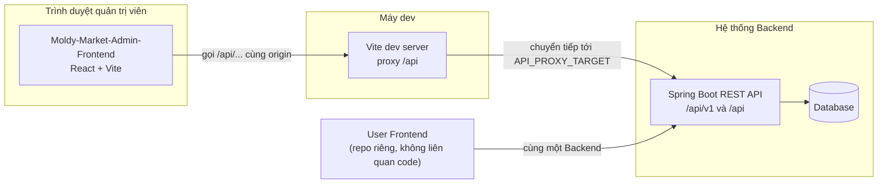

# 01 - Project Overview (Tổng quan dự án)

> **Trạng thái:** BẢN NHÁP v0.1
> **Cập nhật:** 2026-11-08
> **Áp dụng cho:** `Moldy-Market-Admin-Frontend`
> **Mục đích:** Giới thiệu cổng quản trị Moldy Market: ai dùng, quản lý được những gì với Backend hiện tại, những gì chưa làm được vì Backend chưa có, và cách đọc bộ tài liệu.

Quy ước nhãn dùng xuyên suốt bộ tài liệu:

| Nhãn | Ý nghĩa |
|---|---|
| `[ĐÃ XÁC MINH BACKEND]` | Thông tin có trong doc 14, rút từ việc đọc source code Backend. |
| `[ĐÃ CẤU HÌNH]` | Đã thực sự có trong repo Frontend (công cụ, cấu hình, thư mục). |
| `[ĐỀ XUẤT]` | Kiến trúc Frontend dự kiến, **chưa có code**. Có thể thay đổi sau khi team review. |

> Hiện tại repo chỉ có phần nền (công cụ, cấu hình, cấu trúc thư mục, design tokens, i18n). **Chưa có trang, router, service, hook hay store nào.** Mọi thứ thuộc lớp ứng dụng là `[ĐỀ XUẤT]`.

---

## 1. Moldy Market và vai trò của cổng Admin

Moldy Market là sàn **C2C đồ cũ** (đồ án tốt nghiệp): người dùng đăng bán đồ đã qua sử dụng, một số người mở **gian hàng** để bán nhiều sản phẩm và thêm nhân viên. Hệ thống cần một nơi để **vận hành và kiểm soát** nền tảng; đó là Admin Frontend.

Cổng Admin dành cho **quản trị viên (role `ADMIN`)**. Người mua, người bán, chủ gian hàng dùng ứng dụng riêng (`Moldy-Market-User-Frontend`). Hai repo **độc lập, không chia sẻ code**.

Lý do tách `[ĐỀ XUẤT]`: bundle của người dùng cuối không chứa mã quản trị; giao diện quản trị thiên về bảng dữ liệu và thao tác hàng loạt, khác hẳn giao diện mua sắm; hai bên có thể deploy độc lập. Đổi lại, design tokens và quy ước bị lặp ở hai repo, cần đối chiếu định kỳ (doc 13).

---

## 2. Người dùng của cổng Admin

| Người dùng | Điều kiện | Ghi chú |
|---|---|---|
| Quản trị viên | Có role `ADMIN` (xem `roles` từ `GET /api/v1/users/me`) | Tài khoản admin được tạo sẵn lúc Backend khởi động (`RoleInitializer`) `[ĐÃ XÁC MINH BACKEND]`. |

Điều cần biết về phân quyền:

- Backend phân quyền theo **permission code** (`hasAuthority(...)`), không theo tên role. Các permission liên quan đến Admin đã thấy trong code: `ADMIN_PORTAL_ACCESS`, `USER_STORE_MANAGE`, `PRODUCT_MODERATE`, `CATEGORY_MANAGE`.
- Frontend **chưa đọc được permission code** của user hiện tại: JWT không chứa, `/users/me` chỉ trả tên role (Q1). Cho đến khi giải quyết, Admin Frontend chỉ có thể dựa vào tên role `ADMIN` để cho vào giao diện, và coi `403` là quyết định cuối.
- Frontend không phải ranh giới bảo mật. Một dev có thể bỏ qua giao diện và gọi API trực tiếp; Backend phải tự chặn.

> **Cảnh báo bảo mật phía Backend (B2):** trên các branch chưa merge, nhiều endpoint admin (reference price, appraiser admin, voucher admin, escrow, withdrawal approve) **chưa có kiểm tra quyền**, bất kỳ user đã đăng nhập nào cũng gọi được. Dù Admin Frontend ẩn chúng sau role `ADMIN`, đó không phải bảo mật. Phải được Backend sửa trước khi phát hành.

---

## 3. Phạm vi của repo này

### 3.1 Quản lý được ngay (Backend `IMPLEMENTED` trên `main`)

| Chức năng | Endpoint chính | Permission Backend | FE |
|---|---|---|---|
| Đăng nhập admin | `POST /api/v1/auth/login`, sau đó `GET /api/v1/users/me` để kiểm tra role | công khai / đã đăng nhập | `NOT_STARTED` |
| Danh sách, chi tiết user | `GET /api/v1/users`, `GET /api/v1/users/{id}` | `USER_STORE_MANAGE` | `NOT_STARTED` |
| Đổi trạng thái user (khóa, kích hoạt) | `PUT /api/v1/users/{id}/status` | `USER_STORE_MANAGE` | `NOT_STARTED` |
| Danh sách gian hàng, đổi trạng thái | `GET /api/v1/stores`, `PUT /api/v1/stores/{id}/status` | `USER_STORE_MANAGE` | `NOT_STARTED` |
| Kiểm duyệt sản phẩm | `PUT /api/v1/products/{id}/remove` (kèm `reason`), `PUT /api/v1/products/{id}/restore` | `PRODUCT_MODERATE` | `NOT_STARTED` |
| Xem danh sách, chi tiết sản phẩm | `GET /api/v1/products`, `GET /api/v1/products/{id}` | công khai | `NOT_STARTED` |
| Quản lý danh mục | `GET /api/v1/categories`, `POST`, `PUT /{id}`, `DELETE /{id}` | `CATEGORY_MANAGE` (ghi) | `NOT_STARTED` |

Trạng thái giá trị đã xác minh: `UserStatus { ACTIVE, LOCKED, PENDING_VERIFICATION }`, `StoreStatus { ACTIVE, BLOCKED }`, `ProductStatus { ACTIVE, HIDDEN, SOLD, DELETED, REMOVED }`.

> **B10 và vai trò kích hoạt tài khoản:** user tự đăng ký có trạng thái `PENDING_VERIFICATION` và **chưa đăng nhập được**; chưa có luồng xác minh email hay OTP (team xác nhận 2026-11-08). Với Backend hiện tại, **admin là người duy nhất kích hoạt** user (chuyển sang `ACTIVE` bằng `PUT /api/v1/users/{id}/status`). Màn hình quản lý user vì vậy phải cho lọc và xử lý nhanh user `PENDING_VERIFICATION`. Luồng kích hoạt chính thức còn mở (Q14); khi team chốt thì vai trò này có thể đổi.

### 3.2 Chưa làm được vì Backend chưa có hoặc chưa merge

| Chức năng | Trạng thái Backend | Vì sao chưa làm | Cách xử lý trong Frontend |
|---|---|---|---|
| Dashboard thống kê | `NOT_FOUND` | Có permission `ANALYTICS_SYSTEM_VIEW` nhưng không có controller | Chỉ skeleton khung thẻ và biểu đồ |
| Giám sát giao dịch | `NOT_FOUND` | Không có controller | Skeleton |
| Escrow | `IN_PROGRESS` | Branch chưa merge, B2 (không kiểm tra quyền), Q4 (ai gọi hold/capture/release) | Skeleton, chờ merge |
| Order | `IN_PROGRESS` | Chỉ có `POST /api/v1/orders/admin/{orderId}/cod-collected`; **không có endpoint liệt kê order cho admin** | Skeleton |
| Voucher, reference price, appraiser admin | `IN_PROGRESS` | Branch chưa merge, B2 | Skeleton |
| Khiếu nại, tranh chấp | `REQUIRES_BUSINESS_CLARIFICATION` | Quy trình dispute chưa định nghĩa (Q10) | Skeleton |
| Báo cáo vi phạm, cấu hình hệ thống | `NOT_FOUND` | Không có controller | Skeleton |

Quy tắc (doc 14 mục 1.2): chỉ dòng `IMPLEMENTED` mới được viết service gọi API thật; `IN_PROGRESS` chờ merge và cập nhật doc 14; `PLANNED` và `NOT_FOUND` chỉ làm skeleton có ghi `TODO`.

Admin không có `features/dashboard`, `escrow`, `vouchers`, `orders`, `appraisers` trong cấu trúc thư mục hiện tại. Các trang này chỉ là skeleton `[ĐỀ XUẤT]` khi vào giai đoạn code; thư mục feature được tạo khi Backend sẵn sàng.

### 3.3 Frontend làm và không làm

| Frontend LÀM | Frontend KHÔNG làm |
|---|---|
| Hiển thị bảng, bộ lọc, trạng thái từ dữ liệu Backend | Quyết định ai được làm gì (`403` là quyết định cuối) |
| Xác nhận trước thao tác nguy hiểm (khóa user, gỡ sản phẩm, xóa danh mục) | Coi hộp thoại xác nhận là bảo mật |
| Bắt buộc nhập `reason` khi gỡ sản phẩm (Backend yêu cầu body `{ reason }`) | Tự đặt lý do thay admin |
| Ánh xạ mã lỗi (`code`) sang thông báo i18n | Hiển thị nguyên văn `message` tiếng Anh của Backend |
| Xử lý xung đột dữ liệu `COMMON_010` (409) bằng cách tải lại | Ghi đè dữ liệu người khác vừa sửa mà không báo |

---

## 4. Công nghệ sử dụng `[ĐÃ CẤU HÌNH]`

Ngôn ngữ: **JavaScript** (không TypeScript), dùng JSDoc khi cần. Cấu hình giống repo User (chưa đối chiếu lại từng dòng `package.json` của Admin; doc 13 có bước đối chiếu hai repo).

| Mảng | Công nghệ | Phiên bản | Vai trò |
|---|---|---|---|
| Runtime | Node.js | `>=22.12.0` (`.nvmrc` = 22) | Chạy công cụ build |
| Build | Vite, `@vitejs/plugin-react` | ^8.3.5, ^6.1.2 | Dev server, build, proxy `/api` |
| UI | React, react-dom | ^19.3.1 | Giao diện |
| Style | Tailwind CSS (qua `@tailwindcss/vite`) | ^4.3.4 | Utility CSS, cấu hình trong CSS |
| Component | shadcn/ui (`radix-nova`), radix-ui, lucide-react | shadcn ^4.23.0 | Component nền, icon |
| Routing | react-router | ^7.18.5 | Điều hướng |
| HTTP | axios | ^1.21.0 | Gọi REST |
| Server state | @tanstack/react-query | ^5.105.3 | Cache dữ liệu API |
| Client state | zustand | ^5.0.16 | Trạng thái giao diện (sidebar...) |
| Form | react-hook-form, zod, @hookform/resolvers | ^7.91.0, ^4.6.7, ^7.0.1 | Form và validation |
| i18n | i18next, react-i18next | ^26.7.1, ^17.1.11 | `vi`, `en` (tên app: "Moldy Market Admin") |
| Chất lượng | ESLint (flat config), Prettier | ^10.13.0, ^3.9.10 | Lint, format |
| Font | Be Vietnam Pro, Playfair Display Variable (tự host) | | Chữ |

**Chưa cấu hình** (xem doc 13): Vitest + React Testing Library, GitHub Actions CI, mẫu Pull Request, luật bảo vệ nhánh `main`, metadata `index.html`. Playwright E2E chỉ là kế hoạch. Chưa chọn thư viện biểu đồ (sẽ chọn khi làm dashboard; hiện dashboard chỉ là skeleton vì Backend chưa có API thống kê). `npm audit` báo cảnh báo moderate `minimatch` thuộc chuỗi ESLint, chưa có bản vá upstream.

---

## 5. Ranh giới hệ thống

- Khi dev, trình duyệt gọi `/api/...` cùng origin với Vite, Vite chuyển tiếp tới Backend (`API_PROXY_TARGET`, mặc định `http://localhost:8080`). Lý do: Backend **chưa có CORS cho REST** (B1). `[ĐÃ CẤU HÌNH]`
- Production: phục vụ cùng origin với API hoặc Backend thêm CORS (doc 12). Admin và User có thể được phục vụ ở hai origin khác nhau; điều đó càng cần CORS nếu không đứng sau cùng một reverse proxy.
- Admin Frontend không dùng WebSocket và không nhận webhook.

---

## 6. Tình trạng hiện tại của repo

| Hạng mục | Trạng thái |
|---|---|
| Công cụ (Vite, React, Tailwind, shadcn, ESLint, Prettier) | `FOUNDATION_ONLY` `[ĐÃ CẤU HÌNH]` |
| Proxy `/api`, alias `@`, biến môi trường | `[ĐÃ CẤU HÌNH]` |
| Design tokens và font | `[ĐÃ CẤU HÌNH]` (doc 03) |
| i18n (`vi`, `en`, namespace `common`) | `[ĐÃ CẤU HÌNH]` |
| Cấu trúc thư mục | `[ĐÃ CẤU HÌNH]` theo nghĩa thư mục tồn tại (nhiều thư mục chỉ có `.gitkeep`) |
| Component shadcn | Chỉ có `button` |
| Router, providers, layout, Axios, service, hook, store, schema, trang | Chưa có, `[ĐỀ XUẤT]` |
| Test, CI | Chưa cấu hình |

---

## 7. Hướng dẫn đọc bộ tài liệu

| Bạn muốn... | Đọc |
|---|---|
| Hiểu kiến trúc, thư mục, quy tắc phụ thuộc | 02 |
| Xem màu, font, bảng dữ liệu, trạng thái badge | 03 |
| Biết có những route/trang nào | 04, 05 |
| Tổ chức component | 06 |
| Biết Backend có gì để gọi | 14 (và 07 cho cách gọi) |
| Đăng nhập admin, phân quyền | 08 |
| State nằm ở đâu | 09 |
| Luồng nghiệp vụ | 10 |
| Quy tắc code | 11 |
| Cài đặt, build | 12 |
| Thứ tự công việc | 13 |
| Đóng góp, mở PR | 15 |

**Nguyên tắc vàng:** nếu thông tin không có trong doc 14, coi là *chưa biết*; hỏi team Backend và cập nhật doc 14, không tự bịa endpoint, DTO hay quy tắc nghiệp vụ.

---

## 8. Thuật ngữ

| Thuật ngữ | Nghĩa |
|---|---|
| Store (gian hàng) | Cửa hàng của một user. **Không** phải "store" của Zustand (nên thư mục Zustand tên `state/`). |
| Kiểm duyệt (moderation) | Gỡ (`remove`) hoặc khôi phục (`restore`) sản phẩm vi phạm. |
| Envelope | Khung `ApiResponse { success, code, message, data, timestamp }` bọc mọi REST response. |
| Optimistic lock | Cập nhật kèm `version`; lệch version trả `COMMON_010` (409). |

---

## Tài liệu liên quan

- 02 - Frontend Architecture
- 03 - Design System
- 07 - API Integration
- 08 - Authentication and Authorization
- 13 - Development Roadmap
- 14 - Backend Integration Matrix (nguồn sự thật về Backend)
