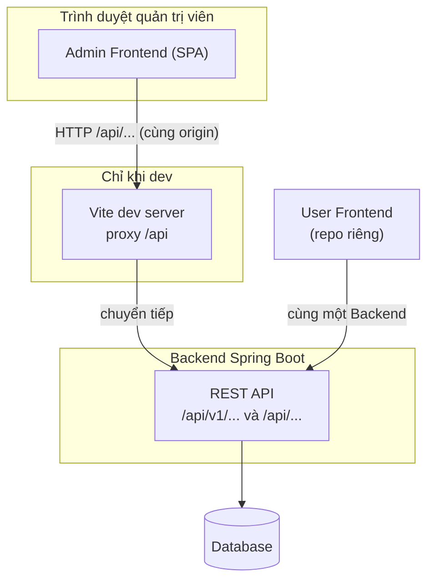
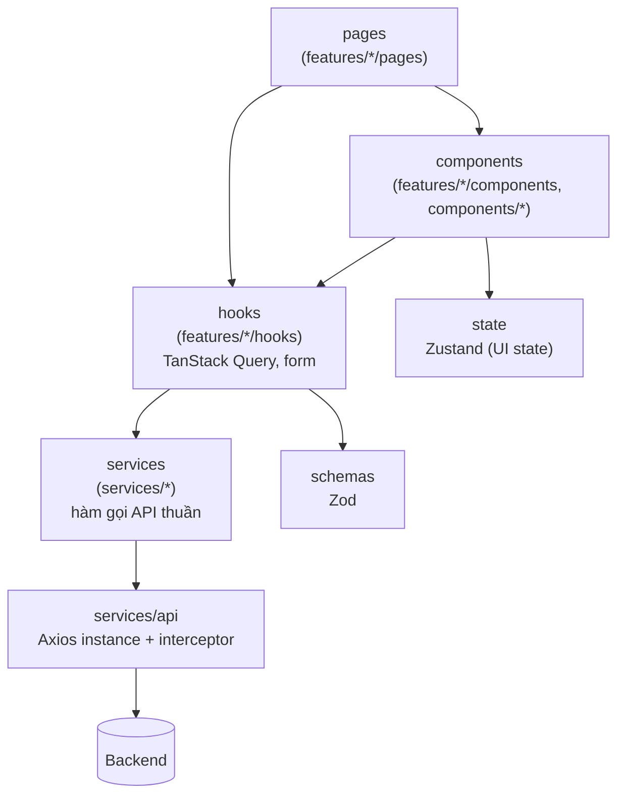
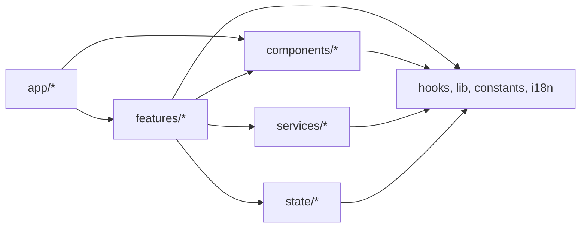
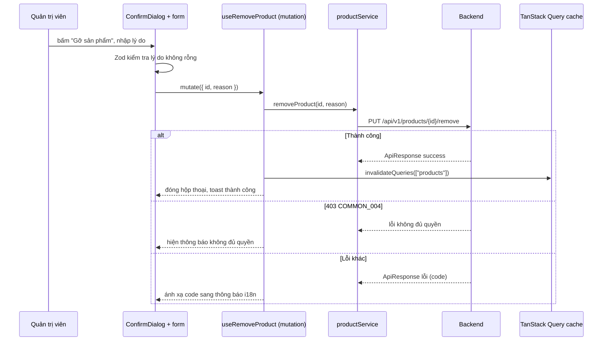

# 02 - Frontend Architecture (Kiến trúc Frontend)

> **Trạng thái:** BẢN NHÁP v0.1
> **Cập nhật:** 2026-11-08
> **Áp dụng cho:** `Moldy-Market-Admin-Frontend`
> **Mục đích:** Mô tả kiến trúc tổng thể của cổng quản trị, cấu trúc thư mục, cách chia lớp, quy tắc phụ thuộc và lý do của từng quyết định lớn.

Nhãn: `[ĐÃ XÁC MINH BACKEND]`, `[ĐÃ CẤU HÌNH]`, `[ĐỀ XUẤT]` (xem doc 01). **Phần lớn tài liệu này là `[ĐỀ XUẤT]`** vì repo chưa có code ứng dụng. Ví dụ code là *ví dụ minh họa, chưa có trong repo*.

---

## 1. Nguyên tắc kiến trúc

1. **Tổ chức theo tính năng (feature-based)**: mọi thứ của "quản lý user" nằm gần nhau.
2. **Tách lớp**: giao diện, logic dữ liệu, gọi API ở ba chỗ khác nhau.
3. **Ba loại state, ba công cụ**: server state (TanStack Query), UI state (Zustand), form state (React Hook Form + Zod).
4. **Backend là nguồn sự thật và là chốt chặn bảo mật.** Admin Frontend ẩn menu và route theo role chỉ để giao diện gọn. Bất kỳ ai cũng có thể gọi API trực tiếp; Backend phải tự kiểm tra quyền (B2 cho thấy chưa phải chỗ nào cũng làm).
5. **Chỉ code những gì Backend đã có** (doc 14 mục 1.2). Trang Dashboard, Escrow, Giao dịch... chỉ là skeleton.
6. **Ưu tiên giao diện dữ liệu**: bảng, bộ lọc, phân trang phía server, hộp thoại xác nhận. Admin ít trang hơn User nhưng mỗi trang dày thao tác hơn.

---

## 2. Kiến trúc hệ thống tổng thể



- Admin Frontend là **SPA** thuần client, không SSR. `[ĐÃ CẤU HÌNH]`
- Chỉ dùng REST. Không WebSocket, không nhận webhook.
- Dùng chung Backend với User Frontend nhưng **không chia sẻ code** với repo kia.

---

## 3. Cấu trúc thư mục

Các thư mục đã được tạo thủ công (nhiều thư mục chỉ có `.gitkeep`) `[ĐÃ CẤU HÌNH]`. **File bên trong là `[ĐỀ XUẤT]`.**

```text
src/
  app/
    providers/        # QueryClientProvider, ...
    router/           # định nghĩa route, route guard (role ADMIN)
    layouts/          # AuthLayout, AdminLayout (sidebar trái, header trên, vùng nội dung)
  components/
    ui/               # shadcn (sinh bởi CLI, KHÔNG sửa tay)
    common/           # DataTable, StatusBadge, ConfirmDialog, PageHeader... (đề xuất)
    feedback/         # loading, lỗi, rỗng, toast
    navigation/       # sidebar, header, breadcrumb
  features/
    auth/{components,hooks,pages,schemas}
    users/{components,hooks,pages}
    stores/{components,hooks,pages}
    products/{components,hooks,pages}      # kiểm duyệt: remove, restore
    categories/{components,hooks,pages,schemas}
  hooks/              # hook dùng chung
  lib/                # utils.js (hàm cn), helper chung
  state/              # Zustand: client state (sidebar thu gọn, ngôn ngữ)
  constants/          # hằng số
  i18n/               # index.js, locales/{vi,en}/common.json
  services/
    api/              # Axios instance, interceptor, chuẩn hóa lỗi/phân trang
    auth/  users/  stores/  categories/  products/
```

Điểm cần nhớ:

- **`state/` thay vì `stores/`**: "store" trong dự án là *gian hàng*; Admin lại có `features/stores/` (quản lý gian hàng) nên nếu thư mục Zustand tên `stores/` sẽ rất dễ nhầm.
- **Không có** `features/dashboard`, `escrow`, `vouchers`, `orders`, `appraisers`: Backend chưa có API ổn định (doc 14 mục 4.2, 4.3). Các trang này chỉ là skeleton `[ĐỀ XUẤT]` ở giai đoạn code; khi Backend sẵn sàng sẽ tạo feature tương ứng.
- Component nặng bảng (`DataTable`, `StatusBadge`, `ConfirmDialog`) nên nằm ở `components/common` để cả bốn feature dùng chung, tránh feature này import feature kia.
- `components/ui` là mã shadcn sinh ra, không sửa tay; Prettier bỏ qua và ESLint có khối nới lỏng riêng. `[ĐÃ CẤU HÌNH]`

---

## 4. Các lớp và trách nhiệm `[ĐỀ XUẤT]`



| Lớp | Thư mục | Làm | Không làm |
|---|---|---|---|
| Page | `features/*/pages` | Ghép component, đọc search params (trang, bộ lọc) | Gọi Axios trực tiếp |
| Component | `features/*/components`, `components/*` | Hiển thị bảng, form, hộp thoại | Gọi API trực tiếp |
| Hook | `features/*/hooks` | Bọc service bằng `useQuery`/`useMutation`, invalidate cache sau thao tác | Biết URL, header |
| Service | `services/*` | Hàm async thuần: gọi Axios, bóc `ApiResponse` | Dùng hook, React, state |
| API client | `services/api` | Axios instance, gắn token, xử lý 401/refresh, chuẩn hóa lỗi | Biết endpoint cụ thể của module |
| State | `state/*` | UI state thuần client | Lưu dữ liệu API |
| Schema | `features/*/schemas` | Zod cho form | Gọi API |

### 4.1 Ví dụ minh họa (chưa có trong repo)

Danh sách user (endpoint đã xác minh `GET /api/v1/users`, phân trang `page` bắt đầu từ 1):

```js
// services/users/userService.js  (ví dụ minh họa)
import { apiClient } from '@/services/api/client'

export async function listUsers({ page = 1, size = 20 } = {}) {
  const res = await apiClient.get('/api/v1/users', { params: { page, size } })
  return res.data.data // PagedResponse { content, page, size, hasNext, totalElements }
}
```

```js
// features/users/hooks/useUsers.js  (ví dụ minh họa)
import { useQuery, keepPreviousData } from '@tanstack/react-query'
import { listUsers } from '@/services/users/userService'

export function useUsers(params) {
  return useQuery({
    queryKey: ['users', 'list', params],
    queryFn: () => listUsers(params),
    placeholderData: keepPreviousData, // giữ dữ liệu cũ khi đổi trang để bảng không nhấp nháy
  })
}
```

Lưu ý: `totalElements` của `PagedResponse` có thể là `null` khi Backend dùng Slice (doc 14 mục 2.2). Component phân trang phải chịu được giá trị này (chỉ có nút "trang trước/sau" dựa vào `hasNext`).

---

## 5. Quy tắc phụ thuộc (import rules) `[ĐỀ XUẤT]`



1. `components/ui` không import gì ngoài `lib/utils` và thư viện.
2. `components/common|feedback|navigation` **không import từ `features/*`**.
3. `services/*` không import React, hook, `features/*`, `state/*`.
4. `features/A` không import trực tiếp từ `features/B`. Phần chung đưa lên `components/common`, `hooks/` hoặc `lib/`.
5. `app/*` là nơi duy nhất ghép feature (router, layout).
6. Import dùng alias `@/...`.

Có thể cưỡng chế sau bằng ESLint `no-restricted-imports`; hiện chưa cấu hình.

---

## 6. Routing và phân quyền giao diện `[ĐỀ XUẤT]`

- **React Router v7** data router: `createBrowserRouter` + `RouterProvider` (import từ `react-router/dom`).
- Hai layout: `AuthLayout` (trang `/login`) và `AdminLayout` (sidebar trái, header trên, vùng nội dung) cho mọi trang quản trị.
- **Route guard**: bao toàn bộ nhánh `AdminLayout`. Quy trình dự kiến: có phiên đăng nhập (token) → gọi `GET /api/v1/users/me` → role có `ADMIN` thì cho vào; ngược lại chuyển về `/login` kèm thông báo "không có quyền". Permission `ADMIN_PORTAL_ACCESS` có tồn tại ở Backend nhưng Frontend chưa đọc được (Q1), nên guard dựa vào tên role.
- Guard **chỉ là tiện ích giao diện.** Mọi lời gọi API vẫn có thể trả `403`; giao diện luôn phải xử lý `403` (hiện thông báo và/hoặc điều hướng), không giả định guard đã đủ.
- Danh sách route và trạng thái từng trang ở doc 04; mô tả trang ở doc 05. Tài liệu này không lặp lại.

---

## 7. Quản lý state `[ĐỀ XUẤT]`

| Loại state | Công cụ | Ví dụ trong Admin | Nơi |
|---|---|---|---|
| Server state | TanStack Query | danh sách user, store, product, cây danh mục | `features/*/hooks` |
| Client state | Zustand | sidebar thu gọn/mở, ngôn ngữ | `state/` |
| Form state | React Hook Form + Zod | form danh mục, lý do gỡ sản phẩm, đăng nhập | `features/*/components`, `schemas` |
| URL state | React Router search params | trang hiện tại, kích thước trang, bộ lọc trạng thái | page |

Quy tắc: không chép dữ liệu API vào Zustand. Trang, bộ lọc và sắp xếp của bảng nằm trên URL để chia sẻ link và dùng nút Back. Sau mỗi thao tác ghi thành công (đổi trạng thái user, gỡ sản phẩm...), `invalidateQueries` danh sách tương ứng để bảng đọc lại. Nơi lưu token **chưa chốt** (Q2, doc 08). Chi tiết ở doc 09.

---

## 8. Luồng dữ liệu tiêu biểu: gỡ một sản phẩm

Ví dụ này dựa trên endpoint đã xác minh `PUT /api/v1/products/{id}/remove` (body `{ reason }`, cần `PRODUCT_MODERATE`).



Ràng buộc độ dài tối đa của `reason` chưa có trong doc 14: Frontend chỉ bắt buộc không rỗng, và chờ Backend xác nhận giới hạn (xem doc 05).

---

## 9. Xử lý lỗi `[ĐỀ XUẤT]`

- Lỗi Backend là `ApiResponse` với `success = false` và `code`. Lớp `services/api` chuẩn hóa thành một đối tượng lỗi thống nhất.
- Ánh xạ `code` sang key i18n, không hiển thị nguyên `message` tiếng Anh.
- Xử lý riêng: `401` (refresh một lần, xếp hàng request chờ, không lặp vô hạn), `403` (không đủ quyền), `COMMON_010` (dữ liệu bị sửa, tải lại), `COMMON_009` (rate limit), `AUTH_003`/`AUTH_004` (tài khoản bị khóa/vô hiệu).
- Với Admin, thao tác ghi quan trọng (khóa user, đổi trạng thái gian hàng, gỡ sản phẩm, xóa danh mục) luôn qua hộp thoại xác nhận và có trạng thái loading để tránh bấm đúp.

---

## 10. Quyết định kiến trúc và lý do

| # | Quyết định | Lý do | Đánh đổi / lưu ý |
|---|---|---|---|
| D1 | **Hai repo tách rời** (User, Admin) | Bundle người dùng không chứa mã admin; giao diện và nhịp phát hành khác nhau | Lặp design tokens và quy ước; cần đối chiếu định kỳ |
| D2 | **JavaScript + JSDoc** | Giảm chi phí cấu hình cho đồ án có thời hạn | Bù bằng Zod, JSDoc, ESLint, doc 14 |
| D3 | **Vite** | Nhanh, proxy sẵn có | Không SSR (không cần) |
| D4 | **Tailwind CSS v4** (cấu hình trong CSS) | Token nằm trong `index.css`, tích hợp shadcn | Khác v3: không có `tailwind.config.js` |
| D5 | **shadcn/ui** | Sở hữu mã component, nền Radix có a11y tốt; có sẵn các khối cho bảng, dialog khi cần | Không sửa tay mã sinh ra |
| D6 | **React Router v7 data router** | Layout lồng nhau, chuẩn hiện tại | Chỉ dùng phần định tuyến; fetch dùng TanStack Query |
| D7 | **TanStack Query** | Cache, `keepPreviousData` cho phân trang bảng, invalidate sau thao tác | Cần kỷ luật query key |
| D8 | **Zustand** | API nhỏ cho UI state | Không thay TanStack Query |
| D9 | **React Hook Form + Zod** | Form hiệu năng tốt, một schema cho validate | Ràng buộc phải khớp Backend nhưng Backend vẫn là chốt chặn |
| D10 | **i18next** (`vi` mặc định, `en`) | Giao diện Việt, sẵn sàng mở rộng | Không dịch enum/mã lỗi Backend |
| D11 | **Feature-based + `services` tách riêng** | Dễ tìm, dễ test lớp gọi API | Cần quy tắc phụ thuộc (mục 5) |
| D12 | **`state/` không `stores/`** | Admin có `features/stores` (gian hàng) | Khác tên thường gặp |
| D13 | **Axios `baseURL` không gắn cứng `/api/v1`** | Backend có hai prefix (doc 14 mục 2.3) | Service viết đường dẫn đầy đủ |
| D14 | **Dev dùng Vite proxy** | Backend chưa có CORS cho REST (B1) | Production cần cùng origin hoặc CORS (doc 12) |
| D15 | **Chỉ service cho endpoint `IMPLEMENTED`** | Tránh code theo contract chưa ổn định | Cập nhật doc 14 khi Backend merge |
| D16 | **Phân trang phía server cho bảng** | Backend phân trang `PagedResponse` (user, store) | `totalElements` có thể `null`; không hứa "tổng số trang" |
| D17 | **Chưa chọn thư viện biểu đồ** | Dashboard chỉ là skeleton vì không có API thống kê | Chọn khi Backend có API |
| D18 | **Dark mode ngoài phạm vi** | Giữ phạm vi nhỏ | Không dùng class `dark` cho đến khi có quyết định |

---

## 11. Điểm mở và rủi ro

| Điểm mở | Tham chiếu | Ảnh hưởng |
|---|---|---|
| Nơi lưu token | Q2, doc 08 | **CHƯA CHỐT.** Ảnh hưởng interceptor và khởi tạo phiên. |
| Không lấy được permission code | Q1 | Guard chỉ dựa tên role; `403` là quyết định thật. |
| Endpoint admin thiếu kiểm tra quyền trên các branch chưa merge | B2 | Giao diện admin không thể bù cho Backend. |
| Danh sách product `GET /api/v1/products` chưa audit tham số | doc 14 mục 2.2 | Bảng kiểm duyệt sản phẩm cần xác nhận tham số lọc và phân trang trước khi code. |
| Không có endpoint liệt kê order cho admin | doc 14 mục 4.2 | Trang quản lý order chỉ là skeleton. |
| Luồng kích hoạt tài khoản | B10, Q14 | Admin hiện là người kích hoạt user. |
| Backend chưa có CORS | B1 | Deploy production. |

---

## Tài liệu liên quan

- 01 - Project Overview
- 03 - Design System
- 04 - Routing and Pages
- 06 - Component Architecture
- 07 - API Integration
- 08 - Authentication and Authorization
- 09 - State Management
- 11 - Coding Conventions
- 14 - Backend Integration Matrix
