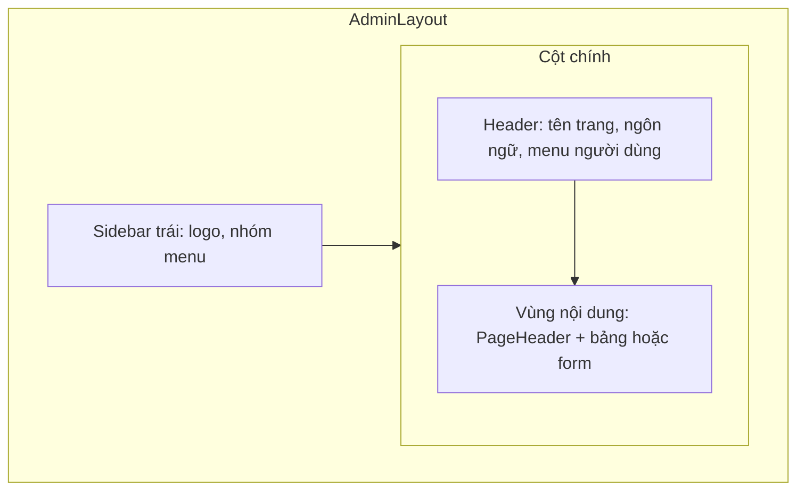

# 03 - Design System (Hệ thống thiết kế, Admin)

> **Trạng thái:** BẢN NHÁP v0.1
> **Cập nhật:** 2026-11-08
> **Áp dụng cho:** `Moldy-Market-Admin-Frontend`
> **Mục đích:** Chốt quy tắc nhìn và cảm cho khu quản trị: màu, chữ, khoảng cách, bảng dữ liệu, form, hộp thoại, sidebar, responsive. Bộ token **dùng chung** với User Frontend, nhưng cách dùng khác vì Admin là công cụ làm việc, không phải gian hàng trưng bày.

Nhãn dùng trong tài liệu:
- `[ĐÃ CẤU HÌNH]`: đã thật sự có trong repo (chủ yếu là `src/index.css` và `components.json`).
- `[ĐỀ XUẤT]`: quy tắc dự kiến, **chưa có code**. Các đoạn code là ví dụ minh họa, chưa có trong repo.
- `[ĐÃ XÁC MINH BACKEND]`: có trong doc 14 (ở đây dùng cho enum cần màu trạng thái và ràng buộc dữ liệu).

Phạm vi hiện tại: **chỉ giao diện sáng (light)**. Khối `.dark` trong `index.css` do shadcn sinh ra, nằm ngoài phạm vi và không được dùng.

---

## 1. Nguyên tắc thiết kế `[ĐỀ XUẤT]`

1. **Công cụ làm việc, ưu tiên rõ ràng và an toàn.** Admin xử lý hành động có hậu quả (khóa tài khoản, gỡ sản phẩm, xóa danh mục). Giao diện phải làm cho hành động nguy hiểm **khó bấm nhầm** và hậu quả **rõ trước khi xác nhận**.
2. **Mật độ cao hơn User.** Người quản trị xem nhiều dòng dữ liệu một lúc. Dùng cỡ chữ `text-sm` cho bảng và khoảng cách chặt hơn User, nhưng vẫn đủ vùng chạm và dòng cao dễ đọc.
3. **Đơn sắc như User.** Nền trắng, thang xám, chữ gần đen. Màu chỉ xuất hiện để biểu thị trạng thái (thành công, cảnh báo, lỗi, thông tin) và các hành động nguy hiểm.
4. **Không dựa vào màu một mình.** Trạng thái luôn có chữ.
5. **Trung thực về những gì chưa có.** Trang chưa có Backend (Dashboard, giao dịch...) hiển thị khung rõ ràng, nhãn "Sắp có", **không số liệu giả** (doc 04 mục 3.2).
6. **Nhất quán qua token.** Không gõ mã màu trong component; thêm token trước rồi mới dùng.

---

## 2. Màu sắc và design token

### 2.1 Cách hoạt động `[ĐÃ CẤU HÌNH]`

Token màu là biến CSS trong `:root` của `src/index.css` theo chuẩn shadcn, được ánh xạ thành màu Tailwind bằng khối `@theme inline`. Viết `bg-background`, `text-foreground`, `text-muted-foreground`..., không viết mã màu. Tailwind 4 không có `tailwind.config.js`; mọi cấu hình nằm trong CSS.

Hai repo (User và Admin) dùng **cùng bộ token gốc**. Khi đổi token dùng chung, sửa cả hai repo (mục 10).

### 2.2 Bảng token `[ĐÃ CẤU HÌNH]`

| Token | Giá trị | Class Tailwind | Dùng cho trong Admin |
|---|---|---|---|
| `--background` | `#ffffff` | `bg-background` | Nền vùng nội dung |
| `--foreground` | `#252525` | `text-foreground` | Chữ chính |
| `--primary` | `#252525` | `bg-primary` | Nút hành động chính (một nút mỗi vùng) |
| `--primary-foreground` | trắng | `text-primary-foreground` | Chữ trên nền primary |
| `--secondary`, `--muted`, `--accent` | `#f3f4f6` | `bg-muted`, `bg-accent` | Nền sidebar nhẹ, dòng bảng hover, vùng nhóm |
| `--muted-foreground` | `#777777` | `text-muted-foreground` | Chữ phụ, tiêu đề cột bảng |
| `--card`, `--popover` | trắng | `bg-card`, `bg-popover` | Thẻ số liệu, menu nổi |
| `--border`, `--input` | `oklch(0.922 0 0)` | `border-border` | Viền thẻ, bảng, ô nhập |
| `--ring` | `oklch(0.708 0 0)` | `ring-ring` | Viền focus |
| `--destructive` | `oklch(0.577 0.245 27.325)` | `bg-destructive`, `text-destructive` | Xóa, gỡ, khóa |
| `--success` | `#15803d` | `text-success` | Trạng thái hoạt động, thành công |
| `--warning` | `#b45309` | `text-warning` | Chờ xử lý, cảnh báo |
| `--info` | `#1d4ed8` | `text-info` | Thông tin |
| `--chart-1` đến `--chart-5` | thang xám | `fill-chart-1`... | Biểu đồ Dashboard (khi có dữ liệu thật) |
| `--sidebar-*` | bộ biến sidebar | `bg-sidebar`, `text-sidebar-foreground`... | `AdminLayout` sidebar |

Ghi chú:
- `success`, `warning`, `info` là **giá trị khởi đầu** của team, cần xem lại khi có thiết kế chính thức. Nếu bảng này khác `index.css` thì `index.css` đúng.
- Bộ biến `sidebar-*` sinh sẵn bởi shadcn và là nơi tự nhiên để tạo diện mạo riêng cho sidebar Admin (ví dụ nền `#f3f4f6`, hoặc tối `#252525` với chữ trắng) mà **không** ảnh hưởng vùng nội dung. Chọn kiểu nào là quyết định giao diện chưa chốt; mặc định đề xuất sidebar nền sáng cho đồng bộ với User.

### 2.3 Độ tương phản `[ĐỀ XUẤT]`

Tiêu chuẩn WCAG AA cho chữ thường: tối thiểu 4,5:1. Số liệu dưới đây là **tính xấp xỉ** từ mã màu, cần đo lại bằng công cụ khi có thiết kế chính thức:

| Chữ | Trên nền trắng | Trên nền `#f3f4f6` | Nhận xét |
|---|---|---|---|
| `#252525` | khoảng 15,3:1 | khoảng 13,9:1 | Rất tốt |
| `#777777` | khoảng 4,48:1 | khoảng 4,07:1 | **Sát ngưỡng, hơi thiếu.** Chỉ dùng cho chữ phụ từ 14px trở lên trên nền trắng |
| `#15803d` | khoảng 5,0:1 | khoảng 4,6:1 | Đạt |
| `#b45309` | khoảng 5,0:1 | khoảng 4,6:1 | Đạt |
| `#1d4ed8` | khoảng 6,7:1 | khoảng 6,1:1 | Tốt |

Lưu ý riêng cho Admin: **tiêu đề cột bảng** thường dùng `text-muted-foreground` cỡ nhỏ và đôi khi nằm trên nền xám nhạt, đúng chỗ dễ thiếu tương phản. Nếu đặt tiêu đề cột trên nền `bg-muted`, dùng `text-foreground` thay vì `text-muted-foreground`, hoặc làm tối token `--muted-foreground` (ví dụ `#5f5f5f`) bằng cách chỉnh token, không chọn màu riêng trong component.

### 2.4 Màu trạng thái nghiệp vụ `[ĐÃ XÁC MINH BACKEND]` + `[ĐỀ XUẤT]`

Component `StatusBadge` (doc 06) ánh xạ giá trị enum sang màu và key dịch. Enum Backend **không** được dịch ở Backend, Frontend tự ánh xạ và có **nhánh mặc định** (xám) cho giá trị lạ để không vỡ giao diện khi Backend thêm giá trị mới.

| Enum (doc 14 mục 5.6) | Giá trị | Màu đề xuất | Ghi chú cho Admin |
|---|---|---|---|
| `UserStatus` | `ACTIVE` | success | |
| | `PENDING_VERIFICATION` | warning | Admin là người duy nhất kích hoạt (B10), nên nổi bật để lọc và xử lý |
| | `LOCKED` | destructive | |
| `StoreStatus` | `ACTIVE` | success | |
| | `BLOCKED` | destructive | |
| `ProductStatus` | `ACTIVE` | success | |
| | `HIDDEN` | muted (xám) | Người bán tự ẩn |
| | `SOLD` | info | |
| | `DELETED` | muted (xám) | Người bán tự xóa |
| | `REMOVED` | destructive | Admin đã gỡ (kiểm duyệt), có thể khôi phục |
| `ProductCondition` | `NEW`, `LIKE_NEW`, `USED`, `DAMAGED` | muted | Nhãn trung tính |

Chưa định nghĩa màu cho `OrderStatus`, `PaymentStatus`, `EscrowStatus`, `WithdrawalStatus` vì các module này `IN_PROGRESS` (doc 14 mục 4.2). Bổ sung khi branch được merge.

---

## 3. Typography `[ĐÃ CẤU HÌNH]` + `[ĐỀ XUẤT]`

### 3.1 Font `[ĐÃ CẤU HÌNH]`

| Vai trò | Font | Cách cài | Biến | Weight nạp |
|---|---|---|---|---|
| Nội dung, UI, bảng | **Be Vietnam Pro** | `@fontsource/be-vietnam-pro`, tự host | `--font-sans` | 400, 500, 600, 700 |
| Tiêu đề `h1`, `h2`, `h3` | **Playfair Display** (variable) | `@fontsource-variable/playfair-display`, tự host | `--font-heading` | variable |

Thẻ `h1`, `h2`, `h3` tự dùng font heading. Font tự host (không gọi Google Fonts) để chạy ổn định và không gửi IP người dùng ra dịch vụ ngoài. Người dùng nhận xét font "tạm được", có thể đổi sau (ứng viên: Fraunces + Inter); vì mọi component dùng `font-sans` và `font-heading` qua biến, đổi font chỉ sửa `index.css` và `package.json`. Nếu đổi, kiểm tra lại dấu tiếng Việt ở mọi weight.

### 3.2 Thang chữ cho khu quản trị `[ĐỀ XUẤT]`

Admin có ít chữ trang trí hơn User, nên giảm cỡ và dùng font heading tiết chế.

| Vai trò | Class gợi ý | Ghi chú |
|---|---|---|
| Tiêu đề trang `h1` | `text-2xl font-semibold` | Font heading. Mỗi trang đúng một `h1`, nằm trong `PageHeader` |
| Tiêu đề khối `h2` | `text-lg font-semibold` | Font heading. Dùng ít |
| Tiêu đề thẻ số liệu | `text-sm font-medium text-muted-foreground` | Font body, **không** dùng thẻ `h3` vì bị ép font serif |
| Số liệu lớn (thẻ Dashboard) | `text-3xl font-semibold tabular-nums` | Số căn đều |
| Nội dung, ô nhập | `text-sm` hoặc `text-base` | Form dùng `text-base` trên mobile (16px) để iOS không tự phóng to |
| Nội dung bảng | `text-sm` | Cỡ chuẩn của bảng |
| Tiêu đề cột bảng | `text-xs font-medium uppercase tracking-wide` hoặc `text-sm font-medium` | Xem lưu ý tương phản ở mục 2.3. Tránh in hoa nếu nhãn dài tiếng Việt |
| Nhãn, badge | `text-xs font-medium` | Chỉ cho nhãn ngắn |

Quy tắc:
- Dòng cao tối thiểu 1,4 cho đoạn văn (dấu tiếng Việt chồng).
- Số tiền, ID, số lượng trong bảng dùng `tabular-nums`, căn phải cho số.
- ID dài (UUID) hiển thị rút gọn ở bảng (ví dụ 8 ký tự đầu, có nút sao chép), đầy đủ ở trang chi tiết, dùng font mono (`font-mono`) để dễ đọc.

---

## 4. Khoảng cách `[ĐỀ XUẤT]`

Thang mặc định Tailwind (`0,25rem` = 4px). Không dùng giá trị tùy ý như `p-[13px]`.

| Mục đích | Giá trị gợi ý |
|---|---|
| Icon và chữ trong nút, menu | `gap-2` |
| Giữa các trường form | `space-y-4` |
| Padding thẻ | `p-4` đến `p-6` |
| Giữa các khối trong trang | `space-y-6` |
| Padding ô bảng | `px-3 py-2` (chặt hơn User, vẫn dễ chạm) |
| Lề ngang vùng nội dung | `px-4` mobile, `px-6` từ `md`, `px-8` từ `lg` |
| Chiều rộng sidebar | khoảng `w-64` (16rem) mở rộng, `w-16` thu gọn (icon) |
| Chiều cao header | khoảng `h-14` (3,5rem) |

Vùng nội dung của Admin **không** giới hạn `max-w-7xl` như User: bảng cần dùng hết chiều ngang còn lại. Trang form (tạo danh mục, đổi trạng thái) dùng `max-w-2xl` để dòng không quá dài.

---

## 5. Bo góc, viền, bóng

### 5.1 Bo góc `[ĐÃ CẤU HÌNH]`

`--radius: 0.625rem` (10px) là gốc; thang `sm` đến `4xl` suy ra từ nó theo mẫu shadcn (công thức chính xác xem `index.css`). Đổi `--radius` là mọi góc đổi theo.

Quy tắc `[ĐỀ XUẤT]`: nút, ô nhập `rounded-md`; thẻ, bảng bọc ngoài, hộp thoại `rounded-lg`; avatar `rounded-full`. Không trộn nhiều mức bo góc trong một màn hình.

### 5.2 Viền và bóng `[ĐỀ XUẤT]`

- Phân tách bằng **viền mảnh 1px** (`border`) thay vì bóng, hợp phong cách đơn sắc và giữ giao diện phẳng, dễ đọc khi nhiều dòng dữ liệu.
- Bóng chỉ cho thứ nổi lên trên nội dung: menu thả xuống và popover `shadow-md`, hộp thoại `shadow-lg`. Thẻ và bảng không có bóng.

---

## 6. Thành phần giao diện

Phần này mô tả quy tắc nhìn và cảm; vai trò, props, thư mục nằm ở doc 06. Chỉ `button` đã có trong repo `[ĐÃ CẤU HÌNH]`; còn lại thêm bằng `npx shadcn@latest add <tên>` khi cần.

### 6.1 Button

- Biến thể shadcn: `default`, `outline`, `secondary`, `ghost`, `destructive`, `link`.
- Mỗi vùng chỉ một nút `default`. Hành động phụ dùng `outline` hoặc `ghost`.
- **Hành động nguy hiểm dùng `destructive`** và luôn đi qua `ConfirmDialog` (mục 6.5): khóa tài khoản, chặn gian hàng, gỡ sản phẩm, xóa danh mục.
- Nút đang gửi: vô hiệu hóa, hiện spinner, không đổi chiều rộng nút. Chống gửi hai lần.
- Nút chỉ có icon có `aria-label` (ví dụ nút sao chép ID, nút hành động ở cuối dòng bảng).

### 6.2 Form

- Có `label` hiển thị, không thay bằng placeholder.
- Lỗi hiện dưới ô, màu `text-destructive`, kèm chữ nói rõ lỗi. Không chỉ đổi màu viền. Thông báo lấy từ key i18n, **không** hiển thị `message` tiếng Anh của Backend (doc 07).
- Ràng buộc hiển thị lấy đúng từ Backend, ví dụ mật khẩu đăng nhập, lý do gỡ sản phẩm `reason` (kiểu và độ dài **chưa audit**, không bịa giới hạn). Frontend chỉ phản hồi nhanh, Backend quyết định.
- Form của Admin: tạo và sửa **danh mục** là form trong hộp thoại (schema Zod ở `features/categories/schemas`, doc 02).
- Cập nhật cần `version` (optimistic lock) áp dụng cho product của người bán, không áp dụng cho các thao tác kiểm duyệt của Admin; không dựng trường `version` cho form Admin nếu không có trong doc 14.

### 6.3 Bảng dữ liệu (thành phần quan trọng nhất của Admin) `[ĐỀ XUẤT]`

Danh sách user, store, product, category đều là bảng. Quy tắc chung:

| Hạng mục | Quy tắc |
|---|---|
| Bố cục | Bảng bọc trong thẻ có viền, tiêu đề cột dính trên cùng (`sticky`) khi cuộn dọc |
| Hàng | Chiều cao vừa phải, hover `bg-muted`, hàng bấm được dẫn tới trang chi tiết |
| Cột số, tiền | Căn phải, `tabular-nums` |
| Cột trạng thái | `StatusBadge` (mục 6.6) |
| Cột hành động | Cuối dòng, menu "..." (`DropdownMenu`) chứa các hành động; hành động nguy hiểm trong menu, mở `ConfirmDialog` |
| Phân trang | `PaginationBar` dưới bảng, dùng dạng đã chuẩn hóa của `PagedResponse` (doc 07 mục 6). `page` bắt đầu từ 1; `totalElements` có thể `null` (khi đó chỉ có "Trước/Sau") |
| Sắp xếp, lọc | Chỉ làm khi Backend được xác nhận hỗ trợ: định dạng `sort` và lọc phía server **chưa audit** (doc 04 mục 6, AQ2). Không làm lọc phía client trên dữ liệu đã phân trang vì cho kết quả sai (chỉ lọc được trang hiện tại) |
| Đang tải | Skeleton giữ đúng số cột và chiều cao dòng |
| Rỗng | `EmptyState` có câu giải thích |
| Lỗi | `ErrorState` có nút "Thử lại" |
| Mobile | Cuộn ngang trong `overflow-x-auto` (Admin ưu tiên desktop, mục 7) |

### 6.4 Thẻ số liệu và biểu đồ (Dashboard) `[ĐỀ XUẤT]`

- Backend **chưa có API thống kê** (`NOT_FOUND`, doc 14 mục 4.3). Dashboard hiện chỉ là **khung**: các thẻ và vùng biểu đồ có tiêu đề, trạng thái "Sắp có", và skeleton, **không điền số liệu giả**.
- Khi có API, thẻ số liệu: tiêu đề nhỏ phía trên, số lớn `tabular-nums`, chú thích kỳ so sánh phía dưới.
- Thư viện biểu đồ **chưa chọn** (chọn khi làm Dashboard, doc 13). Biểu đồ dùng token `--chart-1` đến `--chart-5` (hiện là thang xám). Khi vẽ nhiều chuỗi, thang xám khó phân biệt; lúc đó cân nhắc thêm màu biểu đồ có độ tương phản đủ, và luôn có nhãn trực tiếp hoặc chú thích, không chỉ dựa màu.

### 6.5 Hộp thoại xác nhận (Dialog) `[ĐỀ XUẤT]`

Hành động có hậu quả đều qua `ConfirmDialog`:

| Hành động (doc 14) | Nội dung xác nhận cần có |
|---|---|
| Khóa hoặc mở khóa user `PUT /api/v1/users/{id}/status` | Nêu tên/email user và trạng thái mới |
| Chặn hoặc bỏ chặn gian hàng `PUT /api/v1/stores/{id}/status` | Nêu tên gian hàng và trạng thái mới |
| Gỡ sản phẩm `PUT /api/v1/products/{id}/remove` | Nêu tên sản phẩm, **ô nhập `reason` (bắt buộc theo contract: body `{ reason }`)** |
| Khôi phục sản phẩm `PUT .../restore` | Nêu tên sản phẩm |
| Xóa danh mục `DELETE /api/v1/categories/{id}` | Nêu tên danh mục, cảnh báo hậu quả nếu có danh mục con hoặc sản phẩm (hành vi Backend trong trường hợp này **chưa audit**, không khẳng định) |

Quy tắc chung:
- Tiêu đề nêu **đối tượng** cụ thể ("Gỡ sản phẩm 'Áo khoác da'?"), không chỉ "Bạn chắc chứ?".
- Nút xác nhận có nhãn động từ cụ thể ("Gỡ sản phẩm", "Khóa tài khoản"), kiểu `destructive` cho hành động phá hủy; nút hủy là mặc định được focus.
- Trong lúc gửi: nút xác nhận vô hiệu hóa, hộp thoại chưa đóng; chỉ đóng khi thành công, lỗi hiện trong hộp thoại.
- Focus vào trong hộp thoại và `Esc` để đóng đã do Radix lo, đừng tự viết lại.

### 6.6 Badge trạng thái `[ĐỀ XUẤT]`

`StatusBadge` theo bảng ở mục 2.4: chữ ngắn, `text-xs`, kèm chấm màu nhỏ, đủ nhận ra khi không phân biệt màu.

### 6.7 Thành phần phản hồi `[ĐỀ XUẤT]`

| Tình huống | Thành phần | Quy tắc |
|---|---|---|
| Tải lần đầu | `PageSkeleton`, skeleton bảng | Giữ đúng bố cục |
| Nút đang gửi | `LoadingSpinner` | Dùng ít |
| Danh sách rỗng | `EmptyState` | Có câu giải thích |
| Lỗi tải | `ErrorState` | Nút "Thử lại" |
| Không đủ quyền (403) | `ForbiddenState` | **Không** đăng xuất. Báo "không đủ quyền cho thao tác này" (doc 04 mục 5.2) |
| Trang chưa có Backend | khung kèm nhãn "Sắp có" | Không dữ liệu giả |
| Thao tác xong | Toast (`sonner`) | Ngắn, tự tắt; lỗi cần đọc kỹ thì để trong hộp thoại hoặc `InlineError` |

---

## 7. Layout và responsive

### 7.1 Khung `AdminLayout` `[ĐỀ XUẤT]`

Nhóm menu và trạng thái từng mục nằm ở doc 04 mục 4.3; danh sách đặt trong `src/constants/` để đổi trạng thái một mục là sửa một dòng.

### 7.2 Breakpoint `[ĐỀ XUẤT]`

Dùng breakpoint mặc định của Tailwind 4 (không tùy chỉnh): `sm` 640px, `md` 768px, `lg` 1024px, `xl` 1280px, `2xl` 1536px.

### 7.3 Cách tiếp cận

Admin là công cụ dùng chủ yếu trên **máy tính**. Quyết định:
- **Desktop là mục tiêu chính** (từ `lg` trở lên). Thiết kế đầy đủ cho đây.
- **Tablet (`md`)**: dùng được, sidebar thu gọn thành icon.
- **Mobile (dưới `md`)**: **dùng được ở mức cơ bản** (xem, thực hiện hành động đơn giản), không tối ưu cho thao tác bảng nhiều cột. Sidebar thành ngăn kéo, bảng cuộn ngang. Đây là quyết định phạm vi, có thể nâng cấp sau.

Class Tailwind vẫn viết mobile-first (`md:`, `lg:` thêm khi màn lớn).

### 7.4 Hành vi bố cục

| Thành phần | Desktop (`lg` trở lên) | Tablet (`md`) | Mobile (dưới `md`) |
|---|---|---|---|
| Sidebar | Mở rộng, hiện nhãn | Thu gọn thành icon (rê chuột hiện nhãn) | Ẩn, mở thành ngăn kéo (`Sheet`) bằng nút trên header |
| Header | Tên trang, ngôn ngữ, menu người dùng | Như desktop | Nút mở menu, tên trang rút gọn |
| Bảng | Đủ cột | Ẩn bớt cột phụ | Cuộn ngang trong thẻ |
| Thẻ số liệu | 3 đến 4 cột | 2 cột | 1 cột |
| Hộp thoại | Giữa màn hình, rộng vừa | Như desktop | Gần toàn chiều rộng |
| Form | `max-w-2xl` | Như desktop | Toàn chiều rộng |

Trạng thái đóng/mở hoặc thu gọn sidebar là **client state**, lưu trong Zustand (`src/state/`), không phải dữ liệu từ API (doc 09).

Quy tắc chung: không có thanh cuộn ngang cho cả trang (chỉ cho riêng bảng), kiểm tra ở 360px; vùng chạm khoảng 44px trên mobile.

---

## 8. Thương hiệu `[ĐỀ XUẤT]`

- **Hiện chưa có logo chính thức.** Component `Logo` tạm hiển thị chữ "Moldy Market" bằng font heading; dễ thay bằng SVG khi có logo.
- Tên ứng dụng lấy từ key i18n `app.name` = "Moldy Market Admin" `[ĐÃ CẤU HÌNH]`, không gõ cứng.
- Admin có thể phân biệt với User bằng một **nhãn nhỏ "Admin"** cạnh logo, để người dùng có nhiều tab không nhầm.
- Chưa có hướng logo được chốt; xem các gợi ý ở doc 03 của User Frontend. Logo đơn sắc `#252525` là bản chuẩn.
- Favicon và thẻ `<title>` nằm trong bước cấu hình `index.html` sắp làm (doc 13). Đề xuất title khác User (ví dụ có chữ "Admin") để phân biệt tab.
- Tham chiếu Mercari chỉ cho UX của User Frontend; Admin không cần tham chiếu sàn nào.

---

## 9. Biểu tượng và hình ảnh

- Icon: **lucide-react** `[ĐÃ CẤU HÌNH]`. Cỡ nhất quán: 16px (`size-4`) trong nút, bảng, menu; 20px (`size-5`) cho sidebar.
- Icon đi cùng chữ có `aria-hidden`; icon đứng một mình có `aria-label`.
- Ảnh sản phẩm trong bảng kiểm duyệt là **URL HTTPS bên ngoài** (Q5): dùng ảnh nhỏ (thumbnail) cố định kích thước, có ảnh dự phòng khi lỗi (`ImageWithFallback`), `loading="lazy"`. Với kiểm duyệt, trang chi tiết nên hiện đủ ảnh để admin đánh giá nội dung.

---

## 10. Cách thêm hoặc thay đổi token `[ĐỀ XUẤT]`

1. Thêm biến ở `:root` trong `src/index.css` (và ánh xạ vào `@theme inline` nếu cần class Tailwind).
2. Ghi vào bảng mục 2.2 trong **cùng Pull Request**.
3. Token gốc dùng chung với User Frontend: sửa **cả hai repo** để không lệch, nêu rõ trong mô tả PR (doc 15).
4. Chạy `npm run format:check`, `npm run lint`, `npm run build` trước khi đẩy.

---

## 11. Lỗi thường gặp cần tránh

| Lỗi | Cách đúng |
|---|---|
| Gõ mã màu trong component | Dùng token |
| Hành động nguy hiểm bấm một lần là chạy | Luôn qua `ConfirmDialog` nêu đối tượng cụ thể |
| Điền số liệu mẫu vào Dashboard cho "đẹp" | Khung kèm nhãn "Sắp có", không dữ liệu giả |
| Lọc phía client trên dữ liệu đã phân trang | Chỉ lọc khi Backend hỗ trợ lọc phía server (AQ2) |
| Tiêu đề cột `#777777` cỡ nhỏ trên nền xám | Dùng chữ chính hoặc làm đậm token (mục 2.3) |
| Dùng thẻ `h3` cho tiêu đề thẻ số liệu | Dùng thẻ `p` hoặc `span` (vì `h3` bị ép font serif) |
| Hiển thị UUID đầy đủ trong bảng | Rút gọn, có nút sao chép, đầy đủ ở trang chi tiết |
| Làm dark mode theo khối `.dark` sinh sẵn | Ngoài phạm vi hiện tại |
| Chỉ dùng màu để phân biệt trạng thái | Thêm chữ |

---

## Tài liệu liên quan

- 02 - Frontend Architecture: vị trí `index.css`, `components/ui`.
- 04 - Routing and Pages: layout, nhóm menu sidebar, guard.
- 05 - Page by Page Guide: bố cục từng trang.
- 06 - Component Architecture: vai trò, props của từng component.
- 07 - API Integration: phân trang, ánh xạ lỗi sang giao diện.
- 09 - State Management: trạng thái sidebar trong Zustand.
- 13 - Development Roadmap: cấu hình `index.html`, chọn thư viện biểu đồ.
- 14 - Backend Integration Matrix: enum trạng thái, ràng buộc dữ liệu.
