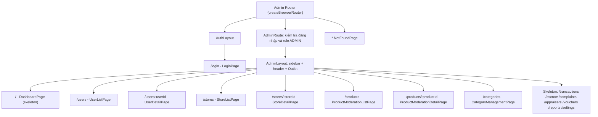
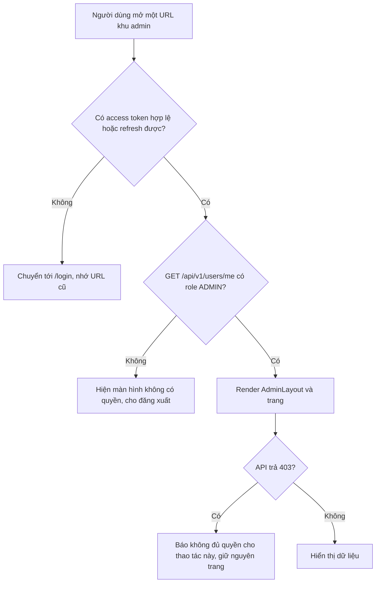

# 04 - Routing và danh sách trang (Admin Frontend)

> **Trạng thái:** BẢN NHÁP v0.1
> **Cập nhật:** 2026-11-08
> **Áp dụng cho:** `Moldy-Market-Admin-Frontend`
> **Mục đích:** Là nguồn duy nhất (single source of truth) về mọi route của Admin Frontend: đường dẫn, trang, layout, quyền truy cập, phụ thuộc Backend và trạng thái triển khai. Các tài liệu khác chỉ trỏ về đây, không lặp lại bảng route.

## 0. Cách đọc tài liệu này

Mọi nội dung được gắn một trong ba nhãn:

| Nhãn | Ý nghĩa |
|---|---|
| `[ĐÃ XÁC MINH BACKEND]` | Có trong doc 14 (đã đọc từ source Backend). |
| `[ĐÃ CẤU HÌNH]` | Đã thực sự có trong repo Frontend. |
| `[ĐỀ XUẤT]` | Kiến trúc dự kiến, **chưa có code**. |

Trạng thái hiện tại của repo: `[ĐÃ CẤU HÌNH]` chỉ có công cụ (Vite, Tailwind, shadcn/ui, `react-router` đã cài, alias `@`, Vite proxy, i18n) và các thư mục rỗng (`.gitkeep`). **Chưa có router, layout, trang nào.** `src/main.jsx` chỉ render `App` thử nghiệm. Vì vậy mọi route trong tài liệu này đều có trạng thái Frontend là `NOT_STARTED`.

---

## 1. Công nghệ routing `[ĐỀ XUẤT]`

| Hạng mục | Quyết định | Lý do |
|---|---|---|
| Thư viện | React Router v7 (`react-router ^7.18.5`, đã cài `[ĐÃ CẤU HÌNH]`) | Là thư viện routing chuẩn của hệ React, có nested routes và `Outlet` rất hợp với bố cục "sidebar cố định, nội dung thay đổi". |
| Kiểu router | `createBrowserRouter` (data router) + `RouterProvider` import từ `react-router/dom` | Cho phép khai báo cây route một chỗ, dùng `lazy` để tách bundle, dùng `errorElement` bắt lỗi theo nhánh. |
| Vị trí code | `src/app/router/` (file cây route), `src/app/layouts/` (layout), `src/features/<module>/pages/` (trang) | Khớp cấu trúc thư mục đã chốt (doc 02). |
| Trang | Mỗi trang là một component `*Page` nằm trong `features/<module>/pages/`. Trang **mỏng**: ghép component và hook, không chứa logic gọi API trực tiếp. | Dễ test, dễ thay đổi giao diện mà không đụng logic. |
| Tải lười (lazy) | Mỗi trang tải bằng `lazy` của route | Admin có nhiều trang bảng dữ liệu; tách bundle để trang đăng nhập nhẹ. |

Lưu ý quan trọng: Backend dùng hai prefix (`/api/v1/...` và `/api/...`) nhưng đó là chuyện của lớp API (doc 07). Route của Frontend (URL trên thanh địa chỉ trình duyệt) **không liên quan** tới prefix của Backend. Ví dụ route `/users` của Frontend gọi `GET /api/v1/users` của Backend, nhưng hai thứ này hoàn toàn độc lập.

---

## 2. Sơ đồ cây route `[ĐỀ XUẤT]`



---

## 3. Bảng route

Quy ước cột:
- **Layout**: `AuthLayout` (trang đăng nhập, bố cục giữa màn hình) hoặc `AdminLayout` (sidebar trái, header trên, vùng nội dung).
- **Quyền**: ở Frontend, "ADMIN" nghĩa là `GET /api/v1/users/me` trả `roles` có `ADMIN`. Đây **chỉ là cổng giao diện**; Backend mới là chốt chặn thật (phần 5).
- **Permission Backend**: permission mà Backend yêu cầu cho endpoint (từ doc 14). Frontend **chưa đọc được** permission code của user (Q1), nên cột này để đối chiếu, không dùng để ẩn/hiện.
- **BE** = trạng thái Backend (doc 14). **FE** = trạng thái Frontend.

### 3.1 Route đã có Backend dùng được (`IMPLEMENTED`)

| Path | Page component | Layout | Quyền truy cập | Permission Backend | Phụ thuộc Backend (doc 14) | BE | FE |
|---|---|---|---|---|---|---|---|
| `/login` | `LoginPage` | `AuthLayout` | Công khai. Nếu đã đăng nhập đúng role ADMIN thì chuyển về `/`. | không áp dụng | `POST /api/v1/auth/login`, `GET /api/v1/users/me`, `POST /api/v1/auth/logout` (khi tài khoản không phải admin). Xem 3.1 và 3.5 doc 14, B10. | `IMPLEMENTED` | `NOT_STARTED` |
| `/users` | `UserListPage` | `AdminLayout` | ADMIN | `USER_STORE_MANAGE` | `GET /api/v1/users` (`PagedResponse`, `page` bắt đầu từ 1) | `IMPLEMENTED` | `NOT_STARTED` |
| `/users/:userId` | `UserDetailPage` | `AdminLayout` | ADMIN | `USER_STORE_MANAGE` | `GET /api/v1/users/{id}`, `PUT /api/v1/users/{id}/status`. `UserStatus`: `ACTIVE`, `LOCKED`, `PENDING_VERIFICATION`. B10: admin là người duy nhất kích hoạt `PENDING_VERIFICATION` sang `ACTIVE` ở trạng thái hiện tại. | `IMPLEMENTED` | `NOT_STARTED` |
| `/stores` | `StoreListPage` | `AdminLayout` | ADMIN | `USER_STORE_MANAGE` | `GET /api/v1/stores` (`PagedResponse`) | `IMPLEMENTED` | `NOT_STARTED` |
| `/stores/:storeId` | `StoreDetailPage` | `AdminLayout` | ADMIN | `USER_STORE_MANAGE` (đổi status) | `PUT /api/v1/stores/{id}/status` (`StoreStatus`: `ACTIVE`, `BLOCKED`). Dữ liệu chi tiết lấy từ `GET /api/v1/stores/{id}` (endpoint công khai). Chưa audit xem endpoint này có trả đủ trường cho nhu cầu admin hay không. | `IMPLEMENTED` | `NOT_STARTED` |
| `/products` | `ProductModerationListPage` | `AdminLayout` | ADMIN | không yêu cầu cho phần đọc (công khai) | `GET /api/v1/products/search` hoặc `GET /api/v1/products` (tham số của `GET /products` chưa audit). Xem câu hỏi mở AQ1 ở mục 8. | `IMPLEMENTED` | `NOT_STARTED` |
| `/products/:productId` | `ProductModerationDetailPage` | `AdminLayout` | ADMIN | `PRODUCT_MODERATE` (gỡ, khôi phục) | `GET /api/v1/products/{id}`, `PUT /api/v1/products/{id}/remove` (body `{ reason }`), `PUT /api/v1/products/{id}/restore`. `ProductStatus`: `ACTIVE`, `HIDDEN`, `SOLD`, `DELETED`, `REMOVED`. | `IMPLEMENTED` | `NOT_STARTED` |
| `/categories` | `CategoryManagementPage` | `AdminLayout` | ADMIN | `CATEGORY_MANAGE` (thêm, sửa, xóa) | `GET /api/v1/categories` (cây, công khai), `GET /api/v1/categories/{id}`, `POST /api/v1/categories`, `PUT /api/v1/categories/{id}`, `DELETE /api/v1/categories/{id}` (không có body trả về). Thêm, sửa dùng dialog trong cùng trang, **không** có route riêng. | `IMPLEMENTED` | `NOT_STARTED` |

### 3.2 Route chỉ là skeleton (Backend chưa có hoặc chưa merge)

Theo quy tắc 1.2 của doc 14: dòng `IN_PROGRESS`, `PLANNED`, `NOT_FOUND`, `REQUIRES_BUSINESS_CLARIFICATION` **chỉ làm khung trang, đánh dấu `TODO`, không viết code gọi API**.

| Path | Page component | Layout | Quyền truy cập | Backend hiện có | BE | FE |
|---|---|---|---|---|---|---|
| `/` | `DashboardPage` | `AdminLayout` | ADMIN | Chưa có API thống kê. Permission `ANALYTICS_SYSTEM_VIEW` tồn tại nhưng không có controller (mục 4.3). Chỉ dựng khung thẻ số liệu và khung biểu đồ, **không có số liệu giả**. | `NOT_FOUND` | `NOT_STARTED` |
| `/transactions` | `TransactionListPage` | `AdminLayout` | ADMIN | Không có controller quản lý giao dịch cho admin. | `NOT_FOUND` | `NOT_STARTED` |
| `/escrow` | `EscrowPage` | `AdminLayout` | ADMIN | Có endpoint escrow trên branch chưa merge (`POST /api/v1/escrows/hold`, `/orders/{orderId}/capture`, `/orders/{orderId}/release`) nhưng chỉ cần đăng nhập (B2), trông như thao tác nội bộ của service (Q4), `orderId` không nhất quán (B7), chưa nối với order thật (Q18). Chưa nên viết service. | `IN_PROGRESS` | `NOT_STARTED` |
| `/complaints` | `ComplaintListPage` | `AdminLayout` | ADMIN | Quy trình dispute và return chưa định nghĩa (Q10); chỉ có entity, chưa có controller. | `REQUIRES_BUSINESS_CLARIFICATION` | `NOT_STARTED` |
| `/appraisers` | `AppraiserManagementPage` | `AdminLayout` | ADMIN | Có `GET /api/admin/appraisers`, `PUT /api/admin/appraisers/{id}/approve`, `PUT .../suspend` trên branch `feature/cart`; DTO chưa audit; không có kiểm tra quyền (B2). | `IN_PROGRESS` | `NOT_STARTED` |
| `/vouchers` | `VoucherManagementPage` | `AdminLayout` | ADMIN | Có `POST/GET /api/admin/vouchers`, `GET /api/admin/vouchers/{code}` trên branch chưa merge; chỉ cần đăng nhập (B2). Chỉ có API voucher cho hệ thống/admin, chưa có cho người bán. | `IN_PROGRESS` | `NOT_STARTED` |
| `/reports` | `ReportPage` | `AdminLayout` | ADMIN | Báo cáo, vi phạm: không có controller. | `NOT_FOUND` | `NOT_STARTED` |
| `/settings` | `SettingsPage` | `AdminLayout` | ADMIN | Cấu hình hệ thống: không có controller. Phần cài đặt giao diện cục bộ (ví dụ ngôn ngữ) không cần Backend. | `NOT_FOUND` | `NOT_STARTED` |

### 3.3 Route bắt lỗi

| Path | Page component | Layout | Ghi chú | FE |
|---|---|---|---|---|
| `*` | `NotFoundPage` | `AuthLayout` (không cần đăng nhập để xem) | Hiện khi URL không khớp route nào. Có nút quay về `/`. Văn bản lấy từ key i18n `notFound.*` (đã có trong `common.json` `[ĐÃ CẤU HÌNH]`). | `NOT_STARTED` |

### 3.4 Những thứ chưa có route (và vì sao)

| Nội dung | Tình trạng | Cách xử lý |
|---|---|---|
| Quản lý order của admin | Backend **không có endpoint liệt kê order** cho admin. Chỉ có `POST /api/v1/orders/admin/{orderId}/cod-collected` (`IN_PROGRESS`, chuyển `DELIVERED` sang `COMPLETED`). Xem Q15, Q18, B11, B12. | Chưa tạo route `/orders`. Khi branch `feature/order` được merge và team chốt luồng, thao tác này dự kiến nằm trong `/transactions` hoặc `/escrow`. **Chưa quyết định**, cần team chốt sau Q18. |
| Reference price (`/api/admin/reference-prices`) | `IN_PROGRESS`, không có kiểm tra quyền (B2), DTO chưa audit. | Chưa có route trong danh sách chuẩn. Khi cần, thêm vào doc 04 trước, rồi mới code. |
| Rút tiền (`/api/v1/withdrawals/*`) | `IN_PROGRESS`, B2. | Chưa có route. Cùng cách xử lý với reference price. |
| Trang chi tiết giao dịch, hồ sơ cá nhân admin, đổi mật khẩu admin | Không nằm trong danh sách chuẩn. | Không tạo. Nếu cần, cập nhật bảng này trước. (`PUT /api/v1/users/me/password` có tồn tại nhưng chưa được đưa vào phạm vi Admin.) |

---

## 4. Layout `[ĐỀ XUẤT]`

### 4.1 `AuthLayout`

- Chỉ chứa vùng nội dung ở giữa màn hình, logo placeholder và `Outlet`. Không có sidebar.
- Dùng cho `/login` và `*` (NotFound).
- Không kiểm tra đăng nhập, nhưng `LoginPage` tự chuyển hướng nếu phiên hiện tại đã là admin hợp lệ.

### 4.2 `AdminLayout`

- Sidebar trái (menu điều hướng), header trên (tên trang, nút đổi ngôn ngữ, menu người dùng và nút đăng xuất), vùng nội dung bên dưới chứa `Outlet`.
- Là con của `AdminRoute` (mục 5), nên mọi trang bên trong đã được bảo đảm là phiên admin.
- Responsive: desktop-first. Dưới breakpoint `lg` của Tailwind, sidebar thu thành ngăn kéo (drawer) mở bằng nút trên header. Chi tiết ở doc 03.
- Trạng thái đóng/mở sidebar là **client state**, đặt trong Zustand (`src/state/`), vì không phải dữ liệu từ API (doc 09).

### 4.3 Nhóm menu sidebar `[ĐỀ XUẤT]`

| Nhóm | Mục menu | Trạng thái Backend |
|---|---|---|
| Tổng quan | Dashboard (`/`) | `NOT_FOUND` |
| Quản lý | Người dùng (`/users`), Gian hàng (`/stores`), Sản phẩm (`/products`), Danh mục (`/categories`) | `IMPLEMENTED` |
| Giao dịch | Giao dịch (`/transactions`), Escrow (`/escrow`), Khiếu nại (`/complaints`) | `NOT_FOUND`, `IN_PROGRESS`, `REQUIRES_BUSINESS_CLARIFICATION` |
| Hệ thống | Thẩm định viên (`/appraisers`), Voucher (`/vouchers`), Báo cáo (`/reports`), Cài đặt (`/settings`) | `IN_PROGRESS`, `IN_PROGRESS`, `NOT_FOUND`, `NOT_FOUND` |

Quy ước hiển thị: mục có Backend chưa sẵn sàng vẫn hiện trong menu (để thấy được phạm vi dự án) nhưng gắn nhãn nhỏ "Sắp có" và trang bên trong chỉ là khung `TODO`. Danh sách mục menu và trạng thái của nó nên đặt ở `src/constants/` (một mảng cấu hình), để đổi trạng thái một mục là sửa một dòng.

---

## 5. Bảo vệ route (guard) `[ĐỀ XUẤT]`

### 5.1 Vì sao cần, và giới hạn của nó

Guard ở Frontend chỉ để **trải nghiệm tốt hơn** (không cho người không có quyền nhìn thấy khung giao diện admin, chuyển họ về trang đăng nhập). Nó **không phải ranh giới bảo mật**: mã JavaScript chạy trên máy người dùng, ai cũng có thể sửa. Backend phải tự kiểm tra từng request. Tình hình thực tế còn đáng lo hơn: trên các branch chưa merge, nhiều endpoint admin chưa có `@PreAuthorize` (B2), tức là ẩn giao diện không đủ. Doc này không giải quyết B2 (việc của Backend), chỉ nhắc để team không nhầm hai thứ.

### 5.2 Quy tắc

1. Chưa đăng nhập (không có token hợp lệ và không refresh được): chuyển tới `/login`, ghi nhớ URL đang truy cập để quay lại sau khi đăng nhập.
2. Đã đăng nhập nhưng `GET /api/v1/users/me` không có `ADMIN` trong `roles`: hiện màn hình "Không có quyền truy cập khu quản trị" kèm nút đăng xuất. Không hiện bất kỳ dữ liệu admin nào.
3. Đã đăng nhập đúng role ADMIN: render `AdminLayout` và trang.
4. Khi một request trả `403` (`COMMON_004`): giữ nguyên trang, báo "không đủ quyền cho thao tác này". **403 luôn là quyết định cuối**, kể cả khi guard đã cho qua. Lý do: Frontend chưa đọc được permission code (Q1), nên không thể biết trước một admin cụ thể thiếu `PRODUCT_MODERATE` hay `CATEGORY_MANAGE`.
5. Khi request trả `401` (`COMMON_003`): lớp Axios thử refresh token một lần (doc 08); nếu thất bại thì quay về `/login`.

Vì Frontend chưa có permission code (Q1), **cách phân biệt các loại admin theo permission chưa làm được**. Chỉ phân biệt theo tên role. Đây là giới hạn đã biết, không phải thiếu sót của tài liệu.

### 5.3 Sơ đồ guard



Nơi lưu token và thời điểm đọc `users/me` (mỗi lần tải lại trang hay cache) phụ thuộc Q2 và doc 08; doc này không quyết định.

---

## 6. Quy ước URL và query string `[ĐỀ XUẤT]`

| Quy ước | Nội dung |
|---|---|
| Tham số động | Dùng tên rõ nghĩa theo bảng: `:userId`, `:storeId`, `:productId`. Giá trị lấy từ `useParams`. |
| Trạng thái danh sách nằm trên URL | Trang danh sách (`/users`, `/stores`, `/products`) lưu `page`, `size`, `sort` trên query string, ví dụ `/users?page=2&size=20`. Lý do: bấm F5 hay gửi link cho đồng nghiệp vẫn đúng trang, nút Back của trình duyệt hoạt động đúng. |
| Chỉ số trang | `page` trên URL **giữ cùng quy ước với `PagedResponse`: bắt đầu từ 1** (doc 14, mục 2.2). Không đổi qua lại 0/1 giữa URL và API để tránh lệch trang. |
| `size` | Mặc định 20, tối đa 100 theo `PaginationConfig`. Frontend chặn giá trị ngoài khoảng này trước khi gọi. |
| `sort` | Backend nhận tham số `sort` nhưng **định dạng chính xác và các trường được phép sắp xếp chưa audit**. Không tự bịa; xác nhận bằng response thật trước khi làm giao diện sắp xếp. |
| Bộ lọc theo từ khóa/trạng thái ở phía server | Doc 14 chỉ xác nhận `page`, `size`, `sort` cho danh sách user và store. Ô tìm kiếm hoặc lọc trạng thái phía server **chưa có cơ sở**. Xem AQ2 ở mục 8. |
| Trang không tồn tại | `*` hiện `NotFoundPage`. Tham số hợp lệ về cú pháp nhưng không có dữ liệu (ví dụ id không tồn tại) hiện trạng thái "không tìm thấy" bên trong trang, theo mã lỗi Backend (`USER_*`, `STORE_*`, `PROD_*`). |
| Redirect sau đăng nhập | Quay lại URL đã nhớ; nếu không có thì về `/`. |

---

## 7. Ví dụ minh họa (chưa có trong repo)

Ví dụ dưới chỉ để hình dung cấu trúc khai báo. **Chưa có file nào như vậy trong repo.** Tên file, tên component là đề xuất.

```jsx
// Ví dụ minh họa, chưa có trong repo: src/app/router/index.jsx
import { createBrowserRouter } from 'react-router'

export const router = createBrowserRouter([
  {
    element: <AuthLayout />,
    children: [{ path: '/login', lazy: () => import('@/features/auth/pages/LoginPage') }],
  },
  {
    element: <AdminRoute />, // kiểm tra phiên và role ADMIN, rồi render <Outlet />
    children: [
      {
        element: <AdminLayout />,
        children: [
          { index: true, lazy: () => import('@/features/dashboard/pages/DashboardPage') },
          { path: 'users', lazy: () => import('@/features/users/pages/UserListPage') },
          // ...các route còn lại theo bảng ở mục 3
        ],
      },
    ],
  },
  { path: '*', element: <NotFoundPage /> },
])
```

Lưu ý khi áp dụng: với `lazy` của React Router, module được import phải export đúng tên mà router yêu cầu (ví dụ `Component`). Cần đọc tài liệu phiên bản đã cài khi viết thật; ví dụ trên chỉ minh họa ý tưởng, không phải mẫu chép nguyên. Ngoài ra thư mục `features/dashboard` **không có trong cấu trúc thư mục đã chốt** (doc 02, mục cấu trúc Admin): trang Dashboard chỉ là skeleton, nơi đặt file sẽ được chốt khi bắt đầu code (đề xuất: tạo `features/dashboard/pages/` lúc đó, hoặc đặt tạm trong `app/`).

---

## 8. Câu hỏi mở riêng của tài liệu này

Các câu hỏi dưới đây **chưa có trong doc 14**; cần đưa vào doc 14 ở lần cập nhật tới. Chúng không làm thay đổi trạng thái Backend ở doc 14, chỉ là những điều chưa được audit.

| ID | Câu hỏi | Chặn việc gì |
|---|---|---|
| AQ1 | `GET /api/v1/products/search` và `GET /api/v1/products` có trả sản phẩm ở trạng thái `REMOVED` hoặc `HIDDEN` cho admin không? Chưa audit. Nếu không, trang `/products` không có cách nào liệt kê sản phẩm đã gỡ để khôi phục (chỉ khôi phục được khi đã biết id). | Danh sách kiểm duyệt, nút khôi phục. |
| AQ2 | Danh sách user và store có hỗ trợ lọc theo từ khóa, trạng thái ở phía server không? Doc 14 chỉ ghi `page`, `size`, `sort`. | Ô tìm kiếm, bộ lọc trạng thái, và việc lọc nhanh user `PENDING_VERIFICATION`. |

---

## 9. Khác biệt so với User Frontend

- Admin chỉ có hai layout (`AuthLayout`, `AdminLayout`); User có thêm `StoreDashboardLayout`.
- Admin không có trang công khai: mọi route trừ `/login` và `*` đều cần phiên ADMIN.
- Admin chỉ gọi các endpoint quản trị và đọc công khai; không có giỏ hàng, thanh toán, chat, notification.
- Nhiều route Admin chỉ là skeleton vì Backend chưa có API (bảng 3.2). Số trang hoạt động thật ở giai đoạn đầu là 8 route (bảng 3.1).

---

## Tài liệu liên quan

- 02 - Frontend Architecture: cấu trúc thư mục và tổ chức theo feature.
- 03 - Design System: layout, responsive, thành phần giao diện.
- 05 - Page by Page Guide: mô tả chi tiết từng trang trong bảng ở mục 3.
- 07 - API Integration: cách gọi API, phân trang, xử lý lỗi.
- 08 - Authentication and Authorization: đăng nhập, token, refresh, phân quyền.
- 09 - State Management: Zustand cho trạng thái sidebar, TanStack Query cho dữ liệu server.
- 13 - Development Roadmap: thứ tự làm các trang.
- 14 - Backend Integration Matrix: nguồn sự thật về Backend.
