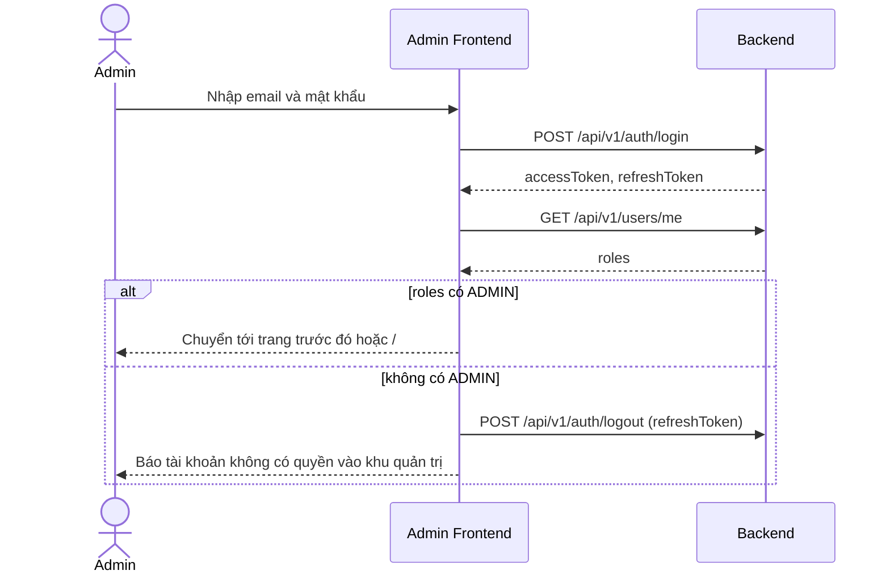
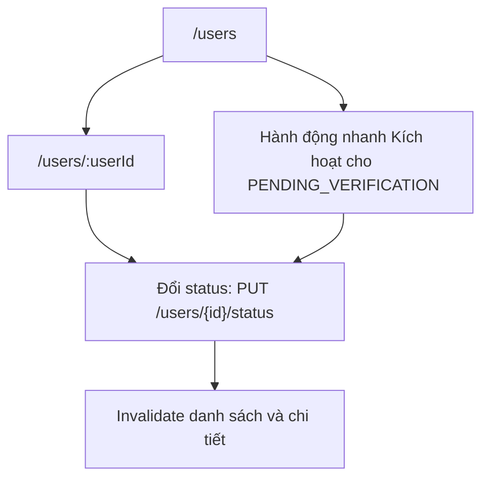

# 05 - Hướng dẫn từng trang (Admin Frontend)

> **Trạng thái:** BẢN NHÁP v0.1
> **Cập nhật:** 2026-11-08
> **Áp dụng cho:** `Moldy-Market-Admin-Frontend`
> **Mục đích:** Mô tả ý định, bố cục, dữ liệu, API, tương tác, validation và các trạng thái giao diện của từng trang Admin, để dev có thể dựng trang mà không phải đoán. Danh sách route, layout và guard nằm ở doc 04; tài liệu này không lặp lại.

## 0. Đọc trước

### 0.1 Nhãn thông tin

| Nhãn | Ý nghĩa |
|---|---|
| `[ĐÃ XÁC MINH BACKEND]` | Có trong doc 14. |
| `[ĐÃ CẤU HÌNH]` | Đã có thật trong repo Frontend. |
| `[ĐỀ XUẤT]` | Thiết kế dự kiến, **chưa có code**. |

Hiện tại repo Frontend **chưa có trang, component, hook, service nào**. Mọi tên component (`UserTable`, `StatusBadge`...), tên hook, tên file trong tài liệu này là `[ĐỀ XUẤT]` hoặc ví dụ minh họa. Mọi trang có trạng thái Frontend `NOT_STARTED`.

### 0.2 Quy tắc chung khi dựng trang `[ĐỀ XUẤT]`

1. **Trang mỏng.** Trang (`features/<module>/pages/`) chỉ ghép component và hook. Gọi API nằm ở `services/<module>/`, bọc bằng hook TanStack Query ở `features/<module>/hooks/` (doc 09).
2. **Mọi trang dữ liệu phải có đủ bốn trạng thái:** đang tải (loading), rỗng (empty), lỗi (error), có dữ liệu. Không để trang trắng.
3. **Không hiển thị `message` tiếng Anh của Backend.** Ánh xạ `code` (ví dụ `COMMON_004`) sang key i18n (doc 14, 2.5). Với `code` chưa biết, hiện thông báo chung "Đã có lỗi xảy ra" kèm mã lỗi để dễ báo cáo.
4. **Hành động hủy hoại hoặc khó đảo ngược** (khóa user, chặn gian hàng, gỡ sản phẩm, xóa danh mục) luôn qua hộp thoại xác nhận, nêu rõ đối tượng bị ảnh hưởng.
5. **Sau mỗi hành động ghi thành công**, làm mới (invalidate) các query liên quan thay vì tự sửa tay dữ liệu cache (doc 09).
6. **Chặn bấm đúp**: nút hành động bị vô hiệu hóa trong lúc request đang chạy.
7. **Nút chỉ là hỗ trợ giao diện.** Một nút hiện ra không có nghĩa là Backend cho phép. Luôn xử lý `403` (`COMMON_004`) và `401` (`COMMON_003`) ở mọi hành động ghi. Frontend chưa đọc được permission code của user (Q1).
8. **Ngày giờ** Backend trả dạng chuỗi ISO (ví dụ `timestamp`). Hiển thị theo múi giờ trình duyệt, định dạng theo ngôn ngữ đang chọn. Định dạng chi tiết từng trường phải kiểm bằng response thật.
9. **Các trường dữ liệu hiển thị:** doc 14 **không liệt kê đầy đủ DTO** của user, store, category và `ProductResponse`. Cột bảng và trường chi tiết dưới đây là **dự kiến**, phải đối chiếu với response thật (hoặc DTO trong Backend) trước khi code. Trường nào đã được doc 14 xác nhận sẽ ghi rõ.

### 0.3 Trạng thái tải dữ liệu dùng chung `[ĐỀ XUẤT]`

| Trạng thái | Hiển thị | Ghi chú |
|---|---|---|
| Đang tải lần đầu | Skeleton có hình dạng giống nội dung (bảng: vài hàng xám) | Tránh spinner toàn trang. |
| Đang tải lại (chuyển trang, refetch) | Giữ dữ liệu cũ, mờ nhẹ, kèm chỉ báo nhỏ | Giữ dữ liệu cũ khi đổi trang (`placeholderData` của TanStack Query v5) để bảng không nhảy. |
| Rỗng | Biểu tượng nhỏ, một câu giải thích, (nếu phù hợp) nút hành động | Phân biệt "chưa có dữ liệu" và "bộ lọc không khớp". |
| Lỗi tải | Khối lỗi trong vùng nội dung, nút "Thử lại" | Không làm mất sidebar và header. |
| Lỗi hành động ghi | Toast lỗi, giữ nguyên trạng thái trang | Lỗi validation (`COMMON_001`) hiện tại ô nhập nếu xác định được trường. |

---

## 1. Khung dùng chung: `AdminLayout`

**Mục đích.** Bộ khung của mọi trang quản trị sau khi đăng nhập. Route, guard xem doc 04.

**Bố cục `[ĐỀ XUẤT]`.**

```text
+-------------+--------------------------------------------------+
| Sidebar     | Header: tên trang | đổi ngôn ngữ | menu tài khoản|
| - Tổng quan |--------------------------------------------------|
| - Quản lý   |                                                  |
| - Giao dịch |   Vùng nội dung (Outlet)                         |
| - Hệ thống  |                                                  |
+-------------+--------------------------------------------------+
```

**Thành phần chính `[ĐỀ XUẤT]`:** `AdminSidebar`, `AdminHeader`, `UserMenu` (hiển thị `fullName` và `email` từ `GET /api/v1/users/me`, nút đăng xuất gọi `POST /api/v1/auth/logout`), `LanguageSwitcher` (vi/en, `[ĐÃ CẤU HÌNH]` i18n đã sẵn sàng), `PageHeader` (tiêu đề trang + khu vực nút hành động), `Breadcrumb` (tùy chọn).

**Hành vi.**
- Mục menu đang mở được tô sáng theo route hiện tại.
- Mục menu có Backend chưa sẵn sàng hiển thị nhãn "Sắp có" (doc 04, 4.3).
- Dưới breakpoint `lg`: sidebar thành ngăn kéo; đóng sau khi chọn mục.
- Đăng xuất: gọi logout (Backend chỉ thu hồi phiên của refresh token được gửi lên, doc 14 3.2), xóa dữ liệu phiên ở Frontend, chuyển `/login`. Nếu gọi logout lỗi mạng, vẫn xóa phiên ở Frontend rồi chuyển hướng (doc 08 sẽ chốt chi tiết).

**Trạng thái.** `NOT_STARTED`.

---

## 2. `/login` - `LoginPage`

**Mục đích nghiệp vụ.** Cho quản trị viên đăng nhập vào khu quản trị. Backend không có endpoint đăng nhập riêng cho admin, nên trang dùng chung `POST /api/v1/auth/login` rồi **tự kiểm tra role** ở Frontend.

**Người dùng và quyền.** Công khai. Tài khoản dùng được là tài khoản `ACTIVE` có role `ADMIN` (ví dụ tài khoản admin được tạo sẵn lúc khởi động Backend, doc 14 3.5). Trong thực tế hiện nay các user thường **chưa đăng nhập được** nếu chưa được admin chuyển `ACTIVE` (B10), nhưng đó là chuyện của User Frontend; Admin Frontend không có trang đăng ký.

**Bố cục `[ĐỀ XUẤT]`.** `AuthLayout`: thẻ giữa màn hình gồm logo placeholder, tiêu đề (key i18n `app.name`, bản Admin là "Moldy Market Admin" `[ĐÃ CẤU HÌNH]`), form email và mật khẩu, nút "Đăng nhập", khu vực hiển thị lỗi.

**Component chính `[ĐỀ XUẤT]`.** `LoginForm` (React Hook Form + Zod, doc 09), `PasswordInput` (nút hiện/ẩn mật khẩu), `FormError`.

**API `[ĐÃ XÁC MINH BACKEND]`.**

| Bước | Endpoint | Ghi chú |
|---|---|---|
| 1 | `POST /api/v1/auth/login` | Request `{ email (tối đa 254), password }`. Trả `{ userId, email, fullName, accessToken, refreshToken, tokenType }`. |
| 2 | `GET /api/v1/users/me` | Lấy `roles: string[]`. Cần có `ADMIN`. |
| 3 (nếu không phải admin) | `POST /api/v1/auth/logout` | Request `{ refreshToken }`. Thu hồi phiên vừa tạo để không để lại refresh token vô ích. |

**Luồng.**



**Validation `[ĐỀ XUẤT dựa trên ràng buộc đã xác minh]`.**

| Trường | Quy tắc ở Frontend | Căn cứ |
|---|---|---|
| `email` | Bắt buộc, đúng định dạng email, tối đa 254 ký tự | `LoginRequest` (doc 14 3.1) |
| `password` | Bắt buộc (không rỗng). **Không** ép độ dài tối thiểu ở form đăng nhập | Ràng buộc 8 đến 100 ký tự của doc 14 áp dụng cho **đăng ký**, không phải đăng nhập. |

Validation ở Frontend chỉ để phản hồi nhanh. Backend vẫn kiểm tra lại và có thể trả `COMMON_001`.

**Xử lý lỗi `[ĐÃ XÁC MINH BACKEND]` (mã) và `[ĐỀ XUẤT]` (thông điệp).**

| Mã | Hiển thị gợi ý |
|---|---|
| `AUTH_001` (401) | "Email hoặc mật khẩu không đúng." Không tiết lộ email có tồn tại hay không. |
| `AUTH_003` (403) | "Tài khoản đã bị khóa." |
| `AUTH_004` (403) | "Tài khoản đã bị vô hiệu." Cũng là mã người dùng sẽ gặp khi tài khoản còn `PENDING_VERIFICATION` (B10, 3.5): Backend trả `ACCOUNT_DISABLED`. Hiển thị chung "Tài khoản chưa được kích hoạt hoặc đã bị vô hiệu". |
| `COMMON_009` (429) | "Bạn thử quá nhiều lần, hãy đợi một lúc." |
| Lỗi mạng | "Không kết nối được máy chủ." |
| Đăng nhập thành công nhưng thiếu role `ADMIN` | "Tài khoản này không có quyền vào khu quản trị." (lỗi do Frontend tự phát hiện, không có mã Backend) |

> Ghi chú: tên mã chính xác cho trường hợp `DisabledException` là `ACCOUNT_DISABLED` theo doc 14 3.5; số hiệu (`AUTH_004`) lấy từ bảng mã lỗi mục 2.5. Cần xác nhận ánh xạ mã này bằng response thật khi code.

**Trạng thái giao diện.** Đang gửi: nút "Đăng nhập" vô hiệu và có chỉ báo; không có trạng thái rỗng.

**Điều hướng sau hành động.** Thành công và là admin: về URL đã nhớ, mặc định `/`. Nếu truy cập `/login` khi đã có phiên admin hợp lệ: chuyển thẳng `/`.

**Trạng thái triển khai.** Backend `IMPLEMENTED`. Frontend `NOT_STARTED`. Phụ thuộc Q2 (nơi lưu token) trước khi code phần lưu phiên.

---

## 3. `/` - `DashboardPage` (skeleton)

**Mục đích dự kiến.** Tổng quan hoạt động hệ thống: số người dùng, số gian hàng, số sản phẩm, giao dịch, doanh thu.

**Thực tế Backend.** **Không có API thống kê** (`NOT_FOUND`). Permission `ANALYTICS_SYSTEM_VIEW` có tồn tại nhưng không có controller (doc 14 4.3). Do đó:

- Chỉ dựng **khung**: lưới thẻ số liệu (`StatCard`) và khung biểu đồ, mỗi ô có trạng thái "Chưa có dữ liệu".
- **Không** dùng số liệu giả/mẫu hiển thị như thật. Nếu cần minh họa bố cục khi demo, phải gắn nhãn rõ ràng là dữ liệu mẫu.
- **Không** tự suy ra thống kê bằng cách tải toàn bộ user/store/product rồi đếm ở Frontend (vừa chậm, vừa sai khi phân trang, vừa lộ dữ liệu không cần thiết). Ngoại lệ có thể xem xét sau: `totalElements` của `PagedResponse` cho danh sách user và store có thể dùng làm số tổng, **nhưng `totalElements` là `null` khi Backend dùng Slice** (doc 14 2.2), nên không được coi là ổn định. Quyết định này để sau, ghi lại ở roadmap.

**Người dùng và quyền.** ADMIN.

**Component `[ĐỀ XUẤT]`.** `StatCard`, `EmptyChartPlaceholder`. Thư viện biểu đồ **chưa chọn** (chọn khi làm dashboard thật, theo kế hoạch).

**Trạng thái giao diện.** Cố định ở "Chưa có dữ liệu" kèm ghi chú "Chờ API thống kê từ Backend". Không có loading hay error vì không có request.

**Trạng thái triển khai.** Backend `NOT_FOUND`, Frontend `NOT_STARTED` (skeleton `TODO`).

---

## 4. `/users` - `UserListPage`

**Mục đích nghiệp vụ.** Xem danh sách người dùng của hệ thống, tìm người cần xử lý (khóa, kích hoạt) và vào trang chi tiết.

**Người dùng và quyền.** ADMIN. Backend yêu cầu permission `USER_STORE_MANAGE` `[ĐÃ XÁC MINH BACKEND]`.

**Bố cục `[ĐỀ XUẤT]`.** `PageHeader` ("Người dùng") > thanh công cụ (chọn kích thước trang; các bộ lọc **chỉ khi** AQ2 được trả lời) > bảng > phân trang.

**Component chính `[ĐỀ XUẤT]`.** `DataTable` (dùng chung, `components/common`), `UserStatusBadge`, `Pagination`, `ConfirmDialog` (nếu có hành động nhanh).

**Dữ liệu hiển thị (dự kiến, phải đối chiếu response thật).**

| Cột | Ghi chú |
|---|---|
| Họ tên | `fullName` (xuất hiện trong response đăng ký và đăng nhập, nên rất có thể có trong response danh sách; chưa xác nhận) |
| Email | `email` (như trên) |
| Trạng thái | `status`: `ACTIVE`, `LOCKED`, `PENDING_VERIFICATION` `[ĐÃ XÁC MINH BACKEND]` (enum `UserStatus`) |
| Vai trò | Chưa xác nhận danh sách có trả `roles` hay không. Chỉ hiển thị nếu response có. |
| Hành động | Xem chi tiết; hành động nhanh "Kích hoạt" cho hàng `PENDING_VERIFICATION` |

**API `[ĐÃ XÁC MINH BACKEND]`.**

| Việc | Endpoint | Ghi chú |
|---|---|---|
| Lấy danh sách | `GET /api/v1/users` | Tham số `page` (**bắt đầu từ 1**), `size` (mặc định 20, tối đa 100), `sort`. Trả `PagedResponse { content, page, size, hasNext, totalElements }`. `totalElements` là `null` khi Backend dùng Slice. |
| Đổi trạng thái nhanh | `PUT /api/v1/users/{id}/status` | Cấu trúc body chưa ghi trong doc 14, phải đọc DTO của Backend trước khi viết service. |

**Phân trang.** Vì `totalElements` có thể `null`, thanh phân trang phải chạy được chỉ với `hasNext` (nút Trước/Sau và "Trang N"), và chỉ hiện tổng số khi có. Trạng thái `page`, `size`, `sort` nằm trên URL (doc 04 mục 6).

**Tương tác.**
- Bấm hàng hoặc nút "Xem" mở `/users/:userId`.
- "Kích hoạt" trên hàng `PENDING_VERIFICATION`: xác nhận rồi `PUT .../status` sang `ACTIVE`. Đây là việc **bắt buộc vì B10**: ở trạng thái hiện tại, admin là người duy nhất đưa tài khoản đăng ký mới lên `ACTIVE` (team xác nhận 2026-11-08; luồng kích hoạt chính thức là Q14).
- Không có nút "Tạo user": Backend không có endpoint admin tạo user.

**Lưu ý về bộ lọc.** Doc 14 chỉ xác nhận `page`, `size`, `sort` (AQ2 ở doc 04). Vì vậy **chưa làm ô tìm kiếm hay lọc trạng thái phía server**. Có thể lọc/ làm nổi bật trên dữ liệu của trang đang xem ở phía client, nhưng phải ghi rõ trên giao diện là "chỉ lọc trong trang hiện tại" để tránh hiểu nhầm là kết quả toàn hệ thống.

**Trạng thái giao diện.**

| Trạng thái | Nội dung |
|---|---|
| Loading | Skeleton bảng 5 đến 8 hàng |
| Rỗng | "Chưa có người dùng nào." (khó xảy ra vì tối thiểu có tài khoản admin) |
| Lỗi | Khối lỗi + "Thử lại". `403`: "Bạn không có quyền xem danh sách người dùng." |
| Vượt trang | Nếu `page` trên URL vượt phạm vi và Backend trả rỗng, hiện rỗng kèm nút về trang 1 |

**Điều hướng.** Sau khi kích hoạt thành công: làm mới danh sách, toast "Đã kích hoạt tài khoản".

**Sơ đồ điều hướng người dùng.**



**Trạng thái triển khai.** Backend `IMPLEMENTED`, Frontend `NOT_STARTED`.

---

## 5. `/users/:userId` - `UserDetailPage`

**Mục đích nghiệp vụ.** Xem thông tin một người dùng và đổi trạng thái (khóa, mở khóa, kích hoạt).

**Quyền.** ADMIN; Backend yêu cầu `USER_STORE_MANAGE`.

**Bố cục `[ĐỀ XUẤT]`.** `PageHeader` có nút quay lại danh sách; khối thông tin (họ tên, email, số điện thoại nếu có, trạng thái, vai trò, ngày tạo nếu có); khối "Quản lý trạng thái" chứa nút hành động.

**API `[ĐÃ XÁC MINH BACKEND]`.**

| Việc | Endpoint |
|---|---|
| Lấy chi tiết | `GET /api/v1/users/{id}` |
| Đổi trạng thái | `PUT /api/v1/users/{id}/status` |

Các trường của response chi tiết và body của đổi trạng thái **chưa được ghi trong doc 14**; phải đọc DTO của Backend hoặc response thật trước khi viết service và form.

**Tương tác và quy tắc `[ĐỀ XUẤT]`.**
- Giá trị trạng thái chọn từ enum `UserStatus` đã xác minh: `ACTIVE`, `LOCKED`, `PENDING_VERIFICATION`. Hiển thị các hành động hợp lý theo trạng thái hiện tại: `PENDING_VERIFICATION` sang `ACTIVE` ("Kích hoạt"), `ACTIVE` sang `LOCKED` ("Khóa"), `LOCKED` sang `ACTIVE` ("Mở khóa"). **Đây là gợi ý giao diện, không phải quy tắc Backend**: doc 14 không ghi các chuyển trạng thái nào được phép. Backend có thể từ chối; Frontend phải xử lý lỗi.
- Hộp thoại xác nhận nêu rõ tên và email người dùng và hệ quả (khóa: người dùng không đăng nhập được, theo cách Backend dùng `AUTH_003`).
- Nên chặn admin tự khóa chính mình ở giao diện (so `userId` của `users/me` với trang đang xem). Đây là bảo vệ UX `[ĐỀ XUẤT]`; hành vi phía Backend với trường hợp này chưa biết.

**Trạng thái giao diện.** Loading (skeleton khối thông tin), lỗi `404` hoặc mã `USER_*` không tìm thấy ("Không tìm thấy người dùng", nút về danh sách), lỗi `403`, đang gửi (nút vô hiệu).

**Điều hướng.** Sau đổi trạng thái thành công: ở lại trang, làm mới chi tiết và danh sách, toast thành công.

**Trạng thái triển khai.** Backend `IMPLEMENTED`, Frontend `NOT_STARTED`.

---

## 6. `/stores` - `StoreListPage`

**Mục đích nghiệp vụ.** Xem danh sách gian hàng trong hệ thống để theo dõi và xử lý gian hàng vi phạm.

**Quyền.** ADMIN; Backend yêu cầu `USER_STORE_MANAGE`.

**API `[ĐÃ XÁC MINH BACKEND]`.** `GET /api/v1/stores`: `PagedResponse`, `page` bắt đầu từ 1, `size` tối đa 100, `sort`. Tham số lọc **chưa audit** (AQ2).

**Dữ liệu hiển thị (dự kiến, phải đối chiếu response thật).** Tên gian hàng, chủ gian hàng (nếu response có), trạng thái `StoreStatus` (`ACTIVE`, `BLOCKED`) `[ĐÃ XÁC MINH BACKEND]`, ngày tạo (nếu có). Liên kết xem chi tiết.

**Component `[ĐỀ XUẤT]`.** `DataTable`, `StoreStatusBadge`, `Pagination` (dùng chung với trang user).

**Trạng thái giao diện, phân trang.** Giống `/users` (mục 4): skeleton, rỗng ("Chưa có gian hàng nào"), lỗi, phân trang chạy được khi `totalElements = null`.

**Trạng thái triển khai.** Backend `IMPLEMENTED`, Frontend `NOT_STARTED`.

---

## 7. `/stores/:storeId` - `StoreDetailPage`

**Mục đích nghiệp vụ.** Xem thông tin một gian hàng và chặn (`BLOCKED`) hoặc mở lại (`ACTIVE`) gian hàng.

**Quyền.** ADMIN; đổi trạng thái cần `USER_STORE_MANAGE`.

**API `[ĐÃ XÁC MINH BACKEND]`.**

| Việc | Endpoint | Ghi chú |
|---|---|---|
| Xem chi tiết | `GET /api/v1/stores/{id}` | Endpoint **công khai** dành cho trang gian hàng của người mua. Chưa audit xem nó có trả đủ trường cho admin (ví dụ thông tin chủ sở hữu) hay có lọc theo trạng thái (gian hàng `BLOCKED` có còn xem được không). |
| Đổi trạng thái | `PUT /api/v1/stores/{id}/status` | Body chưa ghi trong doc 14. |

Nếu `GET /stores/{id}` không đủ dùng cho admin, đây là yêu cầu cần báo team Backend, **không** tự bịa endpoint khác.

**Tương tác `[ĐỀ XUẤT]`.**
- "Chặn gian hàng": xác nhận, nêu hệ quả. Doc 14 ghi `STORE_004` (403 "Gian hàng bị chặn"), nên có thể suy ra gian hàng bị chặn sẽ không dùng được các tính năng của gian hàng; **hệ quả cụ thể với sản phẩm đang bán chưa được audit**, không nêu trên giao diện như sự thật.
- "Mở lại": đưa về `ACTIVE`.
- Có thể thêm liên kết "Xem sản phẩm của gian hàng" sang `/products` kèm `storeId` **nếu** AQ1 được giải quyết (search có tham số `storeId`, đã xác minh cho tìm kiếm công khai).

**Trạng thái giao diện.** Loading, không tìm thấy (mã `STORE_*`), `403`, đang gửi.

**Trạng thái triển khai.** Backend `IMPLEMENTED`, Frontend `NOT_STARTED`.

---

## 8. `/products` - `ProductModerationListPage`

**Mục đích nghiệp vụ.** Tìm và duyệt sản phẩm để kiểm duyệt: gỡ sản phẩm vi phạm, khôi phục sản phẩm bị gỡ nhầm.

**Quyền.** ADMIN. Phần đọc là công khai; thao tác gỡ, khôi phục cần `PRODUCT_MODERATE`.

**API `[ĐÃ XÁC MINH BACKEND]`.**

| Việc | Endpoint | Ghi chú |
|---|---|---|
| Tìm kiếm | `GET /api/v1/products/search` | Tham số: `q (<=100)`, `categoryId[] (<=20)`, `condition[] (<=10)`, `minPrice`, `maxPrice`, `storeId`, `sellerType`, `attr[] (<=10)`, `sort` (`relevance`, `newest`, `price_asc`, `price_desc`), `facets`; `page` bắt đầu từ 1, `size`. Trả `ProductSearchResponse { items, page, size, totalElements, totalPages, totalCapped, facets }`. `totalCapped = true` nghĩa là có từ 10.000 kết quả trở lên. |
| Danh sách | `GET /api/v1/products` | Trả `PagedResponse<ProductResponse>`; **tham số chưa audit**. Doc 14 khuyên ưu tiên `/search` để duyệt. |

**Vấn đề mở AQ1.** Chưa biết các endpoint trên có trả sản phẩm `REMOVED` hoặc `HIDDEN` cho admin hay không (tìm kiếm công khai thường chỉ hiện `ACTIVE`; đây là suy đoán, **chưa xác minh**). Hậu quả có thể xảy ra: không liệt kê được sản phẩm đã gỡ để khôi phục. Cách xử lý đề xuất: kiểm tra bằng response thật, nếu không có thì báo team Backend; trong lúc chờ, trang khôi phục chỉ làm việc được qua `/products/:productId` khi đã biết id.

**Dữ liệu hiển thị (dự kiến).** Ảnh đầu tiên (từ `images`, URL https), tiêu đề (`title`), giá (`price`), tình trạng (`condition`: `NEW`, `LIKE_NEW`, `USED`, `DAMAGED`), trạng thái (`ProductStatus`: `ACTIVE`, `HIDDEN`, `SOLD`, `DELETED`, `REMOVED`), người bán hoặc gian hàng (nếu response có). Tên trường trả về của `ProductResponse` phải xác nhận bằng response thật; doc 14 chỉ xác nhận `id` (5.3, Q7) và các trường của request tạo.

**Bộ lọc phía server `[ĐÃ XÁC MINH BACKEND]`** có thể dùng cho trang này: `q`, `categoryId`, `condition`, khoảng giá, `storeId`, `sellerType`. Chuỗi định dạng đúng của `attr` chưa audit nên **không làm bộ lọc theo thuộc tính** ở giai đoạn đầu. Lưu ý Backend giới hạn số phần tử mảng (ví dụ `categoryId` tối đa 20); giao diện chặn vượt giới hạn.

**Tương tác.** Bấm một sản phẩm mở `/products/:productId`. Giá trị bộ lọc nằm trên query string (doc 04 mục 6). Ô tìm kiếm có debounce. Gợi ý từ khóa dùng `GET /api/v1/products/suggest?q=` (công khai); là tùy chọn, làm sau.

**Trạng thái giao diện.** Loading (skeleton lưới hoặc bảng), rỗng ("Không có sản phẩm khớp bộ lọc" kèm nút xóa lọc), lỗi, `totalCapped` hiển thị "từ 10.000 sản phẩm" thay vì số chính xác.

**Trạng thái triển khai.** Backend `IMPLEMENTED` (phần đọc), Frontend `NOT_STARTED`.

---

## 9. `/products/:productId` - `ProductModerationDetailPage`

**Mục đích nghiệp vụ.** Xem đầy đủ một sản phẩm và thực hiện kiểm duyệt: gỡ (kèm lý do) hoặc khôi phục.

**Quyền.** ADMIN; `PRODUCT_MODERATE` cho hành động ghi.

**API `[ĐÃ XÁC MINH BACKEND]`.**

| Việc | Endpoint | Ghi chú |
|---|---|---|
| Xem chi tiết | `GET /api/v1/products/{id}` | Công khai. Chưa audit xem có trả sản phẩm `REMOVED` hay không (AQ1). |
| Gỡ sản phẩm | `PUT /api/v1/products/{id}/remove` | Body `{ reason }`. |
| Khôi phục | `PUT /api/v1/products/{id}/restore` | Không cần body theo doc 14 (không ghi body). |

**Bố cục `[ĐỀ XUẤT]`.** Cột trái: thư viện ảnh (tối đa 10 ảnh, URL https), cột phải: tiêu đề, giá, tình trạng, mô tả (tối đa 2000 ký tự khi tạo), danh mục, thuộc tính (`attributes`), trạng thái. Khối "Kiểm duyệt" ở cuối hoặc cột phải.

**Luồng.**



```mermaid
flowchart TD
  S["Mở /products"] --> T["Tải danh sách"]
  T --> V["Xem /products/:productId"]
  V --> R{"status của product"}
  R -- "ACTIVE hoặc HIDDEN" --> RM["Nút Gỡ: nhập reason, PUT .../remove"]
  R -- "REMOVED" --> RS["Nút Khôi phục: PUT .../restore"]
  R -- "SOLD hoặc DELETED" --> NO["Không hiện hành động (chưa có quy tắc từ Backend)"]
  RM --> OK["Refetch chi tiết và danh sách"]
  RS --> OK
```

> Việc hiển thị nút nào theo `status` là **quy ước giao diện đề xuất**. Doc 14 không ghi trạng thái nào được phép gỡ hay khôi phục. Backend là nguồn quyết định; Frontend xử lý lỗi nó trả về và không giả định thành công.

**Form gỡ sản phẩm `[ĐỀ XUẤT]`.**

| Trường | Quy tắc giao diện | Căn cứ |
|---|---|---|
| `reason` | Bắt buộc nhập, không chỉ gồm khoảng trắng | Quy ước giao diện để tránh gỡ không lý do. Giới hạn độ dài và có bắt buộc ở Backend hay không **chưa audit**; nếu Backend trả `COMMON_001`, hiện lỗi tại ô nhập. |

Hộp thoại xác nhận nêu rõ tiêu đề sản phẩm. Sau khi gỡ thành công: làm mới chi tiết; trạng thái chuyển sang `REMOVED` theo response mới.

**Chú ý.** Admin **không sửa** nội dung sản phẩm của người bán (không có endpoint đó cho admin trong doc 14). `PUT /api/v1/products/{id}` là của người bán, cần `version`; trang này không dùng nó.

**Trạng thái giao diện.** Loading, không tìm thấy (mã `PROD_*`), `403`, đang gửi. Ảnh lỗi tải: ảnh thay thế.

**Trạng thái triển khai.** Backend `IMPLEMENTED`, Frontend `NOT_STARTED`.

---

## 10. `/categories` - `CategoryManagementPage`

**Mục đích nghiệp vụ.** Quản lý cây danh mục dùng cho sản phẩm: xem cây, thêm, sửa, xóa danh mục.

**Quyền.** ADMIN; thêm, sửa, xóa cần `CATEGORY_MANAGE`. Phần đọc công khai.

**API `[ĐÃ XÁC MINH BACKEND]`.**

| Việc | Endpoint | Ghi chú |
|---|---|---|
| Lấy cây | `GET /api/v1/categories` | Công khai, trả cây. |
| Chi tiết | `GET /api/v1/categories/{id}` | Công khai. |
| Thêm | `POST /api/v1/categories` | Body chưa ghi trong doc 14. |
| Sửa | `PUT /api/v1/categories/{id}` | Body chưa ghi trong doc 14. |
| Xóa | `DELETE /api/v1/categories/{id}` | **Không có body trả về** (doc 14 2.1): lớp Axios không được giả định có `response.data.data`. |

Các trường của danh mục (tên, danh mục cha, thứ tự...) và các mã lỗi `CAT_*` cụ thể **chưa liệt kê trong doc 14**. Phải đọc `CategoryRequest`/`CategoryResponse` và `ErrorCode` của Backend trước khi viết service và form. Chưa biết quy tắc khi xóa danh mục đang có sản phẩm hoặc danh mục con; Backend có thể từ chối bằng mã `CAT_*`, Frontend chỉ hiển thị kết quả, không đoán trước.

**Bố cục `[ĐỀ XUẤT]`.** Cây danh mục dạng danh sách lồng có thể thu gọn/mở rộng (`CategoryTree`); mỗi nút có các hành động Sửa, Thêm con, Xóa. Thêm/sửa dùng `Dialog` chứa `CategoryForm`, **không** có route riêng (doc 04). Nút "Thêm danh mục gốc" ở `PageHeader`.

**Component `[ĐỀ XUẤT]`.** `CategoryTree`, `CategoryTreeNode`, `CategoryFormDialog`, `ConfirmDialog`.

**Validation.** Lấy theo `CategoryRequest` của Backend khi đọc được; trước đó chỉ đặt quy tắc tối thiểu "tên không rỗng". Zod schema đặt ở `features/categories/schemas/` `[ĐỀ XUẤT]` (thư mục `schemas` có trong cấu trúc đã chốt của `features/categories`).

**Trạng thái giao diện.** Loading (skeleton cây), rỗng ("Chưa có danh mục. Hãy thêm danh mục đầu tiên."), lỗi, đang gửi (khóa nút trong dialog), lỗi validation hiện tại ô.

**Điều hướng.** Không rời trang. Sau thêm/sửa/xóa thành công: đóng dialog, làm mới cây, toast. Cây danh mục cũng được User Frontend và trang lọc sản phẩm dùng nên query key cần dùng chung (doc 09).

**Trạng thái triển khai.** Backend `IMPLEMENTED`, Frontend `NOT_STARTED`.

---

## 11. Các trang skeleton (Backend chưa sẵn sàng)

Theo doc 14 mục 1.2: **chỉ dựng khung và `TODO`, không viết service gọi API**. Mỗi trang cần cùng một kiểu hiển thị để đồng nhất: tiêu đề trang, khối giải thích ngắn "Tính năng này đang chờ Backend", danh sách việc cần làm (TODO) trong code.

Component dùng chung `[ĐỀ XUẤT]`: `ComingSoon` (nhận tên tính năng và mô tả ngắn), để mọi trang skeleton giống nhau và dễ thay thế khi có API.

### 11.1 `/transactions` - `TransactionListPage`

- **Ý định.** Admin xem các giao dịch trên hệ thống.
- **Backend.** `NOT_FOUND`: không có controller quản lý giao dịch. Phía người mua đã có `GET /api/v1/payments/my-payments` (chỉ trả payment của chính người gọi, `IN_PROGRESS`) nhưng không dùng được cho admin.
- **Chặn bởi.** Quyết định nghiệp vụ và API từ team Backend; liên quan Q12, Q15, Q18, B12.
- **Lưu ý khi sau này làm.** `status` của order và checkout group chưa được cập nhật sau thanh toán (B12); `Payment.paymentStatus` mới là nguồn tin cậy cho việc đã thanh toán.

### 11.2 `/escrow` - `EscrowPage`

- **Ý định.** Admin theo dõi tiền đang giữ (escrow), giải quyết tranh chấp.
- **Backend.** `IN_PROGRESS`. Mô hình dữ liệu đã đọc: `EscrowStatus` (`HELD`, `CAPTURED`, `RELEASED`, `DISPUTED`), `DisputeOutcome` (`PAY_SELLER`, `REFUND_BUYER`). Các endpoint `hold`, `capture`, `release` chỉ cần đăng nhập (B2), trông như thao tác nội bộ của service (Q4), `orderId` không nhất quán (B7) và chưa nối với order thật (Q18).
- **Quyết định.** Chưa viết service. Không có endpoint liệt kê escrow trong doc 14.

### 11.3 `/complaints` - `ComplaintListPage`

- **Ý định.** Xử lý khiếu nại, hoàn trả, tranh chấp.
- **Backend.** `REQUIRES_BUSINESS_CLARIFICATION` (Q9, Q10). Chỉ có entity `DisputeRequest` và permission `DISPUTE_*`, chưa có controller. Class `Refund` còn rỗng.
- **Chặn bởi.** Team cần định nghĩa quy trình trước.

### 11.4 `/appraisers` - `AppraiserManagementPage`

- **Ý định.** Duyệt, tạm đình chỉ thẩm định viên.
- **Backend.** `IN_PROGRESS` (`feature/cart`): `GET /api/admin/appraisers`, `PUT /api/admin/appraisers/{id}/approve`, `PUT /api/admin/appraisers/{id}/suspend`. DTO chưa audit, không có kiểm tra quyền (B2). Danh sách admin trả Spring `Page` thô (doc 14 2.2), cần adapter riêng khi làm thật.

### 11.5 `/vouchers` - `VoucherManagementPage`

- **Ý định.** Admin tạo và xem voucher hệ thống.
- **Backend.** `IN_PROGRESS`: `POST/GET /api/admin/vouchers`, `GET /api/admin/vouchers/{code}`. Prefix là `/api/...` (không có `v1`, doc 14 2.3). Contract tạm: tạo `{ code, discountType, discountValue > 0, remainingQuantity > 0, expiredAt }`; `DiscountType` chưa audit. Chỉ cần đăng nhập (B2). Voucher chưa được áp ở checkout (Q16).

### 11.6 `/reports` - `ReportPage`

- **Ý định.** Báo cáo, danh sách vi phạm.
- **Backend.** `NOT_FOUND`. Không có controller.

### 11.7 `/settings` - `SettingsPage`

- **Ý định.** Cấu hình hệ thống.
- **Backend.** `NOT_FOUND` (không có controller cấu hình hệ thống).
- **Có thể làm không cần Backend `[ĐỀ XUẤT]`:** chọn ngôn ngữ giao diện (vi/en). Chưa lưu lựa chọn ngôn ngữ (`[ĐÃ CẤU HÌNH]`: i18n mặc định `vi`, chưa persist); dự kiến lưu bằng Zustand khi làm phần này. Chưa quyết định đặt chỗ chọn ngôn ngữ ở trang này hay chỉ ở header.

**Trạng thái triển khai cho cả mục 11.** Frontend `NOT_STARTED`; Backend như từng mục.

---

## 12. `*` - `NotFoundPage`

**Mục đích.** Hiển thị khi URL không khớp route.

**Bố cục `[ĐỀ XUẤT]`.** `AuthLayout`: mã "404", thông điệp từ key i18n `notFound.message` (`[ĐÃ CẤU HÌNH]` trong `common.json`), nút "Về trang chủ" tới `/`.

**API.** Không có. **Trạng thái.** `NOT_STARTED`.

---

## 13. Bảng tổng hợp trạng thái trang

| Trang | Path | Backend | Frontend | Phụ thuộc cần giải quyết trước khi code |
|---|---|---|---|---|
| Đăng nhập | `/login` | `IMPLEMENTED` | `NOT_STARTED` | Q2 (lưu token), doc 08 |
| Dashboard | `/` | `NOT_FOUND` | `NOT_STARTED` | API thống kê |
| Danh sách user | `/users` | `IMPLEMENTED` | `NOT_STARTED` | DTO user, AQ2 |
| Chi tiết user | `/users/:userId` | `IMPLEMENTED` | `NOT_STARTED` | Body `PUT .../status`, B10, Q14 |
| Danh sách store | `/stores` | `IMPLEMENTED` | `NOT_STARTED` | DTO store, AQ2 |
| Chi tiết store | `/stores/:storeId` | `IMPLEMENTED` | `NOT_STARTED` | Body `PUT .../status`, đủ trường ở `GET /stores/{id}` |
| Danh sách product | `/products` | `IMPLEMENTED` | `NOT_STARTED` | AQ1 |
| Chi tiết product | `/products/:productId` | `IMPLEMENTED` | `NOT_STARTED` | AQ1, giới hạn `reason` |
| Danh mục | `/categories` | `IMPLEMENTED` | `NOT_STARTED` | `CategoryRequest`, mã `CAT_*` |
| Giao dịch | `/transactions` | `NOT_FOUND` | `NOT_STARTED` | Backend |
| Escrow | `/escrow` | `IN_PROGRESS` | `NOT_STARTED` | B2, Q4, B7, Q18 |
| Khiếu nại | `/complaints` | `REQUIRES_BUSINESS_CLARIFICATION` | `NOT_STARTED` | Q9, Q10 |
| Thẩm định viên | `/appraisers` | `IN_PROGRESS` | `NOT_STARTED` | Merge branch, B2 |
| Voucher | `/vouchers` | `IN_PROGRESS` | `NOT_STARTED` | Merge branch, B2, Q16 |
| Báo cáo | `/reports` | `NOT_FOUND` | `NOT_STARTED` | Backend |
| Cài đặt | `/settings` | `NOT_FOUND` | `NOT_STARTED` | Backend (phần ngôn ngữ làm cục bộ được) |
| Không tìm thấy | `*` | không áp dụng | `NOT_STARTED` | không |

---

## Tài liệu liên quan

- 03 - Design System: màu, typography, bảng, form, dialog, responsive.
- 04 - Routing and Pages: route, layout, guard, query string.
- 06 - Component Architecture: `DataTable`, `ConfirmDialog`, `StatusBadge`...
- 07 - API Integration: Axios, phân trang, xử lý lỗi, bảng ánh xạ endpoint.
- 08 - Authentication and Authorization: đăng nhập, token, role, 401, 403.
- 09 - State Management: TanStack Query (query key, invalidation), React Hook Form, Zod.
- 10 - Feature Flows: luồng nghiệp vụ liên trang.
- 13 - Development Roadmap: thứ tự làm các trang.
- 14 - Backend Integration Matrix: nguồn sự thật về Backend.
