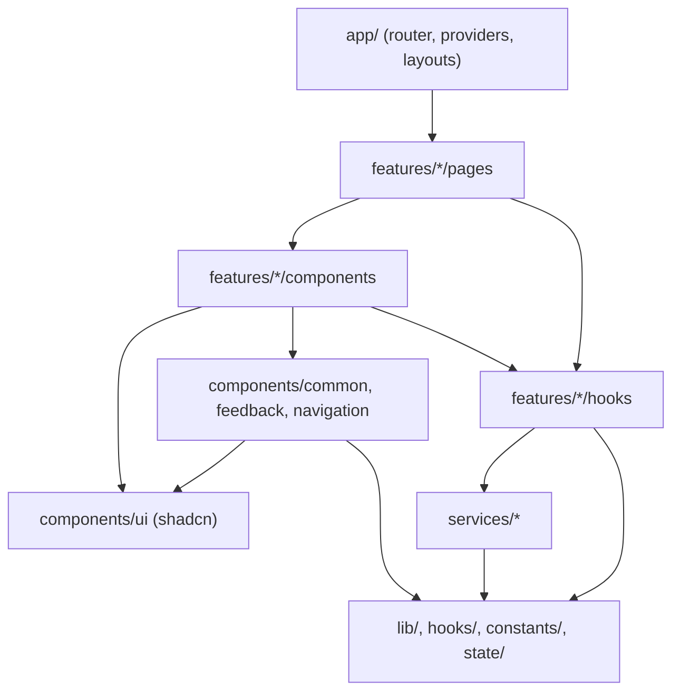
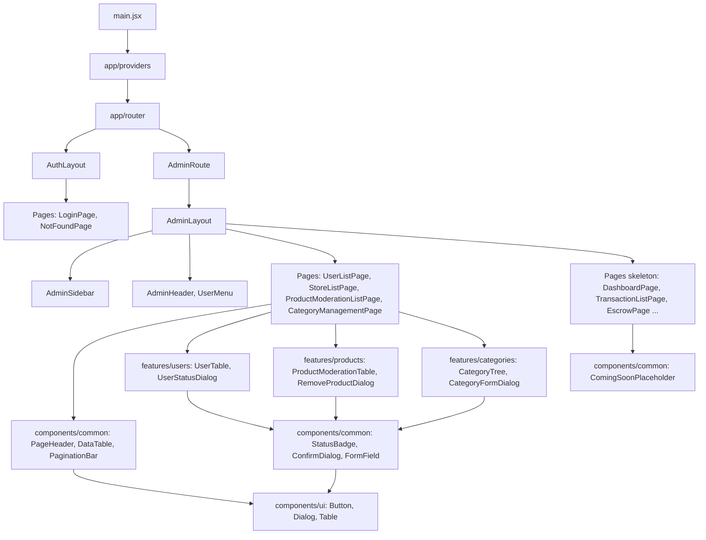

# 06 - Component Architecture (Kiến trúc component, Admin)

> **Trạng thái:** BẢN NHÁP v0.1
> **Cập nhật:** 2026-11-08
> **Áp dụng cho:** `Moldy-Market-Admin-Frontend`
> **Mục đích:** Quy định component của khu quản trị được chia thành những loại nào, nằm ở thư mục nào, được phép biết gì và không được biết gì, để nhiều người cùng code mà không làm rối cấu trúc.

Nhãn dùng trong tài liệu:
- `[ĐÃ XÁC MINH BACKEND]`: có trong doc 14.
- `[ĐÃ CẤU HÌNH]`: đã thật sự có trong repo.
- `[ĐỀ XUẤT]`: kiến trúc dự kiến, **chưa có code**. Mọi tên component trong tài liệu này là `[ĐỀ XUẤT]` trừ khi ghi khác. Các đoạn code là ví dụ minh họa, chưa có trong repo.

---

## 1. Hiện trạng `[ĐÃ CẤU HÌNH]`

- `src/components/ui` đã có, hiện chỉ chứa `button.jsx` do shadcn sinh ra.
- Các thư mục `components/common`, `components/feedback`, `components/navigation`, `app/layouts`, `app/router`, `app/providers`, và `features/{auth,users,stores,products,categories}/{components,hooks,pages,...}` đã tạo (Bước 12), phần lớn chỉ có `.gitkeep`.
- Chưa có component ứng dụng nào. `src/App.jsx` chỉ là trang thử i18n và nút.

Mọi thứ còn lại dưới đây là thiết kế để team thống nhất trước khi code.

---

## 2. Nguyên tắc chung `[ĐỀ XUẤT]`

### 2.1 Component chỉ lo hiển thị và tương tác, không gọi API trực tiếp

Một component **không** import Axios và **không** import trực tiếp hàm trong `services/`. Việc gọi API đi qua hook trong `features/<module>/hooks/` (TanStack Query). Lý do: khi Backend đổi contract, bạn chỉ sửa `services/` và hook, không phải sửa hàng chục component. Xem doc 07 và 09.

Với Admin, nguyên tắc này càng quan trọng vì nhiều endpoint quản trị còn thiếu kiểm tra quyền ở Backend (B2) và có thể đổi: cô lập chúng trong `services/` giúp sửa ở một chỗ.

### 2.2 Phân tầng theo mức độ biết nghiệp vụ

| Tầng | Thư mục | Biết nghiệp vụ Moldy Market không? | Ví dụ trong Admin |
|---|---|---|---|
| Nguyên thủy | `components/ui` | Không | `Button`, `Dialog`, `Table` (shadcn) |
| Dùng chung | `components/common`, `components/feedback`, `components/navigation` | Rất ít | `PageHeader`, `DataTable`, `ConfirmDialog`, `AdminSidebar` |
| Theo feature | `features/<module>/components` | Có | `UserTable`, `RemoveProductDialog`, `CategoryTree` |
| Trang | `features/<module>/pages` | Có, chỉ lắp ráp | `UserListPage` |
| Cấp ứng dụng | `app/layouts`, `app/router`, `app/providers` | Biết cấu trúc app | `AdminLayout`, `AdminRoute` |

Quy tắc đọc: tầng nào chỉ được dùng tầng **ở trên nó trong bảng** (trừ `app/` đứng riêng). `components/common` không import từ `features/`.

### 2.3 Hướng phụ thuộc `[ĐỀ XUẤT]`



Mũi tên chỉ đi **một chiều**. Hai điều cấm:
1. `services/` không import React và không import `features/` (doc 07).
2. `features/A` không import trực tiếp từ `features/B`. Admin có các feature gần nhau (`users`, `stores`, `products`): nếu trang chi tiết gian hàng cần hiện danh sách sản phẩm của gian hàng, **page** ghép hai feature, hoặc phần chung được đưa lên `components/common`. Không để `stores` import từ `products`.

### 2.4 `components/ui` là code sinh ra `[ĐÃ CẤU HÌNH]`

- Không sửa tay trừ khi có lý do rõ. File trong thư mục này được loại khỏi Prettier (`.prettierignore`) và nới rule ESLint (`eslint.config.js`).
- Cần biến thể riêng: **không** sửa `button.jsx`; bọc component ở `components/common` hoặc trong feature, truyền `className` và `variant` có sẵn.
- `cn` luôn import từ `@/lib/utils` (package npm tên `cn` đã gỡ).

---

## 3. Layout và cấp ứng dụng (`app/`) `[ĐỀ XUẤT]`

Bảng route nào dùng layout nào nằm ở doc 04, không lặp lại ở đây.

| Thành phần | Vị trí | Vai trò |
|---|---|---|
| `AuthLayout` | `app/layouts` | Khung tối giản cho `/login` và trang 404: logo, vùng giữa màn hình, `<Outlet />`. Không sidebar |
| `AdminLayout` | `app/layouts` | Khung khu quản trị: `AdminSidebar` bên trái, `AdminHeader` trên, vùng nội dung `<Outlet />` |
| `AdminRoute` | `app/router` | Guard: kiểm tra phiên và role `ADMIN` rồi render `<Outlet />`; nếu không thì chuyển hướng hoặc hiện màn hình không có quyền (doc 04 mục 5, doc 08) |
| `AppProviders` | `app/providers` | Gom `QueryClientProvider`, provider i18n nếu cần, `ToastProvider`; bọc ngoài `RouterProvider` |

Quy tắc layout:
- Layout **không** tự quyết định quyền truy cập. `AdminRoute` làm việc đó; layout chỉ lo giao diện. Tách như vậy để đổi cách kiểm tra quyền (khi Q1, Q2 được chốt) mà không đụng giao diện.
- Layout không gọi API nghiệp vụ. Ngoại lệ: `AdminHeader` hiện tên/email admin lấy từ phiên hiện tại (doc 08), không phải từ một lời gọi riêng trong layout.
- Responsive của layout (sidebar thu gọn, ngăn kéo) mô tả ở doc 03 mục 7. Trạng thái mở/thu gọn sidebar là client state trong Zustand (`state/`, doc 09).

---

## 4. Component dùng chung `[ĐỀ XUẤT]`

### 4.1 `components/common`

| Component | Vai trò | Props chính (dự kiến) |
|---|---|---|
| `Logo` | Chữ "Moldy Market" + nhãn "Admin" (placeholder, chưa có logo chính thức, doc 03) | `size`, `className` |
| `PageHeader` | Tiêu đề trang, mô tả ngắn, vùng nút hành động bên phải | `title`, `description`, `actions` |
| `DataTable` | Bảng dữ liệu dùng chung: tiêu đề cột, dòng, trạng thái tải/rỗng/lỗi, nhúng `PaginationBar` | `columns`, `rows`, `isLoading`, `error`, `onRetry`, `pagination` |
| `PaginationBar` | Điều khiển phân trang, nhận dạng đã chuẩn hóa (doc 07 mục 6) | `page`, `size`, `hasNext`, `totalElements`, `onPageChange` |
| `StatusBadge` | Huy hiệu trạng thái: ánh xạ giá trị enum sang màu và key dịch | `type` (`user`, `store`, `product`), `value` |
| `ConfirmDialog` | Hộp thoại xác nhận hành động nguy hiểm (doc 03 mục 6.5) | `open`, `title`, `description`, `confirmLabel`, `onConfirm`, `loading`, `children` (ví dụ ô nhập lý do) |
| `FormField` | Gói label + input + lỗi để mọi form hiển thị lỗi giống nhau | `label`, `error`, `hint`, `children` |
| `CopyableId` | Hiển thị ID rút gọn kèm nút sao chép (UUID dài) | `value` |
| `LanguageSwitcher` | Đổi ngôn ngữ `vi`/`en` bằng `i18n.changeLanguage` | không |
| `ComingSoonPlaceholder` | Khung cho trang chưa có Backend, có nhãn "Sắp có" và lý do (trạng thái Backend) | `title`, `backendStatus`, `note` |
| `ImageWithFallback` | Ảnh có ảnh dự phòng (ảnh product là URL ngoài, Q5) | `src`, `alt`, `fallback` |

Điểm đáng chú ý:
- **`DataTable`** là component quan trọng nhất của Admin vì user, store, product, category đều là bảng. Nó **không** biết cột nào là gì; cột do feature truyền vào. Nó chỉ lo khung, tải/rỗng/lỗi và phân trang. Cách này tránh bốn bản bảng gần giống nhau.
- **`StatusBadge`** giữ bảng `giá trị -> key i18n + màu` (doc 03 mục 2.4) và có nhánh mặc định cho giá trị lạ để không vỡ khi Backend thêm giá trị mới. Enum Backend không được dịch ở Backend.
- **`ComingSoonPlaceholder`** thực thi quy tắc "trang chưa có Backend chỉ là khung, không số liệu giả" (doc 04 mục 3.2): nhận trạng thái Backend (`NOT_FOUND`, `IN_PROGRESS`...) và hiển thị trung thực.

### 4.2 `components/feedback`

| Component | Khi nào dùng |
|---|---|
| `PageSkeleton`, `TableSkeleton`, `CardSkeleton` | Tải lần đầu, giữ đúng bố cục |
| `LoadingSpinner` | Nút đang gửi, tải ngắn |
| `EmptyState` | Danh sách rỗng, có câu giải thích |
| `ErrorState` | Lỗi tải, có nút "Thử lại" gọi `refetch` |
| `ForbiddenState` | Nhận `403` (`COMMON_004`...) hoặc phiên không có role `ADMIN`. **Không** đăng xuất người dùng ở lỗi 403 từ API |
| `InlineError` | Lỗi nhỏ ngay tại form hoặc hộp thoại |
| `ToastProvider` (shadcn `sonner` nếu chọn) | Thông báo ngắn sau hành động |

### 4.3 `components/navigation`

| Component | Vai trò |
|---|---|
| `AdminSidebar` | Menu trái theo nhóm (Tổng quan, Quản lý, Giao dịch, Hệ thống; doc 04 mục 4.3). Đọc danh sách mục từ `constants/`, mục có Backend chưa sẵn sàng hiện nhãn "Sắp có" |
| `AdminHeader` | Tên trang, `LanguageSwitcher`, menu người dùng (tên, đăng xuất), nút mở sidebar trên màn nhỏ |
| `UserMenu` | Menu tài khoản admin: đăng xuất. Không có "Hồ sơ" hay đổi mật khẩu vì nằm ngoài phạm vi Admin (doc 04 mục 3.4) |
| `Breadcrumbs` | Đường dẫn phân cấp ở trang chi tiết (ví dụ Người dùng > Chi tiết) |

---

## 5. Component theo feature `[ĐỀ XUẤT]`

Mỗi feature sở hữu component riêng trong `features/<module>/components`. Bảng dưới là **gợi ý khởi điểm**; danh sách thật lớn lên khi code. Cột "Backend" cho biết dữ liệu và hành động dựa vào endpoint nào (doc 14); nếu doc 14 chưa ghi hình dạng DTO thì **chưa audit**, đừng đoán.

| Feature | Component gợi ý | Backend (doc 14) | Ghi chú |
|---|---|---|---|
| `auth` | `LoginForm` | `POST /api/v1/auth/login`, `GET /api/v1/users/me` | Schema Zod ở `auth/schemas`. Chỉ vào khu admin nếu `roles` có `ADMIN`. Không có form đăng ký ở Admin |
| `users` | `UserTable`, `UserDetailCard`, `UserStatusDialog` | `GET /api/v1/users`, `GET /api/v1/users/{id}`, `PUT /api/v1/users/{id}/status` | `UserStatus`: `ACTIVE`, `LOCKED`, `PENDING_VERIFICATION`. Thao tác đổi trạng thái qua `ConfirmDialog`. B10: admin là người kích hoạt `PENDING_VERIFICATION` sang `ACTIVE` |
| `stores` | `StoreTable`, `StoreDetailCard`, `StoreStatusDialog` | `GET /api/v1/stores`, `GET /api/v1/stores/{id}`, `PUT /api/v1/stores/{id}/status` | `StoreStatus`: `ACTIVE`, `BLOCKED`. Chưa audit `GET /stores/{id}` có đủ trường cho nhu cầu admin hay không (doc 04 bảng 3.1) |
| `products` | `ProductModerationTable`, `ProductModerationDetail`, `RemoveProductDialog`, `RestoreProductDialog` | `GET /api/v1/products/search` hoặc `GET /api/v1/products`, `GET /api/v1/products/{id}`, `PUT .../remove` (body `{ reason }`), `PUT .../restore` | `RemoveProductDialog` có ô nhập `reason` (schema Zod ở `products/schemas` nếu cần; giới hạn độ dài của `reason` chưa audit). Chưa chắc liệt kê được sản phẩm `REMOVED` (AQ1, doc 04 mục 8) |
| `categories` | `CategoryTree`, `CategoryFormDialog`, `DeleteCategoryDialog` | `GET /api/v1/categories` (cây), `GET /api/v1/categories/{id}`, `POST`, `PUT /{id}`, `DELETE /{id}` | Thêm, sửa dùng dialog trong trang (doc 04), không có route riêng. `DELETE` không có body trả về. Schema Zod ở `categories/schemas`; trường của body chưa audit |

Ghi chú:
- Thư mục `features/dashboard`, `escrow`, `vouchers`, `orders`, `appraisers` **chưa có** (doc 02). Các trang đó chỉ là skeleton dùng `ComingSoonPlaceholder`. Khi branch Backend merge và doc 14 cập nhật, tạo thư mục feature tương ứng. Nơi đặt `DashboardPage` sẽ chốt lúc code (doc 04 mục 7).
- `ProductModerationTable` và `ProductModerationDetail` chỉ là giao diện **kiểm duyệt**; Admin không tạo/sửa product (đó là việc của người bán ở User Frontend).
- Hành động nguy hiểm đều qua `ConfirmDialog` (doc 03 mục 6.5).

---

## 6. shadcn/ui `[ĐÃ CẤU HÌNH]` + `[ĐỀ XUẤT]`

- Cấu hình: style `radix-nova`, base color `neutral`, icon `lucide`, không TypeScript, không RSC (`components.json`). Hiện có: `button`.
- Thêm component bằng CLI khi **thật sự cần dùng**, không thêm cả bộ từ đầu: chạy trong thư mục repo (PowerShell) `npx shadcn@latest add <tên>`.
- Admin nhiều bảng và hộp thoại nên danh sách thường cần: `table`, `dialog`, `alert-dialog` (xác nhận phá hủy), `dropdown-menu`, `input`, `label`, `textarea`, `select`, `badge`, `skeleton`, `sheet` (sidebar mobile), `tabs`, `separator`, `avatar`, `alert`, `sonner`, `pagination`, `breadcrumb`, `tooltip`, `collapsible` (cây danh mục). Kiểm tra tên chính xác trong danh mục của CLI khi thêm.
- Với form, kết nối React Hook Form + Zod theo doc 09. Cách ghép với component form của shadcn bản 4.x cần xem tài liệu CLI lúc làm, không giả định ở đây.
- Cây danh mục (`CategoryTree`) là cây nhiều cấp: thư viện cây chuyên dụng **chưa chọn**; bắt đầu bằng danh sách lồng đệ quy đơn giản, chỉ thêm thư viện nếu thật cần.

---

## 7. Quy ước props và composition `[ĐỀ XUẤT]`

1. **Props rõ ràng, ít, có JSDoc.** Dự án dùng JavaScript nên JSDoc là cách duy nhất để editor gợi ý kiểu. Mỗi component công khai có `@typedef` mô tả props.
2. **Dùng `children` và slot** thay vì nhiều cờ boolean. `PageHeader` nhận `actions` là node.
3. **Controlled bằng props, không tự gọi API.** Component nhận dữ liệu và callback (`onSubmit`, `onConfirm`). Page hoặc hook nối với API.
4. **Page là nơi lắp ráp.** Page gọi hook, xử lý tải/rỗng/lỗi rồi truyền dữ liệu xuống. Component trình bày không biết `useQuery`.
5. **`className` và `cn`** để ghi đè kiểu, không dùng style inline.
6. **Một component một file**, tên file trùng tên component, PascalCase `.jsx` (doc 11).
7. **Không truyền cả object response Backend xuống sâu hơn hai tầng.** Ánh xạ sang object nhỏ ở hook (`select` của `useQuery`) để component không phụ thuộc hình dạng DTO.
8. **Trạng thái UI cục bộ** (mở dialog, hàng đang chọn) dùng `useState`. Chỉ đưa lên Zustand khi nhiều nơi xa nhau cần (doc 09). Riêng sidebar mở/thu gọn là client state dùng chung nên đặt ở Zustand.
9. **Cột bảng khai báo ở feature, không ở `DataTable`.** `DataTable` nhận mảng `columns`, nhờ vậy dùng lại cho mọi danh sách.
10. **Không tự tính quyền trong component.** Không viết `if (role === 'ADMIN')` rải rác; dùng một nơi (`AdminRoute`, hook quyền theo doc 08). Frontend chưa đọc được permission code (Q1), nên mọi nút hành động đều phải sẵn sàng nhận `403` và hiện `ForbiddenState`/toast.

### Ví dụ minh họa (chưa có trong repo)

```jsx
// features/users/components/UserTable.jsx
import { DataTable } from '@/components/common/DataTable'
import { StatusBadge } from '@/components/common/StatusBadge'

/**
 * @typedef {Object} UserTableProps
 * @property {Array<{ id: string, email: string, status: string }>} rows
 * @property {boolean} isLoading
 * @property {unknown} error
 * @property {() => void} onRetry
 * @property {(user: { id: string, status: string }) => void} onChangeStatus
 */

/** @param {UserTableProps} props */
export function UserTable({ rows, isLoading, error, onRetry, onChangeStatus }) {
  const columns = [
    { key: 'email', header: 'Email', render: (u) => u.email },
    { key: 'status', header: 'Trạng thái', render: (u) => <StatusBadge type="user" value={u.status} /> },
    // cột hành động mở UserStatusDialog qua onChangeStatus
  ]
  return <DataTable columns={columns} rows={rows} isLoading={isLoading} error={error} onRetry={onRetry} />
}
```

Đây chỉ là **ví dụ minh họa**. Tên trường `id`, `email`, `status` chỉ là giả định để minh họa cấu trúc; hình dạng thật của phần tử trong `PagedResponse` của danh sách user **chưa được audit** (doc 14 mục 2.2), phải xem response thật khi code.

---

## 8. Cây component tổng quát `[ĐỀ XUẤT]`



Danh sách trang đầy đủ và quyền truy cập theo từng trang nằm ở doc 04 và doc 05.

---

## 9. Lỗi thường gặp cần tránh

| Lỗi | Hậu quả | Cách đúng |
|---|---|---|
| Gọi `axios.get` trong component | Khó test, trùng lặp, không cache | Qua hook của feature |
| Viết riêng một bảng cho mỗi danh sách | Bốn bản bảng khác nhau, sửa phân trang phải sửa bốn nơi | Dùng chung `DataTable` + `columns` |
| Hành động nguy hiểm không qua `ConfirmDialog` | Admin bấm nhầm khóa user hay gỡ sản phẩm | Luôn xác nhận, nêu đối tượng cụ thể |
| Ẩn nút theo role rồi coi là bảo mật | Backend vẫn là chốt chặn thật; nhiều endpoint thiếu `@PreAuthorize` (B2) | Ẩn chỉ để trải nghiệm; xử lý `403` |
| Điền dữ liệu mẫu vào trang chưa có Backend | Người dùng tưởng tính năng chạy | `ComingSoonPlaceholder`, không số liệu giả |
| Lọc phía client trên dữ liệu đã phân trang | Kết quả sai, chỉ lọc được trang hiện tại | Lọc phía server khi Backend hỗ trợ (AQ2) |
| `features/stores` import từ `features/products` | Vòng phụ thuộc | Page ghép, hoặc đưa phần chung lên `components/common` |
| Sửa `components/ui/button.jsx` | Bị ghi đè khi cập nhật shadcn, lệch hai repo | Bọc component, dùng `className`, `variant` |
| Hiển thị trực tiếp `message` tiếng Anh của Backend | Giao diện lẫn ngôn ngữ | Ánh xạ `code` sang key i18n (doc 07) |
| Component chứa cả logic nghiệp vụ lẫn UI 400 dòng | Khó đọc | Tách hook, tách component con |

---

## Tài liệu liên quan

- 02 - Frontend Architecture: cấu trúc thư mục và quyết định kiến trúc.
- 03 - Design System: token, bảng dữ liệu, hộp thoại xác nhận, responsive.
- 04 - Routing and Pages: route, layout, guard, nhóm menu sidebar.
- 05 - Page by Page Guide: component chính của từng trang.
- 07 - API Integration: lớp service, hook gọi API, phân trang.
- 08 - Authentication and Authorization: `AdminRoute`, 401 và 403.
- 09 - State Management: `useState` hay Zustand hay TanStack Query.
- 11 - Coding Conventions: đặt tên file, component, JSDoc.
- 14 - Backend Integration Matrix: nguồn sự thật về Backend.
