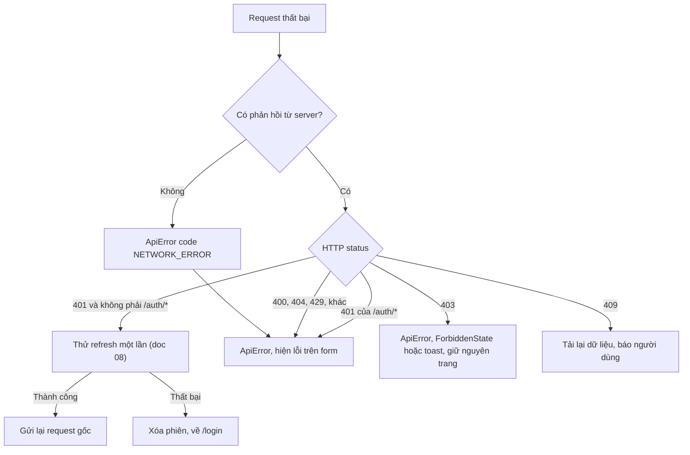
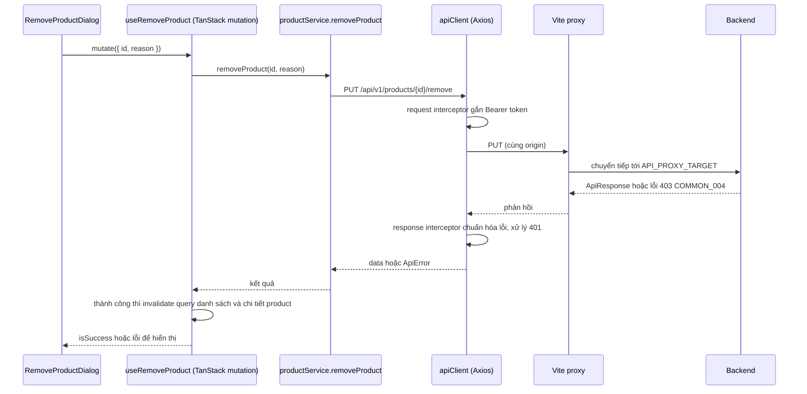

# 07 - API Integration (Tích hợp API, Admin)

> **Trạng thái:** BẢN NHÁP v0.1
> **Cập nhật:** 2026-11-08
> **Áp dụng cho:** `Moldy-Market-Admin-Frontend`
> **Mục đích:** Quy định cách Admin Frontend nói chuyện với Backend: cấu hình Axios, xử lý lỗi, tổ chức `services/`, phân trang, và bảng ánh xạ endpoint dành cho khu quản trị.

Nhãn dùng trong tài liệu:
- `[ĐÃ XÁC MINH BACKEND]`: có trong doc 14.
- `[ĐÃ CẤU HÌNH]`: đã có trong repo (proxy, biến môi trường, thư mục `services/`).
- `[ĐỀ XUẤT]`: thiết kế dự kiến, **chưa có code**. Các đoạn code là ví dụ minh họa, chưa có trong repo.

Quy tắc số một: **mọi endpoint trong tài liệu này phải có trong doc 14.** Thứ gì doc 14 không có thì Frontend coi là chưa biết, không tự bịa. Phạm vi Admin hẹp hơn User: chỉ các endpoint quản trị và đọc công khai (mục 9).

---

## 1. Hiện trạng `[ĐÃ CẤU HÌNH]`

- Axios ^1.21.0 đã cài. **Chưa có** Axios instance, interceptor hay service nào. Thư mục `src/services/{api,auth,users,stores,categories,products}` đã tạo, đang trống (`.gitkeep`).
- Vite proxy: mọi request bắt đầu bằng `/api` được chuyển tới `API_PROXY_TARGET` (mặc định `http://localhost:8080`). Đã kiểm chứng gọi `/api/v1/categories` qua `http://localhost:5173` chạy được trên máy phát triển.
- `.env.example`: `VITE_API_BASE_URL` (để trống khi dev), `API_PROXY_TARGET` (chỉ dev, không lộ ra bundle vì không có tiền tố `VITE_`).

---

## 2. Cấu hình Axios `[ĐỀ XUẤT]`

### 2.1 Vì sao `baseURL` để trống và không gắn `/api/v1`

1. **Trình duyệt gọi cùng origin với Vite dev server** (`localhost:5173`), Vite proxy chuyển tiếp sang Backend. Nhờ vậy dev không cần CORS, vì Backend chưa có CORS cho REST (B1, doc 14 mục 2.4).
2. **Backend có hai prefix**: `/api/v1/...` và `/api/...` (doc 14 mục 2.3). Với Admin điều này **chạm trực tiếp**: các endpoint admin của voucher, reference price, appraiser nằm dưới `/api/admin/...` (không có `v1`), còn user, store, product, category nằm dưới `/api/v1/...`. Gắn cứng `/api/v1` vào `baseURL` sẽ làm Admin không gọi được nhóm `/api/admin/...` sau này.
3. **Production:** đặt `VITE_API_BASE_URL` thành URL tuyệt đối của Backend, **hoặc** phục vụ app cùng origin với API. Cả hai cần Backend sẵn sàng (thêm CORS hoặc reverse proxy). Xem doc 12.

Vì vậy mọi service viết **đường dẫn đầy đủ**, ví dụ `'/api/v1/users'`.

### 2.2 Instance (ví dụ minh họa, chưa có trong repo)

```js
// src/services/api/client.js
import axios from 'axios'

export const apiClient = axios.create({
  baseURL: import.meta.env.VITE_API_BASE_URL ?? '',
  timeout: 15000,
  headers: { Accept: 'application/json' },
})
```

`?? ''` để khi biến không có giá trị, Axios gọi cùng origin (đúng với dev + proxy).

### 2.3 Request interceptor

Nhiệm vụ duy nhất: gắn `Authorization: Bearer <accessToken>` nếu đang có token. Token lấy qua một hàm `getAccessToken()` để khi chốt nơi lưu (Q2, doc 08) chỉ sửa một chỗ. Với Admin, **hầu như mọi endpoint đều cần token** (trừ đăng nhập, refresh, và các lời gọi đọc công khai như cây danh mục).

Lưu ý: chưa xác minh được Backend phản ứng thế nào khi gửi access token hết hạn tới endpoint **công khai**. Cần thử bằng request thật trước khi quyết định có gắn token cho mọi request hay chỉ endpoint cần đăng nhập.

### 2.4 Response interceptor

Hai việc, **tách riêng**:

1. **Chuẩn hóa lỗi** thành class `ApiError` (mục 4).
2. **Xử lý `401`**: thử refresh token đúng một lần rồi gửi lại request gốc. Chi tiết, gồm hàng đợi và rủi ro đa tab, ở doc 08. Interceptor **không** thử refresh cho chính các endpoint `/api/v1/auth/*` (vì `AUTH_001` sai mật khẩu cũng là `401`, refresh không giúp gì).

---

## 3. Bóc phong bì `ApiResponse` `[ĐÃ XÁC MINH BACKEND]` + `[ĐỀ XUẤT]`

Backend trả mọi REST response dạng `{ success, code, message, data, timestamp }` (doc 14 mục 2.1). Cần một hàm duy nhất để lấy `data`:

```js
// src/services/api/unwrap.js (ví dụ minh họa, chưa có trong repo)
export function unwrap(response) {
  const body = response.data
  // Một số endpoint không có body, ví dụ DELETE /api/v1/categories/{id}
  if (body === undefined || body === null || body === '') return null
  return body.data ?? null
}
```

Ngoại lệ liên quan Admin (doc 14 mục 2.1):
- **`DELETE /api/v1/categories/{id}` không có body.** Đây là thao tác xóa duy nhất trong phạm vi Admin đang `IMPLEMENTED`; đừng giả định luôn có `response.data.data`.
- `DELETE /api/admin/reference-prices/{id}` cũng không có body nhưng đang `IN_PROGRESS` (chưa viết service).
- Payload WebSocket của chat và webhook SePay không dùng `ApiResponse`; Admin **không** dùng cả hai (webhook chỉ SePay gọi, chat không thuộc Admin).

---

## 4. Xử lý lỗi `[ĐÃ XÁC MINH BACKEND]` + `[ĐỀ XUẤT]`

### 4.1 Hình dạng lỗi từ Backend

`success = false`, `code` là chuỗi `ErrorCode` (ví dụ `AUTH_001`), `data` là object `ApiError` (có ít nhất đường dẫn request; các trường khác chưa đọc). `message` là **tiếng Anh**.

### 4.2 `ApiError` phía Frontend

Interceptor biến mọi lỗi Axios thành một dạng thống nhất để phần còn lại của app không đọc cấu trúc Axios:

```js
// src/services/api/ApiError.js (ví dụ minh họa, chưa có trong repo)
export class ApiError extends Error {
  /**
   * @param {{ status: number|null, code: string, message: string, details?: unknown }} p
   */
  constructor({ status, code, message, details }) {
    super(message)
    this.name = 'ApiError'
    this.status = status // HTTP status, null nếu không có phản hồi (mất mạng)
    this.code = code // mã của Backend, hoặc mã do Frontend tự đặt
    this.details = details
  }
}
```

Hai mã do **Frontend tự đặt** (không có trong `ErrorCode` của Backend): `NETWORK_ERROR` (không nhận được phản hồi) và `UNKNOWN_ERROR`. Giữ chúng tách biệt bằng hằng số riêng để không nhầm với mã Backend.

### 4.3 Ánh xạ mã lỗi sang giao diện Admin

Nguyên tắc: **không hiển thị `message` của Backend**. Dùng `code` làm khóa i18n, ví dụ `errors.AUTH_001` trong namespace `errors` (cần thêm vào `src/i18n`, hiện mới có `common`). Mã chưa có bản dịch rơi về thông báo chung.

Các mã trong doc 14 mục 2.5 liên quan Admin:

| Mã | HTTP | Hành vi giao diện đề xuất trong Admin |
|---|---|---|
| `COMMON_001` | 400 | Validation thất bại: hiển thị lỗi theo trường trong form (hộp thoại gỡ sản phẩm, form danh mục) nếu `data` có chi tiết; nếu không, thông báo chung. Hình dạng chi tiết lỗi theo trường **chưa audit**, cần đối chiếu response thật |
| `COMMON_003` | 401 | Chạy cơ chế refresh (doc 08); thất bại thì về `/login` |
| `COMMON_004` | 403 | `ForbiddenState` hoặc toast "không đủ quyền cho thao tác này". **Không** đăng xuất. Với Admin đây là tình huống thường gặp vì Frontend chưa đọc được permission code (Q1): một admin có thể thiếu `PRODUCT_MODERATE` hay `CATEGORY_MANAGE` mà giao diện không biết trước |
| `COMMON_009` | 429 | Báo "thử lại sau", không tự gửi lại ngay |
| `COMMON_010` | 409 | Dữ liệu bị người khác sửa trước (optimistic lock). Doc 14 chỉ nêu mã này cho cập nhật product của người bán; **chưa xác minh** có áp dụng cho thao tác nào của Admin hay không. Nếu gặp, tải lại dữ liệu và báo người dùng, không tự ghi đè |
| `AUTH_001` | 401 | Sai email hoặc mật khẩu: lỗi ngay trên form đăng nhập |
| `AUTH_003`, `AUTH_004` | 403 | Tài khoản bị khóa, bị vô hiệu: hiện thông báo trên trang đăng nhập. Với tài khoản `PENDING_VERIFICATION` xem B10, Q14 và doc 08 |
| `AUTH_005`, `AUTH_006`, `AUTH_007` | 401 | Refresh token không hợp lệ, hết hạn, bị dùng lại. Xóa phiên, về `/login`. Với `AUTH_007` báo "phiên đã bị đóng vì lý do an toàn" (Backend đã thu hồi mọi phiên của user, doc 14 mục 3.2) |
| `STORE_004` | 403 | Gian hàng bị chặn (ít gặp trong Admin; admin thao tác chính trạng thái này) |
| `PROD_*`, `STORE_*`, `USER_*`, `CAT_*` khác | khác | Doc 14 không liệt kê từng mã. Ánh xạ khi gặp thật, tham khảo `ErrorCode.java` ở repo Backend. Mã chưa biết rơi về thông báo chung kèm `code` hiển thị nhỏ để báo lỗi cho dev |

Ghi chú: các mã `ORDER_*`, `PAYMENT_*` thuộc module checkout, **không** thuộc Admin ở giai đoạn này. Riêng `POST /api/v1/orders/admin/{orderId}/cod-collected` có `ORDER_009` (order không ở trạng thái `DELIVERED`) nhưng đang `IN_PROGRESS`, chưa viết service.

### 4.4 Luồng xử lý lỗi



---

## 5. Tổ chức `services/` `[ĐỀ XUẤT]`

### 5.1 Quy ước

- **Một thư mục cho mỗi module Backend:** `services/users/userService.js`, `services/stores/storeService.js`, `services/products/productService.js`, `services/categories/categoryService.js`, `services/auth/authService.js`. Khớp với cấu trúc đã tạo (doc 02).
- Hàm service là **hàm async thuần**: nhận tham số, gọi `apiClient`, trả `data` đã bóc phong bì (hoặc đã qua adapter phân trang). Không `useState`, không `useQuery`, không `toast`. Cache và hiển thị là việc của hook (doc 09).
- **Chỉ viết service cho endpoint `IMPLEMENTED`** (doc 14 mục 1.2). Endpoint `IN_PROGRESS` chỉ được viết sau khi branch merge vào `main` và doc 14 cập nhật. Điều này **đặc biệt quan trọng với Admin**: gần như mọi endpoint admin trên branch chưa merge (escrow, withdrawal, voucher admin, reference price, appraiser admin) hiện **chưa có kiểm tra quyền** (B2). Viết service trước khi Backend sửa B2 nghĩa là Frontend dựng giao diện quản trị trên một API ai đăng nhập cũng gọi được.
- Endpoint `PLANNED` hoặc `NOT_FOUND` chỉ làm skeleton trang `TODO`, không viết service.
- Tên hàm theo động từ + đối tượng: `listUsers`, `getUserById`, `setUserStatus`, `listStores`, `setStoreStatus`, `removeProduct`, `restoreProduct`, `getCategoryTree`, `createCategory`, `updateCategory`, `deleteCategory`.
- Mỗi hàm có JSDoc ghi: endpoint, permission Backend cần, các lỗi đáng chú ý.
- `services/api/` chứa phần nền: `client.js`, `unwrap.js`, `ApiError.js`, `pagination.js` (adapter).
- **Không có hàm service nào gắn với `PUT /api/v1/users/me/password`, hồ sơ cá nhân, đăng ký** trong Admin vì ngoài phạm vi (doc 04 mục 3.4).

### 5.2 Ví dụ minh họa (chưa có trong repo)

```js
// src/services/products/productService.js
import { apiClient } from '@/services/api/client'
import { unwrap } from '@/services/api/unwrap'

/**
 * PUT /api/v1/products/{id}/remove
 * Permission Backend: PRODUCT_MODERATE. Body: { reason }.
 * Giới hạn độ dài của reason chưa audit.
 */
export async function removeProduct(id, reason) {
  const res = await apiClient.put(`/api/v1/products/${id}/remove`, { reason })
  return unwrap(res)
}

/** PUT /api/v1/products/{id}/restore. Permission Backend: PRODUCT_MODERATE. */
export async function restoreProduct(id) {
  const res = await apiClient.put(`/api/v1/products/${id}/restore`)
  return unwrap(res)
}
```

```js
// src/services/categories/categoryService.js
/** DELETE /api/v1/categories/{id}. Không có body trả về. Permission: CATEGORY_MANAGE. */
export async function deleteCategory(id) {
  await apiClient.delete(`/api/v1/categories/${id}`)
}
```

Đây chỉ là minh họa cấu trúc. Hình dạng body của các thao tác đổi trạng thái user/store và của form danh mục **chưa được audit** trong doc 14; viết service thật phải đối chiếu `*Request` DTO ở Backend hoặc response thật trước.

Hook của feature gọi các hàm này (doc 09), component gọi hook.

---

## 6. Phân trang `[ĐÃ XÁC MINH BACKEND]`

Backend có nhiều dạng phân trang (doc 14 mục 2.2). Mỗi dạng cần một **adapter** chuẩn hóa về hình dạng nội bộ, ví dụ `{ items, page, size, totalElements, hasNext }`, để `PaginationBar` và hook dùng chung.

Dạng liên quan Admin:

| Dạng | Endpoint (trạng thái) | `page` bắt đầu | Response | Adapter / cách dùng |
|---|---|---|---|---|
| `PagedResponse` | `GET /api/v1/users`, `GET /api/v1/stores` (`IMPLEMENTED`) | **1** | `{ content, page, size, hasNext, totalElements }`; `totalElements` là `null` khi Backend dùng Slice | `content` thành `items`. Nếu `totalElements` null, `PaginationBar` chỉ có "Trước/Sau", không hiển thị tổng số trang |
| `PagedResponse<ProductResponse>` | `GET /api/v1/products` (`IMPLEMENTED`, tham số **chưa audit**) | 1 | theo chữ ký method | Xem mục 7 |
| `ProductSearchResponse` | `GET /api/v1/products/search` (`IMPLEMENTED`) | 1 | `{ items, page, size, totalElements, totalPages, totalCapped, facets }` | `totalCapped = true` hiển thị "10.000+" |
| Danh sách thuần | `GET /api/v1/categories` (cây) | không phân trang | mảng/cây | Trả nguyên cây |
| Spring `Page` thô | Danh sách trong `/api/admin/...` của pricing (`IN_PROGRESS`) | theo Pageable | `Page<...>` | Chưa viết, chờ branch merge |

Quy tắc:
- `size` tối đa 100, mặc định 20 (`PaginationConfig`). Frontend chặn giá trị ngoài khoảng này trước khi gọi.
- `page` trên URL **bắt đầu từ 1** để khớp `PagedResponse` (doc 04 mục 6); không đổi 0/1 giữa URL và API.
- Các dạng khác (cursor của notification, Spring `Page` của chat, danh sách order/payment) **không dùng trong Admin**.

---

## 7. Tìm kiếm, lọc, sắp xếp trong Admin

### 7.1 Danh sách user và store

Doc 14 chỉ xác nhận `page`, `size`, `sort` cho `GET /api/v1/users` và `GET /api/v1/stores`. **Định dạng chính xác của `sort` và các trường được phép sắp xếp chưa audit.** Lọc theo từ khóa hoặc trạng thái **phía server chưa có cơ sở** (AQ2, doc 04 mục 8). Hệ quả:
- Chưa làm ô tìm kiếm hay bộ lọc trạng thái cho hai danh sách này cho đến khi xác nhận với team Backend.
- **Không** lọc phía client trên dữ liệu đã phân trang: chỉ lọc được trang đang xem, cho kết quả sai và gây hiểu nhầm.
- Nhu cầu thực tế "tìm các user `PENDING_VERIFICATION` để kích hoạt" (B10) cần lọc phía server; ghi vào danh sách câu hỏi cho team Backend.

### 7.2 Danh sách product để kiểm duyệt

Hai lựa chọn có trong doc 14: `GET /api/v1/products/search` hoặc `GET /api/v1/products`. Tham số của `GET /products` chưa audit, còn `/search` có bộ tham số đã xác minh (doc 14 mục 5.6): `q` (tối đa 100), `categoryId[]` (tối đa 20), `condition[]` (tối đa 10), `minPrice`, `maxPrice`, `storeId`, `sellerType`, `attr[]` (tối đa 10), `sort` (`relevance`, `newest`, `price_asc`, `price_desc`), `facets`, `page`, `size`.

Vấn đề chưa có đáp án (**AQ1**): hai endpoint này có trả sản phẩm `REMOVED` hoặc `HIDDEN` cho admin không? Nếu không, Admin không có cách liệt kê sản phẩm đã gỡ để khôi phục (chỉ khôi phục được khi biết sẵn id). Đây là câu hỏi cho team Backend, chưa phải điều Frontend có thể giả định.

`[ĐỀ XUẤT]` Khi viết code:
- **Mảng trong query string.** Axios mặc định serialize mảng thành `categoryId[]=1&categoryId[]=2`, trong khi Spring thường mong `categoryId=1&categoryId=2`. Có thể phải cấu hình `paramsSerializer: { indexes: null }`. **Cần thử với Backend thật** vì doc 14 chưa xác minh định dạng này.
- Trạng thái bộ lọc nằm trên **URL** (doc 09), giá trị `sort` hợp lệ đặt hằng số trong `constants/`.
- Debounce ô tìm kiếm (khoảng 300 ms).

---

## 8. Upload file `[ĐÃ XÁC MINH BACKEND]`

Không có API upload ảnh (`NOT_FOUND`, doc 14 mục 4.3; Q5). Admin **không tạo hay sửa product** nên không có form upload ảnh. Admin chỉ **xem** ảnh product (URL HTTPS bên ngoài) khi kiểm duyệt, với ảnh dự phòng khi URL lỗi (doc 03 mục 9). Không viết service upload.

---

## 9. Bảng ánh xạ endpoint cho Admin

Cột "FE" là trạng thái tích hợp phía Frontend; hiện tại **mọi dòng là `NOT_STARTED`**. "Xác thực/permission" theo doc 14. Trang dùng endpoint nào xem doc 04 và 05.

### 9.1 Dùng được ngay (`IMPLEMENTED` trên `main`)

| Tính năng | Endpoint | Method | Xác thực / permission | Trạng thái Backend | FE |
|---|---|---|---|---|---|
| Đăng nhập | `/api/v1/auth/login` | POST | công khai | `IMPLEMENTED` | `NOT_STARTED` |
| Refresh token | `/api/v1/auth/refresh` | POST | công khai (gửi `refreshToken`) | `IMPLEMENTED` | `NOT_STARTED` |
| Đăng xuất | `/api/v1/auth/logout` | POST | công khai (gửi `refreshToken`) | `IMPLEMENTED` | `NOT_STARTED` |
| Hồ sơ của tôi (kiểm tra role `ADMIN`) | `/api/v1/users/me` | GET | đã đăng nhập | `IMPLEMENTED` | `NOT_STARTED` |
| Danh sách user | `/api/v1/users` | GET | `USER_STORE_MANAGE` | `IMPLEMENTED` | `NOT_STARTED` |
| Chi tiết user | `/api/v1/users/{id}` | GET | `USER_STORE_MANAGE` | `IMPLEMENTED` | `NOT_STARTED` |
| Đổi trạng thái user (`ACTIVE`, `LOCKED`, `PENDING_VERIFICATION`) | `/api/v1/users/{id}/status` | PUT | `USER_STORE_MANAGE` | `IMPLEMENTED` | `NOT_STARTED` |
| Danh sách store | `/api/v1/stores` | GET | `USER_STORE_MANAGE` | `IMPLEMENTED` | `NOT_STARTED` |
| Chi tiết store | `/api/v1/stores/{id}` | GET | công khai | `IMPLEMENTED` | `NOT_STARTED` |
| Đổi trạng thái store (`ACTIVE`, `BLOCKED`) | `/api/v1/stores/{id}/status` | PUT | `USER_STORE_MANAGE` | `IMPLEMENTED` | `NOT_STARTED` |
| Product: tìm kiếm | `/api/v1/products/search` | GET | công khai | `IMPLEMENTED` | `NOT_STARTED` |
| Product: danh sách | `/api/v1/products` | GET | công khai (tham số chưa audit) | `IMPLEMENTED` | `NOT_STARTED` |
| Product: chi tiết | `/api/v1/products/{id}` | GET | công khai | `IMPLEMENTED` | `NOT_STARTED` |
| Product: gỡ (body `{ reason }`) | `/api/v1/products/{id}/remove` | PUT | `PRODUCT_MODERATE` | `IMPLEMENTED` | `NOT_STARTED` |
| Product: khôi phục | `/api/v1/products/{id}/restore` | PUT | `PRODUCT_MODERATE` | `IMPLEMENTED` | `NOT_STARTED` |
| Category: cây | `/api/v1/categories` | GET | công khai | `IMPLEMENTED` | `NOT_STARTED` |
| Category: chi tiết | `/api/v1/categories/{id}` | GET | công khai | `IMPLEMENTED` | `NOT_STARTED` |
| Category: tạo | `/api/v1/categories` | POST | `CATEGORY_MANAGE` | `IMPLEMENTED` | `NOT_STARTED` |
| Category: sửa | `/api/v1/categories/{id}` | PUT | `CATEGORY_MANAGE` | `IMPLEMENTED` | `NOT_STARTED` |
| Category: xóa (không có body trả về) | `/api/v1/categories/{id}` | DELETE | `CATEGORY_MANAGE` | `IMPLEMENTED` | `NOT_STARTED` |

Ghi chú:
- Backend cho phép `GET /api/v1/stores/{id}` công khai; chưa audit endpoint này có trả đủ trường cho nhu cầu admin (doc 04 bảng 3.1).
- `GET /api/v1/users/me` chỉ trả **tên role**, không trả permission code (Q1). Admin chỉ kiểm tra được "có role `ADMIN` hay không".
- Body của `PUT .../status` (user, store) và của `POST/PUT` category **chưa audit**; không đoán.
- Backend cũng có `ADMIN_PORTAL_ACCESS` (doc 14 mục 3.3) nhưng Frontend không đọc được (Q1).

### 9.2 Đang phát triển (`IN_PROGRESS`, **chưa được viết service**)

| Tính năng Admin | Endpoint | Method | Branch | Lưu ý |
|---|---|---|---|---|
| Xác nhận thu tiền COD | `/api/v1/orders/admin/{orderId}/cod-collected` | POST | `feature/order` | `@IsAdmin`; chỉ order `DELIVERED` sang `COMPLETED`, khác trả `ORDER_009`. Không có endpoint liệt kê order cho admin. Q15, Q18, B11, B12 |
| Escrow | `/api/v1/escrows/hold`, `/api/v1/escrows/orders/{orderId}/capture`, `/api/v1/escrows/orders/{orderId}/release` | POST | `feature/escrow-wallet` và các branch khác | Chỉ cần đăng nhập (B2), trông như thao tác nội bộ (Q4), `orderId` không nhất quán (B7) |
| Rút tiền (xử lý) | `/api/v1/withdrawals/{id}/approve`, `/complete`, `/reject`, `/fail` | PATCH | `feature/escrow-wallet` | Chỉ cần đăng nhập (B2). DTO chưa audit |
| Voucher (admin) | `/api/admin/vouchers`, `/api/admin/vouchers/{code}` | POST, GET | `feature/voucher` | Chỉ cần đăng nhập (B2) |
| Reference price | `/api/admin/reference-prices`, `/api/admin/reference-prices/{id}` | GET, POST, PUT, DELETE | `feature/pricing` | Chỉ cần đăng nhập (B2). DELETE không có body |
| Duyệt appraiser | `/api/admin/appraisers`, `/api/admin/appraisers/{id}/approve`, `/api/admin/appraisers/{id}/suspend` | GET, PUT | `feature/cart` | Chỉ cần đăng nhập (B2). DTO chưa audit |

Quy tắc cho các dòng này: **không viết service** cho đến khi (1) branch merge vào `main`, (2) doc 14 cập nhật, và (3) với endpoint admin, Backend đã thêm kiểm tra quyền (B2) hoặc team đã ghi nhận rủi ro một cách có chủ đích. Frontend ẩn menu **không** thay thế việc kiểm tra quyền ở Backend.

### 9.3 Chưa có (`NOT_FOUND`, `PLANNED`, `REQUIRES_BUSINESS_CLARIFICATION`)

Thống kê dashboard (có permission `ANALYTICS_SYSTEM_VIEW`, không có controller), quản lý giao dịch, khiếu nại, báo cáo/vi phạm, cấu hình hệ thống, liệt kê order cho admin, refund, dispute (doc 14 mục 4.3). **Không có service**, chỉ có skeleton `TODO`.

---

## 10. Luồng gọi API tổng quát, ví dụ gỡ sản phẩm `[ĐỀ XUẤT]`



Khi chạy production, bước "Vite proxy" không còn: request đi thẳng tới `VITE_API_BASE_URL` hoặc cùng origin qua reverse proxy (doc 12). Quy ước query key và invalidation xem doc 09.

---

## 11. Bảo mật phía Frontend `[ĐỀ XUẤT]`

- **Frontend không phải ranh giới bảo mật.** Chốt chặn thật là Backend. Trên các branch chưa merge, nhiều endpoint quản trị chưa kiểm tra quyền (B2); Admin Frontend không được dùng chúng như thể đã an toàn.
- Không đặt khóa bí mật trong biến `VITE_*` (bị nhúng vào bundle, ai cũng đọc được). `API_PROXY_TARGET` không có tiền tố `VITE_` nên không lộ.
- Không ghi token hay thông tin cá nhân của user vào `console.log` hoặc log lỗi.
- Không hiển thị dữ liệu cá nhân nhạy cảm nhiều hơn cần thiết trong bảng danh sách (email, số điện thoại): hiển thị vừa đủ ở danh sách, đầy đủ ở trang chi tiết.
- Nơi lưu token **chưa chốt** (Q2); xem doc 08.

---

## 12. Lỗi thường gặp cần tránh

| Lỗi | Cách đúng |
|---|---|
| Gắn `baseURL: '/api/v1'` | Để trống, dùng đường dẫn đầy đủ (Admin sẽ cần `/api/admin/...`) |
| Viết `response.data.data` ở mọi nơi | Dùng `unwrap`, nhớ `DELETE` category không có body |
| Hiển thị `message` tiếng Anh của Backend | Ánh xạ `code` sang i18n |
| Viết service cho endpoint admin `IN_PROGRESS` | Chờ branch merge, doc 14 cập nhật, và xử lý B2 |
| Lọc phía client trên dữ liệu đã phân trang | Chờ Backend hỗ trợ lọc phía server (AQ2) |
| Tự đoán body của `PUT .../status` | Đối chiếu DTO ở Backend hoặc response thật |
| Coi `403` là phiên hết hạn và đăng xuất | `403` nghĩa là thiếu quyền, giữ phiên, hiện thông báo |
| Một bộ phân trang chung cho mọi endpoint | Mỗi dạng một adapter |
| Dựng giao diện admin trên API chưa có `@PreAuthorize` rồi coi là an toàn | Ghi rõ rủi ro (B2), chờ Backend sửa |

---

## Tài liệu liên quan

- 02 - Frontend Architecture: lớp `services/` nằm ở đâu.
- 03 - Design System: hiển thị lỗi, trạng thái rỗng, hộp thoại xác nhận.
- 04 - Routing and Pages: trang nào dùng endpoint nào, AQ1 và AQ2.
- 05 - Page by Page Guide: API cần cho từng trang.
- 06 - Component Architecture: `DataTable`, `ConfirmDialog`, hook gọi service.
- 08 - Authentication and Authorization: interceptor refresh token, 401 và 403.
- 09 - State Management: hook TanStack Query, query key, invalidation.
- 12 - Environment and Deployment: biến môi trường, proxy, CORS, production.
- 14 - Backend Integration Matrix: nguồn sự thật về endpoint và contract.
