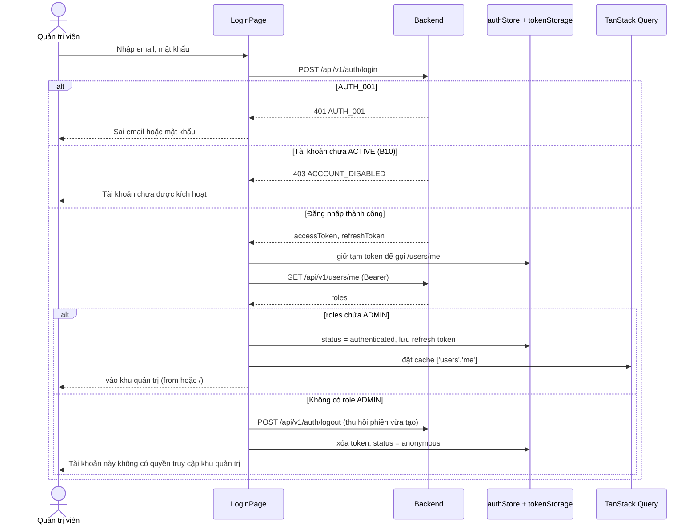
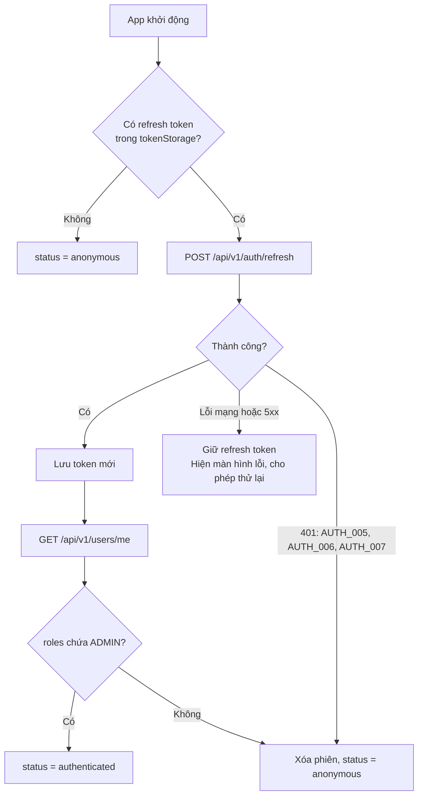
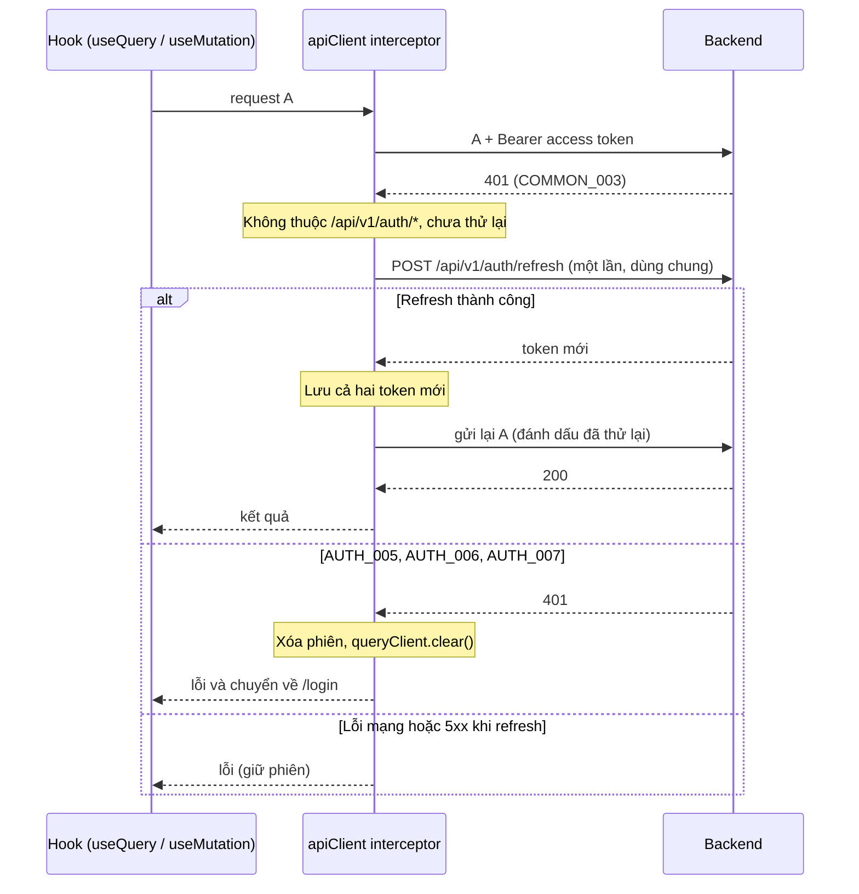

# 08 - Authentication and Authorization (Xác thực và phân quyền)

> **Trạng thái:** BẢN NHÁP v0.1
> **Cập nhật:** 2026-11-08
> **Áp dụng cho:** `Moldy-Market-Admin-Frontend`
> **Mục đích:** Mô tả cách ứng dụng quản trị đăng nhập, giữ phiên, làm mới token, và chỉ cho phép người có role `ADMIN` vào khu quản trị, dựa trên cách Backend thật sự hoạt động.

Nhãn dùng trong tài liệu:
- `[ĐÃ XÁC MINH BACKEND]`: có trong doc 14.
- `[ĐÃ CẤU HÌNH]`: đã thật sự có trong repo.
- `[ĐỀ XUẤT]`: kiến trúc dự kiến, **chưa có code**. Mọi tên hook, store, guard, hàm trong tài liệu này là `[ĐỀ XUẤT]`. Các đoạn code là ví dụ minh họa, chưa có trong repo.

Hai quyết định **CHƯA CHỐT**:
- **Q2**: lưu token ở đâu (mục 4).
- **Q1**: Frontend không đọc được permission code của user (mục 7).

---

## 1. Hiện trạng

- `[ĐÃ CẤU HÌNH]` Đã cài `axios`, `zustand`, `react-router`, `@tanstack/react-query`, `react-hook-form`, `zod`. Thư mục `src/services/auth`, `src/features/auth/*`, `src/state`, `src/app/router` đã tạo nhưng **trống**.
- Chưa có Axios instance, interceptor, store, guard, trang đăng nhập nào.

Khác với User Frontend: **Admin không có đăng ký, không có tự mở tài khoản**. Chỉ có một cửa vào là `/login`, và chỉ người có role `ADMIN` mới dùng được ứng dụng này.

---

## 2. Backend thật sự làm gì `[ĐÃ XÁC MINH BACKEND]`

Trích từ doc 14 mục 2.5, 3.1 đến 3.5. Admin dùng cùng các endpoint xác thực với User Frontend (Backend không có endpoint đăng nhập riêng cho admin).

| Chủ đề | Sự thật |
|---|---|
| Đăng nhập | `POST /api/v1/auth/login`, body `{ email(tối đa 254), password }`, trả `{ userId, email, fullName, accessToken, refreshToken, tokenType }`. **Không trả role.** |
| Refresh | `POST /api/v1/auth/refresh`, body `{ refreshToken }`, trả giống login. |
| Logout | `POST /api/v1/auth/logout`, body `{ refreshToken }`, không có `data`. Chỉ thu hồi phiên của refresh token gửi lên. |
| Thời hạn | Access token 15 phút, refresh token 30 ngày (**chỉ xác minh ở profile local**). |
| Claim JWT | `sub`, `email`, `tokenType = "ACCESS"`. Không có role hay permission. |
| Xoay vòng | Mỗi lần refresh, token cũ bị thu hồi. Dùng lại token đã thu hồi: `AUTH_007` và Backend **thu hồi mọi phiên** của user. |
| Role | `GET /api/v1/users/me` trả `roles: string[]`. Tên role: `USER`, `APPRAISER`, `STAFF`, `ADMIN`, `OWNER`. |
| Permission code | **Không có endpoint nào trả cho Frontend** (Q1). |
| Quyền khu admin | `@PreAuthorize` theo permission: `USER_STORE_MANAGE` (user, store), `PRODUCT_MODERATE`, `CATEGORY_MANAGE`. Permission `ADMIN_PORTAL_ACCESS` tồn tại nhưng Frontend không đọc được. |
| Tài khoản admin | Được tạo sẵn lúc khởi động (`RoleInitializer`, trạng thái `ACTIVE`). Đây là cách đáng tin duy nhất để có admin hiện nay (B10). |

Mã lỗi quan trọng:

| Mã | HTTP | Ý nghĩa | Frontend làm gì |
|---|---|---|---|
| `AUTH_001` | 401 | Sai email hoặc mật khẩu | Lỗi ở form đăng nhập, **không** refresh |
| `AUTH_003` / `AUTH_004` | 403 | Tài khoản bị khóa / bị vô hiệu | Thông báo, không vào được |
| `AUTH_005` / `AUTH_006` | 401 | Refresh token không hợp lệ / hết hạn | Xóa phiên, về `/login` |
| `AUTH_007` | 401 | Refresh token bị dùng lại, mọi phiên bị thu hồi | Xóa phiên, về `/login`, thông báo riêng |
| `COMMON_003` | 401 | Cần đăng nhập | Refresh một lần (mục 6) |
| `COMMON_004` | 403 | Không đủ quyền | Hiện "không có quyền", **không** xóa phiên |
| `COMMON_009` | 429 | Quá nhiều request | Thông báo thử lại sau |

Khi đăng nhập một tài khoản chưa `ACTIVE`, doc 14 mục 3.5 ghi Backend trả `ACCOUNT_DISABLED` (chưa xác định là `AUTH_003` hay `AUTH_004`; phải thử thật).

---

## 3. Mô hình phiên `[ĐỀ XUẤT]`

### 3.1 Ba nơi giữ thông tin

| Thông tin | Nơi giữ | Lý do |
|---|---|---|
| Access token | Bộ nhớ (store Zustand **không persist**) | Sống 15 phút; không nằm trong storage nên ít bị lộ khi có XSS |
| Refresh token | Qua một module duy nhất `lib/tokenStorage.js`, nơi lưu **CHƯA CHỐT** (Q2, mục 4) | Một chỗ để đổi |
| Thông tin user (`fullName`, `roles`...) | **TanStack Query**, key `['users','me']` | Dữ liệu từ server không để trong Zustand (doc 09) |

```js
// src/state/authStore.js (ví dụ minh họa, chưa có trong repo)
import { create } from 'zustand'

// status: 'unknown' (đang khôi phục phiên) | 'authenticated' | 'anonymous'
export const useAuthStore = create((set) => ({
  status: 'unknown',
  accessToken: null,
  setAccessToken: (accessToken) => set({ accessToken, status: 'authenticated' }),
  clearSession: () => set({ accessToken: null, status: 'anonymous' }),
}))

export const getAccessToken = () => useAuthStore.getState().accessToken
```

### 3.2 Phiên chỉ hợp lệ với admin

Khác User Frontend, trạng thái "đã đăng nhập" của Admin **chưa đủ**: phải kèm role `ADMIN`. Vì vậy `status === 'authenticated'` chỉ được đặt sau khi `GET /api/v1/users/me` xác nhận có `ADMIN`. Nếu đặt sớm hơn, ứng dụng có thể hiện giao diện admin trong tích tắc cho người không phải admin.

### 3.3 Đăng nhập và kiểm tra role



Điểm quan trọng: với người đăng nhập thành công nhưng **không phải admin** (ví dụ user thường nhập nhầm), phải **gọi logout** để thu hồi phiên vừa tạo ở Backend, đồng thời xóa token cục bộ, và **không lưu refresh token vào storage**. Nếu bỏ sót, một phiên hợp lệ treo lại mà không ai dùng.

### 3.4 Khôi phục phiên khi mở app



- Trong lúc `status === 'unknown'`, router hiển thị màn hình chờ, không render trang bảo vệ và không chuyển hướng.
- **Chỉ xóa refresh token khi Backend nói rõ** (`AUTH_005`, `AUTH_006`, `AUTH_007`). Lỗi mạng và `5xx` không xóa phiên.

### 3.5 Đăng xuất

1. Gọi `POST /api/v1/auth/logout` với `{ refreshToken }`.
2. **Dù thành công hay lỗi**, vẫn xóa token cục bộ, gọi `queryClient.clear()`, chuyển về `/login`.
3. `queryClient.clear()` bắt buộc: dữ liệu quản trị (danh sách user, store) nhạy cảm, không được để lại trong cache cho người dùng kế tiếp dùng chung máy.
4. Các tab Admin khác lắng nghe sự kiện `storage` để cũng về `anonymous`.

---

## 4. Nơi lưu refresh token: Q2 CHƯA CHỐT

Backend trả refresh token trong JSON body, nên cookie `httpOnly` đòi hỏi **Backend phải đổi**.

| Phương án | Tải lại trang | Đa tab | Rủi ro |
|---|---|---|---|
| A. `localStorage` | Giữ phiên | Dùng chung, dễ gặp xung đột refresh (mục 6.3) | XSS đọc được token sống 30 ngày |
| B. `sessionStorage` | Giữ phiên (cùng tab) | Mỗi tab một phiên | Như A, nhưng mất khi đóng tab; tránh xung đột đa tab |
| C. Chỉ trong bộ nhớ | **Mất phiên** | Mỗi tab riêng | Ít lộ nhất; phải đăng nhập lại mỗi lần tải |
| D. Cookie `httpOnly` do Backend set | Giữ phiên | Dùng chung | Chống XSS đọc token; cần chống CSRF, cần CORS đúng (B1); **phải sửa Backend** |

**Cân nhắc riêng cho Admin:** đây là ứng dụng quyền cao, dữ liệu nhạy cảm, nên cần thận trọng hơn User Frontend. Một lựa chọn hợp lý là phương án B hoặc C cho Admin (phiên ngắn hơn, ít tồn dư), kể cả khi User Frontend chọn A. Hai app chạy ở **origin khác nhau** nên storage của chúng tách biệt hoàn toàn (khi chạy dev đồng thời hai app, dùng hai cổng khác nhau, ví dụ `--port 5174`).

**Khuyến nghị tạm thời (chưa phải quyết định):** Admin dùng phương án B hoặc C; User dùng A; ghi D là hướng nâng cấp. **CHƯA CHỐT, cần team quyết định**, vì nó ảnh hưởng cả Backend.

Mọi đọc ghi refresh token đều đi qua `lib/tokenStorage.js`, bọc `try/catch` vì storage có thể bị chặn:

```js
// src/lib/tokenStorage.js (ví dụ minh họa, chưa có trong repo)
const KEY = 'mm.admin.refreshToken'

export const tokenStorage = {
  get() { try { return sessionStorage.getItem(KEY) } catch { return null } },
  set(token) { try { sessionStorage.setItem(KEY, token) } catch { /* bỏ qua */ } },
  clear() { try { sessionStorage.removeItem(KEY) } catch { /* bỏ qua */ } },
}
```

(Ví dụ dùng `sessionStorage` để minh họa; đổi thành `localStorage` hay bộ nhớ chỉ cần sửa file này.)

---

## 5. Không có đăng ký, không có tự phục vụ

- Admin Frontend **không có** trang đăng ký, quên mật khẩu, hay đổi mật khẩu (Backend có `PUT /api/v1/users/me/password` nhưng nó là chức năng hồ sơ cá nhân, không thuộc phạm vi Admin ở giai đoạn này).
- Tài khoản admin do Backend tạo (seed) hoặc do team cấp. Cơ chế cấp role `ADMIN` cho user khác **chưa có endpoint** trong doc 14; không dựng giao diện cho việc đó.

---

## 6. Xử lý 401 và refresh token `[ĐỀ XUẤT]`

Doc 07 mục 2.4 mô tả vị trí interceptor; đây là phần chi tiết (giống User Frontend, vì cùng Backend).



### 6.1 Quy tắc bắt buộc

1. **Single-flight:** giữ một `refreshPromise` ở mức module; mọi request nhận 401 cùng chờ nó. Vì Backend xoay vòng token, **hai lần refresh song song dùng cùng token** khiến lần hai bị coi là dùng lại (`AUTH_007`) và mọi phiên bị thu hồi.
2. **Mỗi request chỉ thử lại một lần** (cờ `_retried`); vẫn 401 thì đăng xuất, không lặp vô hạn.
3. **Không refresh cho `/api/v1/auth/*`.** `AUTH_001` cũng là 401.
4. **Chỉ xóa phiên với `AUTH_005`, `AUTH_006`, `AUTH_007`.** Lỗi mạng và `5xx` giữ phiên.
5. **Lưu cả access token và refresh token mới** sau mỗi lần refresh.
6. **Sau refresh phải kiểm tra lại role?** Role lấy từ `['users','me']`. Quản trị viên có thể bị gỡ role `ADMIN` trong lúc đang dùng; khi đó Backend trả `403` ở mỗi thao tác. Xử lý ở mục 8, không cần gọi lại `/users/me` sau mỗi lần refresh.

### 6.2 Rủi ro đa tab

Với phương án A (storage dùng chung giữa các tab), hai tab Admin cùng refresh sẽ gây `AUTH_007` và mất mọi phiên. Biện pháp: khóa liên tab bằng Web Locks API (`navigator.locks.request`), đọc lại refresh token mới nhất sau khi giành được khóa; hoặc dùng phương án B (mỗi tab một phiên) và rủi ro này biến mất.

### 6.3 Rủi ro không tránh được

Nếu Backend đã xoay vòng token mà phản hồi bị mất trên đường về, lần refresh kế tiếp bị `AUTH_007` và mọi phiên bị thu hồi. Đây là thuộc tính của Backend; Frontend chỉ thông báo rõ ràng.

| Tình huống | Thông báo gợi ý (qua i18n) |
|---|---|
| `AUTH_005` / `AUTH_006` | "Phiên đăng nhập đã hết hạn, vui lòng đăng nhập lại." |
| `AUTH_007` | "Vì lý do bảo mật, bạn đã bị đăng xuất khỏi tất cả thiết bị. Vui lòng đăng nhập lại." |
| Không có role `ADMIN` | "Tài khoản này không có quyền truy cập khu quản trị." |

Không in `message` tiếng Anh của Backend; ánh xạ `code` sang key i18n (doc 07).

---

## 7. Phân quyền trong khu quản trị

### 7.1 Nguyên tắc

> **Frontend không phải ranh giới bảo mật.** Ẩn nút chỉ để trải nghiệm tốt hơn. Backend kiểm tra quyền ở mỗi request (`hasAuthority(PERMISSION)`, tính lại từ role và permission) và là nơi quyết định cuối cùng. Với Admin điều này đặc biệt quan trọng vì các thao tác ở đây (đổi trạng thái user, gỡ sản phẩm) có tác động lớn.

### 7.2 Frontend biết và không biết gì

| Nhu cầu | Có không? | Hệ quả |
|---|---|---|
| Đã đăng nhập, có role `ADMIN` | Có (`roles` từ `/users/me`) | Guard `AdminRoute` |
| Từng permission code (`USER_STORE_MANAGE`, `PRODUCT_MODERATE`, `CATEGORY_MANAGE`, `ADMIN_PORTAL_ACCESS`) | **Không** (Q1) | Không thể ẩn nút theo từng permission một cách đáng tin |

Vì vậy một tài khoản có role `ADMIN` về nguyên tắc có đủ các permission này (Backend gán permission cho role, doc 14 mục 3.3), nhưng Frontend **không thể chắc**. Nếu có tài khoản được cấp thiếu một permission, thao tác tương ứng sẽ trả `403` dù menu hiện ra.

### 7.3 Guard `[ĐỀ XUẤT]`

Danh sách route và guard nằm ở **doc 04**; ở đây định nghĩa hành vi.

| Guard | Điều kiện | Khi không đạt |
|---|---|---|
| `AdminRoute` | `status === 'authenticated'` **và** `roles` chứa `ADMIN` | `unknown`: màn hình chờ. `anonymous`: chuyển `/login` kèm `state.from`. Có phiên nhưng không có `ADMIN`: xóa phiên, về `/login` với thông báo (không có trang "không có quyền" riêng vì không ai khác được vào app này). |

`/login` là trang duy nhất ngoài guard. Người đã là admin mà vào `/login` thì chuyển thẳng về `/`.

Chuyển hướng sau đăng nhập chỉ chấp nhận đường dẫn nội bộ (bắt đầu bằng `/`).

### 7.4 Điều hướng (sidebar)

- Mục sidebar hiện theo **mức hỗ trợ của Backend** (doc 04, doc 14 mục 4), không theo permission: các mục có Backend `IMPLEMENTED` (`/users`, `/stores`, `/products`, `/categories`) dùng được; các mục `NOT_FOUND`, `IN_PROGRESS`, `REQUIRES_BUSINESS_CLARIFICATION` hiển thị dạng khung trang `TODO`, có nhãn "Chưa có Backend" và **không gọi API**.
- Các trang chưa có Backend không được hiện số liệu giả.

### 7.5 Phương án tạm cho phân quyền chi tiết (đến khi Q1 được giải quyết)

1. Mọi thao tác ghi ở khu admin đều bọc xử lý `403`: hiện "Bạn không có quyền thực hiện thao tác này" và giữ nguyên trang, **không** đăng xuất.
2. Dùng một hàm `can(permission)` duy nhất ở giao diện để sau này thay bằng dữ liệu thật; trong lúc chưa có, `can()` trả `true` (cho phép thử) và `403` quyết định.
3. Khi Backend cung cấp permission (ví dụ mở rộng `/users/me`), chỉ cần thêm `usePermissions()` và các nút nối vào `can()`.

---

## 8. Xử lý 401 và 403 trên giao diện

| Mã | Ở đâu xử lý | Hành vi |
|---|---|---|
| 401 | Interceptor | Refresh một lần; thất bại thì xóa phiên |
| 403 `COMMON_004` | Hook `onError` hoặc lớp hiển thị lỗi chung | "Bạn không có quyền thực hiện thao tác này"; giữ phiên và trang hiện tại |
| 403 `AUTH_003` / `AUTH_004` | Lúc đăng nhập hoặc refresh | Thông báo tài khoản không dùng được; xóa phiên |
| 429 `COMMON_009` | Lớp hiển thị lỗi chung | Thông báo thử lại sau |

Trên trang: 403 khi **đọc** dữ liệu hiển thị `ForbiddenState` thay vì trang trống (doc 06).

Nếu một lời gọi trả `403` hàng loạt sau khi vừa dùng bình thường (dấu hiệu role `ADMIN` bị gỡ), cho phép người dùng bấm "Tải lại quyền" (gọi lại `['users','me']`); nếu không còn `ADMIN` thì xóa phiên và về `/login`.

---

## 9. Bảo mật phía Frontend (checklist)

- Không ghi token ra `console`, log hay công cụ theo dõi lỗi.
- Không đặt token trong URL hay query string.
- Không dùng `dangerouslySetInnerHTML` với dữ liệu người dùng (tên gian hàng, mô tả sản phẩm, lý do gỡ...). Khu admin hiển thị nhiều nội dung do người khác nhập, nên XSS ở đây nguy hiểm hơn.
- Nhớ rằng nút "Gỡ sản phẩm" cần `reason`: nội dung này hiển thị lại cho người khác, phải render như văn bản thuần.
- Biến môi trường `VITE_*` lộ ra bundle; không đặt bí mật vào đó.
- Khi triển khai production: đặt Admin ở origin riêng và hạn chế truy cập (mạng nội bộ, VPN hoặc IP allowlist) nếu có thể; Backend vẫn chưa có CORS (B1), xem doc 12.
- B2: trên các branch chưa merge, nhiều endpoint admin (escrow, withdrawal, voucher admin, pricing admin) **chưa có kiểm tra quyền**. Giao diện admin không được xem việc ẩn nút là đủ; khi các endpoint đó được dựng, cần Backend bổ sung `@PreAuthorize` trước.
- B10: không có UI để kích hoạt tài khoản `PENDING_VERIFICATION` ngoài `PUT /api/v1/users/{id}/status` ở trang chi tiết user; đây là việc admin hiện phải làm.

---

## 10. Câu hỏi mở liên quan

| Mã | Câu hỏi | Ảnh hưởng |
|---|---|---|
| Q1 | Biết permission code bằng cách nào? | Guard, ẩn nút theo quyền |
| Q2 | Lưu token ở đâu? | `tokenStorage`, mục 4 |
| Q14 | Luồng kích hoạt tài khoản (B10) | Cách admin duyệt tài khoản mới |

---

## Tài liệu liên quan

- 04 - Routing and Pages: danh sách route, `AdminRoute`.
- 05 - Page-by-Page Guide: trang đăng nhập, chi tiết user.
- 06 - Component Architecture: `ForbiddenState`, `AdminLayout`.
- 07 - API Integration: Axios instance, interceptor, `ApiError`.
- 09 - State Management: store phiên, query `['users','me']`.
- 12 - Environment and Deployment: CORS, origin riêng cho Admin.
- 14 - Backend Integration Matrix: mục 2.5, 3.1 đến 3.5, B1, B2, B10, Q1, Q2, Q14.
