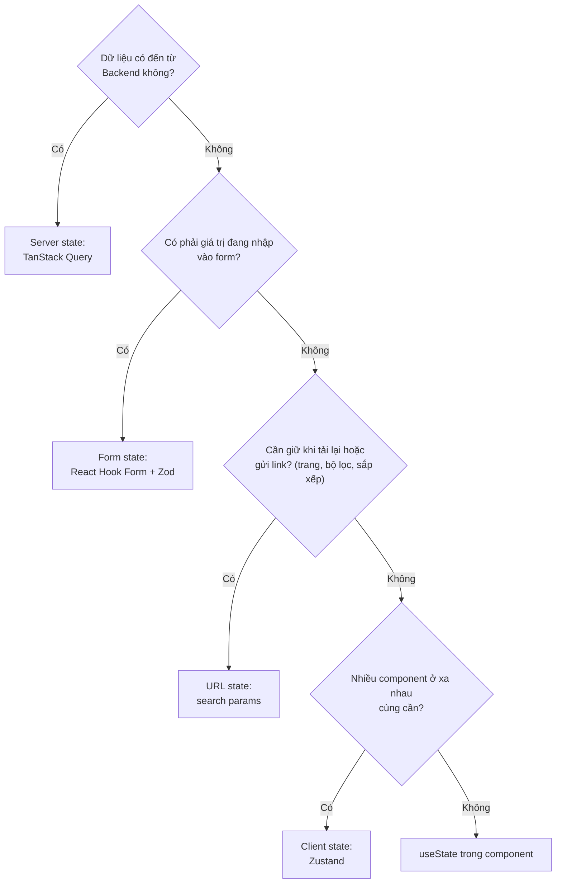
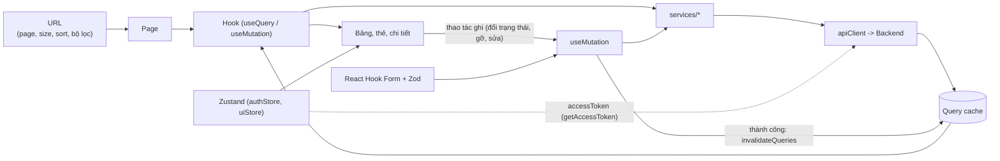

# 09 - State Management (Quản lý state)

> **Trạng thái:** BẢN NHÁP v0.1
> **Cập nhật:** 2026-11-08
> **Áp dụng cho:** `Moldy-Market-Admin-Frontend`
> **Mục đích:** Quy định mỗi loại dữ liệu trong ứng dụng quản trị được giữ ở đâu (TanStack Query, Zustand, React Hook Form, URL, state cục bộ) và vì sao. Admin chủ yếu là bảng dữ liệu, bộ lọc và thao tác ghi, nên tài liệu nhấn mạnh phân trang, bảng và invalidation.

Nhãn dùng trong tài liệu:
- `[ĐÃ XÁC MINH BACKEND]`: có trong doc 14.
- `[ĐÃ CẤU HÌNH]`: đã thật sự có trong repo.
- `[ĐỀ XUẤT]`: kiến trúc dự kiến, **chưa có code**. Mọi tên hook, store, query key trong tài liệu này là `[ĐỀ XUẤT]`. Các đoạn code là ví dụ minh họa, chưa có trong repo.

---

## 1. Hiện trạng

- `[ĐÃ CẤU HÌNH]` Đã cài `@tanstack/react-query` 5, `zustand` 5, `react-hook-form` 7, `zod` 4, `@hookform/resolvers`, `react-router` 7.
- `[ĐÃ CẤU HÌNH]` Thư mục `src/state`, `src/hooks`, `src/app/providers`, `features/*/hooks`, `features/*/schemas` đã tạo, đang trống (`.gitkeep`).
- Chưa có `QueryClient`, store, hook, schema nào.

Phạm vi Admin `[ĐÃ XÁC MINH BACKEND]`: chỉ có Backend ổn định cho `users`, `stores`, `products` (kiểm duyệt), `categories`. Các phần còn lại là khung trang, không có state API.

---

## 2. Năm loại state và nơi giữ chúng `[ĐỀ XUẤT]`

| Loại | Ví dụ trong Admin | Công cụ | Nằm ở |
|---|---|---|---|
| Server state | Danh sách user, chi tiết store, cây danh mục, sản phẩm cần kiểm duyệt | **TanStack Query** | `features/*/hooks` |
| Client state (giao diện thuần) | Sidebar thu gọn, ngôn ngữ, access token trong bộ nhớ | **Zustand** | `state/` |
| Form state | Form thêm/sửa danh mục, form nhập lý do gỡ sản phẩm | **React Hook Form + Zod** | `features/*/schemas` và component |
| URL state | Trang, kích thước trang, sắp xếp, bộ lọc của bảng | **React Router** (`useSearchParams`) | trang |
| State cục bộ | Dialog xác nhận đang mở, hàng đang chọn | `useState` | component |



Quy tắc: **mỗi dữ liệu chỉ có một nguồn sự thật**. Đừng sao chép dữ liệu server sang chỗ khác.

---

## 3. TanStack Query (server state)

### 3.1 Là gì, vì sao dùng

TanStack Query quản lý **gọi API, cache, đánh dấu cũ (stale), tải lại và đồng bộ**. Nếu tự viết bằng `useEffect` + `useState`, mỗi trang sẽ lặp lại logic loading, error, tải lại, và gặp lỗi cổ điển: gọi trùng, race condition khi đổi trang nhanh, dữ liệu bảng cũ sau khi vừa sửa. Mỗi truy vấn có một **query key**; cùng key thì dùng chung cache; hết `staleTime` thì lần dùng kế tiếp tải lại ngầm trong khi vẫn hiện dữ liệu cũ.

### 3.2 Phân tầng

```
component  ->  hook (features/<module>/hooks)  ->  service (services/<module>)  ->  apiClient
```

`services/` là hàm async thuần (doc 07); hook bọc bằng `useQuery` / `useMutation`; **component không gọi service trực tiếp**.

### 3.3 Cấu hình `QueryClient` (mặc định đề xuất)

```js
// src/app/providers/queryClient.js (ví dụ minh họa, chưa có trong repo)
import { QueryClient } from '@tanstack/react-query'

export const queryClient = new QueryClient({
  defaultOptions: {
    queries: {
      staleTime: 15_000, // dữ liệu quản trị cần tươi hơn trang công khai
      gcTime: 5 * 60_000,
      refetchOnWindowFocus: true, // admin quay lại tab sẽ thấy dữ liệu mới
      retry: (failureCount, error) => {
        if (error?.status >= 400 && error?.status < 500) return false
        return failureCount < 2
      },
    },
    mutations: { retry: false }, // thao tác ghi không tự thử lại
  },
})
```

Các con số là giá trị khởi đầu. `retry: false` cho mutation là có chủ đích: thao tác như đổi trạng thái user hay gỡ sản phẩm không nên tự gửi lại khi mạng chập chờn.

### 3.4 Query key: quy ước

Key đi từ tổng quát đến cụ thể và **chứa mọi tham số ảnh hưởng đến kết quả**. Mỗi feature có key factory (ví dụ minh họa):

```js
// src/features/users/hooks/userKeys.js (ví dụ minh họa)
export const userKeys = {
  all: ['users'],
  list: (params) => ['users', 'list', params],
  detail: (id) => ['users', 'detail', id],
}
```

Bảng key đề xuất, chỉ cho endpoint `IMPLEMENTED` `[ĐÃ XÁC MINH BACKEND]`:

| Key | Endpoint | Ghi chú |
|---|---|---|
| `['users','me']` | `GET /api/v1/users/me` | Hồ sơ và `roles` của admin đang đăng nhập (doc 08) |
| `['users','list', params]` | `GET /api/v1/users` | `PagedResponse`, `page` từ 1 |
| `['users','detail', id]` | `GET /api/v1/users/{id}` | |
| `['stores','list', params]` | `GET /api/v1/stores` | `PagedResponse` |
| `['stores','detail', id]` | `GET /api/v1/stores/{id}` | Endpoint công khai; chưa audit có đủ trường cho nhu cầu admin |
| `['products','list', params]` | `GET /api/v1/products/search` hoặc `GET /api/v1/products` | Tham số của `GET /products` chưa audit (xem câu hỏi AQ1 ở doc 04) |
| `['products','detail', id]` | `GET /api/v1/products/{id}` | |
| `['categories','tree']` | `GET /api/v1/categories` | Cây, ít đổi |
| `['categories','detail', id]` | `GET /api/v1/categories/{id}` | |

Với `params`: loại bỏ giá trị `undefined` và chuẩn hóa thứ tự trước khi đưa vào key, để `{ page: 1 }` và `{ page: 1, sort: undefined }` không thành hai cache khác nhau. Không đưa object chứa hàm hay giá trị không serialize được vào key.

### 3.5 Bảng dữ liệu phân trang

`[ĐÃ XÁC MINH BACKEND]` (doc 14 mục 2.2): danh sách user và store trả `PagedResponse { content, page, size, hasNext, totalElements }`.

- `page` **bắt đầu từ 1**; `size` tối đa 100, mặc định 20; có tham số `sort`.
- `totalElements` có thể là `null` (Backend dùng Slice). Khi đó **không hiện tổng số trang hay "trang X/Y"**; dùng `hasNext` để bật/tắt nút "Trang sau" và hiện "Trang X".
- Dùng `placeholderData: keepPreviousData` để bảng giữ nội dung cũ khi đổi trang, tránh chớp trắng.

```js
// src/features/users/hooks/useUserList.js (ví dụ minh họa)
import { keepPreviousData, useQuery } from '@tanstack/react-query'
import { getUsers } from '@/services/users/userService'
import { userKeys } from './userKeys'

export function useUserList(params) {
  return useQuery({
    queryKey: userKeys.list(params),
    queryFn: () => getUsers(params),
    placeholderData: keepPreviousData,
  })
}
```

Phân trang, sắp xếp và bộ lọc của bảng **nằm trên URL** (mục 6), không nằm trong Zustand hay `useState`, để làm mới trang hoặc gửi link vẫn giữ nguyên chế độ xem. Danh sách tham số lọc được Backend hỗ trợ cho `/users` và `/stores` chưa được audit; không thêm bộ lọc nào chưa chắc. Giữ đúng `page`, `size`, `sort` đã xác minh.

### 3.6 Mutation và invalidation

| Thao tác (`IMPLEMENTED`) | Quyền | Invalidate |
|---|---|---|
| `PUT /api/v1/users/{id}/status` | `USER_STORE_MANAGE` | `['users','detail', id]`, `['users','list']` |
| `PUT /api/v1/stores/{id}/status` | `USER_STORE_MANAGE` | `['stores','detail', id]`, `['stores','list']` |
| `PUT /api/v1/products/{id}/remove` (body `{ reason }`) | `PRODUCT_MODERATE` | `['products','detail', id]`, `['products','list']` |
| `PUT /api/v1/products/{id}/restore` | `PRODUCT_MODERATE` | như trên |
| `POST /api/v1/categories` | `CATEGORY_MANAGE` | `['categories','tree']` |
| `PUT /api/v1/categories/{id}` | `CATEGORY_MANAGE` | `['categories','tree']`, `['categories','detail', id]` |
| `DELETE /api/v1/categories/{id}` (không có body trả về) | `CATEGORY_MANAGE` | `['categories','tree']`, `removeQueries` cho `['categories','detail', id]` |

Ghi chú:
- Gọi `invalidateQueries({ queryKey: ['users','list'] })` khớp mọi key bắt đầu bằng tiền tố đó, kể cả các trang và bộ lọc khác nhau, nên các bảng cũ không còn hiển thị dữ liệu lỗi thời.
- **Không dùng cập nhật lạc quan** cho thao tác quản trị: trạng thái và quyền do Backend quyết định, thao tác lỗi `403` hay bị từ chối không được "giả thành công" rồi hoàn tác. Cho nút chuyển sang trạng thái chờ, rồi cập nhật bằng dữ liệu thật sau khi invalidate.
- `DELETE` không có body: lớp service không được giả định luôn có `response.data.data` (doc 14 mục 2.1).
- Mỗi thao tác có tác động lớn (đổi trạng thái user, gỡ sản phẩm, xóa danh mục) cần hộp thoại xác nhận (component, xem doc 06).

### 3.7 Trạng thái user và store `[ĐÃ XÁC MINH BACKEND]`

- `UserStatus`: `ACTIVE`, `LOCKED`, `PENDING_VERIFICATION`. `StoreStatus`: `ACTIVE`, `BLOCKED`.
- B10: tài khoản mới đăng ký ở `PENDING_VERIFICATION` chưa đăng nhập được; admin chuyển sang `ACTIVE` là cách duy nhất hiện nay. Danh sách user cần cho phép nhận ra các tài khoản này (cột trạng thái). Lọc theo trạng thái chỉ làm nếu Backend hỗ trợ tham số đó (chưa audit).
- Danh sách trạng thái chuyển hợp lệ (ví dụ `LOCKED` sang `PENDING_VERIFICATION` có được không) chưa được đọc; đừng chặn hay cho phép trên giao diện bằng phỏng đoán, để Backend trả lỗi.

### 3.8 Cache và phiên đăng nhập

- Đăng xuất hoặc phiên bị thu hồi: `queryClient.clear()` bắt buộc (doc 08). Dữ liệu quản trị nhạy cảm không được ở lại.
- Mọi query khu admin đặt `enabled: status === 'authenticated'`.
- Lỗi `401` được interceptor xử lý trước khi tới hook.

### 3.9 Xử lý lỗi và loading

| Trạng thái | Hiển thị |
|---|---|
| `isPending` (lần tải đầu) | Skeleton của bảng/thẻ (doc 06) |
| `isFetching && !isPending` | Chỉ báo nhỏ ở bảng, không che nội dung |
| `isError` | `ErrorState` kèm nút thử lại |
| Dữ liệu rỗng | `EmptyState` (khác với lỗi) |
| `403` | `ForbiddenState` hoặc thông báo trong thao tác ghi (doc 08) |

Message hiển thị lấy từ i18n theo `error.code`, không in `message` tiếng Anh của Backend.

### 3.10 Trang chưa có Backend

Các trang `NOT_FOUND`, `IN_PROGRESS`, `REQUIRES_BUSINESS_CLARIFICATION` (dashboard, transactions, escrow, complaints, appraisers, vouchers, reports, settings) **không có hook, không có query key, không gọi API** (doc 14 mục 1.2). Chỉ có khung trang `TODO`. Không tạo dữ liệu giả vào cache hay store để "cho đẹp".

---

## 4. Zustand (client state)

### 4.1 Dùng cho gì, không dùng cho gì

| Dùng | Không dùng |
|---|---|
| `authStore`: `status`, `accessToken` (bộ nhớ, không persist) | Dữ liệu từ API (danh sách user, store, sản phẩm...) |
| `uiStore`: sidebar thu gọn, ngôn ngữ | Trang, sắp xếp, bộ lọc của bảng (thuộc URL) |
| | Trạng thái form |

**Vì sao không lưu response API trong Zustand:** bạn sẽ tự viết lại cache, hết hạn, loại bỏ trùng và đồng bộ sau khi ghi, tức là viết lại TanStack Query, và viết sai. Hai nguồn sự thật cho cùng dữ liệu sẽ lệch nhau: ví dụ danh sách user trong Zustand vẫn hiện `PENDING_VERIFICATION` sau khi admin đã kích hoạt. Hồ sơ admin nằm ở `['users','me']`; trong Zustand chỉ có `status` và token (doc 08).

### 4.2 Quy ước

- Thư mục `state/`, không phải `stores/` (tránh nhầm với gian hàng, doc 02) `[ĐÃ CẤU HÌNH]`. Một file một store: `authStore.js`, `uiStore.js`.
- **Luôn dùng selector:**

```js
// Đúng
const sidebarOpen = useUiStore((s) => s.sidebarOpen)
// Sai: re-render mỗi khi bất kỳ giá trị nào trong store đổi
const { sidebarOpen } = useUiStore()
```

- Hành động đặt tên là động từ (`toggleSidebar`, `clearSession`). Ngoài React (interceptor) đọc bằng `useAuthStore.getState()`.

### 4.3 Persist

Chỉ persist giá trị giao diện thuần (`language`, `sidebarCollapsed`) bằng middleware `persist`, bọc an toàn vì storage có thể bị chặn. **Không persist access token.** Refresh token đi qua `lib/tokenStorage.js` (Q2, doc 08), không qua `persist`.

```js
// src/state/uiStore.js (ví dụ minh họa, chưa có trong repo)
import { create } from 'zustand'
import { persist } from 'zustand/middleware'

export const useUiStore = create(
  persist(
    (set) => ({
      language: 'vi',
      sidebarCollapsed: false,
      setLanguage: (language) => set({ language }),
      toggleSidebar: () => set((s) => ({ sidebarCollapsed: !s.sidebarCollapsed })),
    }),
    { name: 'mm.admin.ui' },
  ),
)
```

Key lưu trữ có tiền tố `mm.admin.` để phân biệt với User Frontend nếu hai app vô tình chạy chung origin.

---

## 5. React Hook Form + Zod (form state)

### 5.1 Vì sao

React Hook Form giữ giá trị và lỗi của form mà không re-render cả form mỗi lần gõ; Zod mô tả luật validation ở một nơi; `zodResolver` nối hai thứ.

### 5.2 Vị trí và ràng buộc

- Schema ở `features/<module>/schemas/`. Admin có form ở: `auth` (đăng nhập) và `categories` (thêm, sửa), cộng với hộp thoại nhập `reason` khi gỡ sản phẩm (nhỏ, có thể đặt schema cục bộ trong `features/products`). Các thao tác đổi trạng thái user và store chỉ là chọn giá trị, không cần form phức tạp.
- Luật lấy từ Backend (doc 14), Backend vẫn quyết định cuối cùng.
- Thông báo lỗi dùng key i18n.

| Form | Ràng buộc |
|---|---|
| Đăng nhập | `email` tối đa 254; `password` bắt buộc (`[ĐÃ XÁC MINH BACKEND]`) |
| Gỡ sản phẩm | Body `{ reason }`; **độ dài và bắt buộc của `reason` chưa được audit** trong doc 14. Yêu cầu không rỗng ở Frontend (để phản hồi sớm), để Backend trả `COMMON_001` nếu sai. Ghi `TODO` kiểm tra ràng buộc thật. |
| Thêm, sửa danh mục | **DTO của category chưa được audit chi tiết** trong doc 14. Chỉ dựng ràng buộc cơ bản (tên không rỗng), đánh dấu `TODO`, và để Backend trả lỗi. Không bịa trường như `slug`, `icon`, `sortOrder`. |
| Đổi trạng thái user | Giá trị thuộc `UserStatus` (`ACTIVE`, `LOCKED`, `PENDING_VERIFICATION`). Cấu trúc body của `PUT /users/{id}/status` chưa liệt kê trong doc 14: cần đọc trước khi viết service. |
| Đổi trạng thái store | Giá trị thuộc `StoreStatus` (`ACTIVE`, `BLOCKED`). Như trên. |

### 5.3 Lỗi từ server

- `COMMON_001` (validation thất bại): các trường khác của `ApiError.data` **chưa được đọc**, nên chưa chắc Backend có trả lỗi theo từng trường. Hiện lỗi chung ở đầu form, không ánh xạ lỗi vào từng ô bằng `setError` cho đến khi kiểm chứng.
- Lỗi nghiệp vụ (ví dụ `CAT_*`): hiện thông báo theo `code`; mã cụ thể chưa liệt kê hết trong doc 14, xem `ErrorCode.java`.
- `403`: hiện "không có quyền" (doc 08), form không bị đóng mất dữ liệu đang nhập.

### 5.4 Form sửa

Dữ liệu ban đầu đến từ TanStack Query. Dùng `reset(data)` khi dữ liệu về, và chỉ khi người dùng chưa chỉnh sửa để tải lại ngầm không ghi đè phần đang nhập. Sửa danh mục thì dữ liệu lấy từ `['categories','detail', id]` hoặc từ cây đã có.

---

## 6. URL state (rất quan trọng với Admin)

Bảng quản trị phải **chia sẻ và khôi phục được** qua URL:

| Thông tin | Ở URL | Ghi chú |
|---|---|---|
| Trang | `?page=2` | `page` bắt đầu từ **1** `[ĐÃ XÁC MINH BACKEND]` |
| Kích thước trang | `?size=20` | Tối đa 100 |
| Sắp xếp | `?sort=...` | Giá trị `sort` hợp lệ cho từng danh sách chưa audit; chỉ dùng giá trị chắc chắn |
| Bộ lọc | tham số tương ứng | Chỉ những bộ lọc Backend thật sự hỗ trợ |

- Hook đọc bằng `useSearchParams`, chuẩn hóa kiểu (số, boolean) có kiểm tra, bỏ giá trị không hợp lệ rồi đưa vào query key (mục 3.4).
- Khi đổi bộ lọc hoặc sắp xếp, đặt lại `page = 1`.
- Dùng `replace` thay vì `push` khi thay đổi ô tìm kiếm đang gõ để không làm đầy lịch sử trình duyệt.
- Tham số bộ lọc cụ thể của từng danh sách: doc 05 và doc 07.

---

## 7. Luồng dữ liệu và đồng bộ



Đồng bộ:
1. **Sau khi ghi:** invalidate các key liên quan (mục 3.6). Không sửa tay cache và không dùng `useEffect`.
2. **Quay lại tab:** `refetchOnWindowFocus` cập nhật bảng (admin thường mở nhiều tab).
3. **Nhiều admin cùng làm việc:** Backend không có kênh đẩy, nên người khác thay đổi sẽ chỉ hiện khi tải lại hoặc lấy lại focus. Khi thao tác ghi gặp dữ liệu đã đổi, xử lý theo lỗi Backend trả; Admin không cần cơ chế khóa riêng (khóa lạc quan `COMMON_010` chỉ áp dụng cho cập nhật product, và Admin không sửa nội dung product).
4. **Đăng xuất đồng bộ giữa tab:** qua sự kiện `storage` (doc 08).

---

## 8. Những điều không được làm (anti-pattern)

| Không làm | Làm thay vào đó |
|---|---|
| `useEffect` + `useState` để tải dữ liệu bảng | `useQuery` |
| Sao chép dữ liệu `useQuery` vào `useState` hay Zustand | Dùng trực tiếp dữ liệu từ hook |
| Để trang, sắp xếp, bộ lọc trong state cục bộ hay Zustand | Đưa vào URL |
| Gọi `services/*` thẳng trong component | Qua hook của feature |
| Viết query key bằng tay ở nhiều file | Key factory |
| Subscribe cả store: `useStore()` | Selector |
| Cập nhật lạc quan cho thao tác quản trị | `invalidateQueries`, chờ dữ liệu Backend |
| Quên `queryClient.clear()` khi đăng xuất | Luôn xóa cache khi mất phiên |
| `retry` cho mutation ghi | `retry: false` |
| Hiện số liệu giả ở trang chưa có Backend | Khung trang `TODO` |
| Chặn thao tác bằng phỏng đoán quy tắc chuyển trạng thái | Để Backend trả lỗi, hiển thị theo `code` |
| Hiện "trang X/Y" khi `totalElements` là `null` | Dùng `hasNext` |

---

## 9. Câu hỏi mở liên quan

| Mã | Câu hỏi | Ảnh hưởng |
|---|---|---|
| Q1 | Permission code của admin? | Có thể cần thêm query hoặc mở rộng `['users','me']` |
| Q2 | Nơi lưu token? | `lib/tokenStorage.js` |
| Q14 | Luồng kích hoạt tài khoản (B10) | Cách trang user trình bày `PENDING_VERIFICATION` |
| AQ1 | `GET /products` hay `/products/search` cho trang kiểm duyệt? Tham số `GET /products` chưa audit | Hook danh sách sản phẩm kiểm duyệt (xem doc 04) |

---

## Tài liệu liên quan

- 02 - Frontend Architecture: vì sao `state/`, phân lớp tổng thể.
- 04 - Routing and Pages: route, tham số URL, câu hỏi AQ1.
- 05 - Page-by-Page Guide: bảng, bộ lọc, form từng trang.
- 06 - Component Architecture: skeleton, `EmptyState`, `ErrorState`, `ForbiddenState`, hộp thoại xác nhận.
- 07 - API Integration: `apiClient`, `ApiError`, adapter phân trang.
- 08 - Authentication and Authorization: store phiên, token, 401/403.
- 14 - Backend Integration Matrix: mục 2.1, 2.2, 2.5, 4.1, B10.
