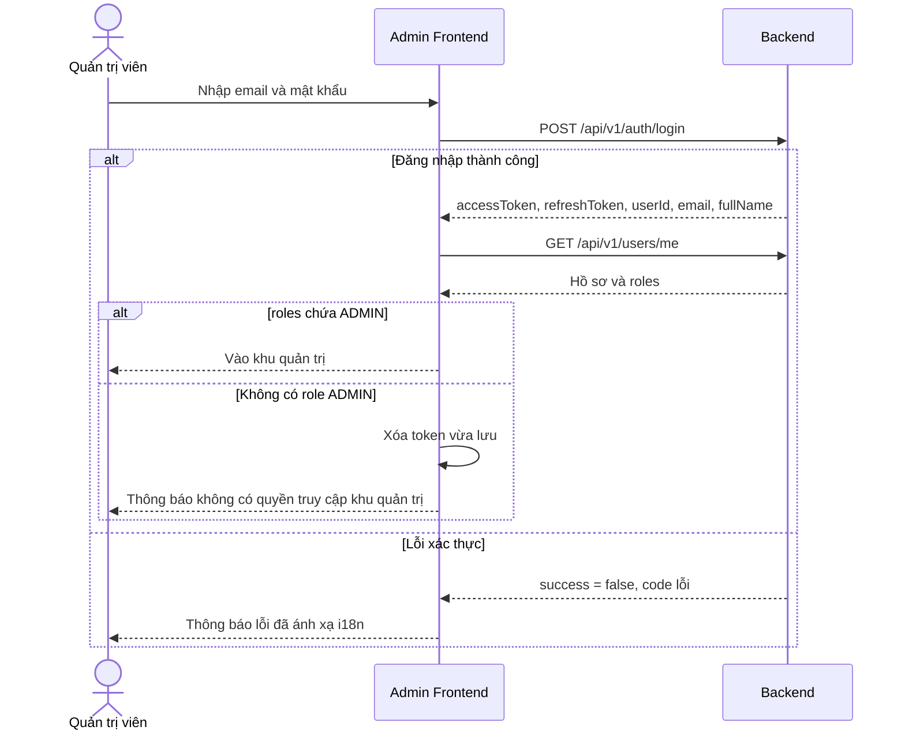
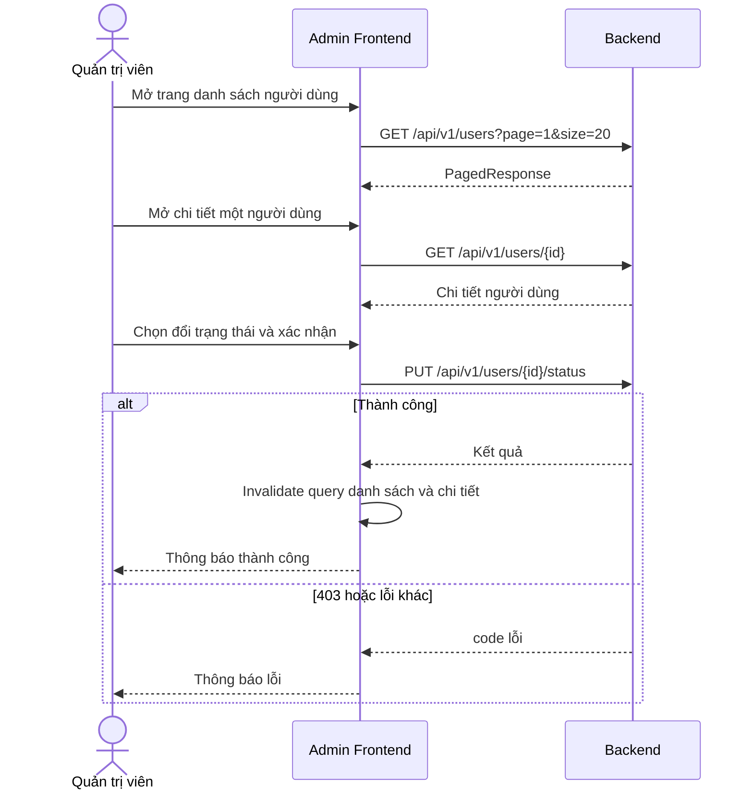
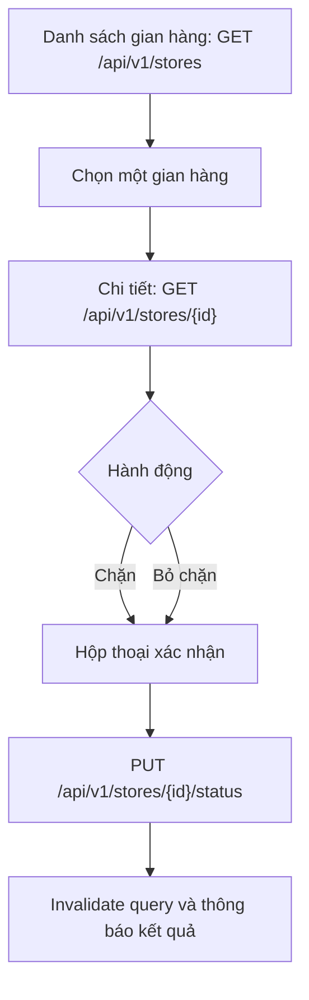
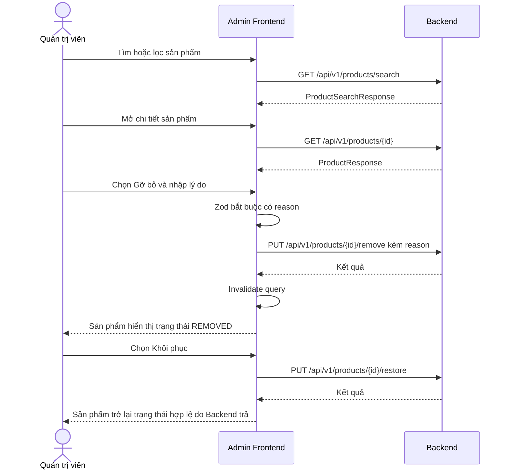
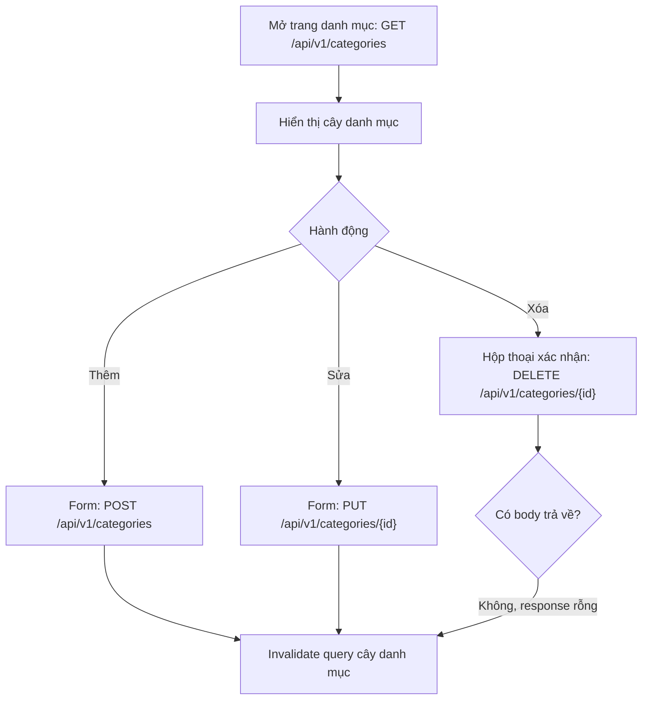

# 10 - Feature Flows (Luồng nghiệp vụ theo tính năng)

> **Trạng thái:** BẢN NHÁP v0.1
> **Cập nhật:** 2026-11-08
> **Áp dụng cho:** `Moldy-Market-Admin-Frontend`
> **Mục đích:** Mô tả từng luồng nghiệp vụ của quản trị viên từ góc nhìn Frontend: admin làm gì, Frontend gọi gì, Backend trả gì, lỗi nào phải xử lý. Chỉ những luồng có Backend hỗ trợ mới có sơ đồ; phần còn lại được ghi rõ là chưa có.

---

## 0. Cách đọc tài liệu này

Mọi luồng bên dưới đều thuộc loại `[ĐỀ XUẤT]` về phía Frontend, vì **Admin Frontend chưa có code ứng dụng nào** (mọi tính năng `NOT_STARTED`). Các sơ đồ mô tả cách Frontend **sẽ** hoạt động.

Nhãn dùng trong tài liệu:

- `[ĐÃ XÁC MINH BACKEND]`: có trong doc 14.
- `[ĐỀ XUẤT]`: thiết kế Frontend dự kiến.
- `IMPLEMENTED`, `IN_PROGRESS`, `PLANNED`, `NOT_FOUND`, `REQUIRES_BUSINESS_CLARIFICATION`: trạng thái Backend theo doc 14 mục 1.1.

Tài liệu này **không lặp lại bảng route**. Route, layout và quyền của từng trang nằm ở [04-ROUTING-AND-PAGES.md](./04-ROUTING-AND-PAGES.md); chi tiết từng màn hình ở [05-PAGE-BY-PAGE-GUIDE.md](./05-PAGE-BY-PAGE-GUIDE.md).

**Nguyên tắc nền của Admin:** Admin Frontend **không phải ranh giới bảo mật**. Ẩn một nút hay một trang chỉ để dễ dùng. Backend mới là chốt chặn thật, và trên các branch chưa merge nhiều endpoint admin còn chưa có kiểm tra quyền (B2). Vì vậy Admin Frontend chỉ làm các luồng mà Backend hiện có và chỉ viết service cho endpoint `IMPLEMENTED`.

### Bảng tổng hợp

| # | Luồng | Backend | Frontend | Chặn bởi |
|---|---|---|---|---|
| 1 | Đăng nhập khu quản trị | `IMPLEMENTED` | `NOT_STARTED` | Q1, Q2, B10 |
| 2 | Quản lý người dùng và kích hoạt tài khoản | `IMPLEMENTED` | `NOT_STARTED` | Q14 |
| 3 | Quản lý gian hàng | `IMPLEMENTED` | `NOT_STARTED` | Không |
| 4 | Kiểm duyệt sản phẩm | `IMPLEMENTED` | `NOT_STARTED` | Danh sách sản phẩm chưa audit |
| 5 | Quản lý danh mục | `IMPLEMENTED` | `NOT_STARTED` | Không |
| 6 | Xác nhận đã thu tiền COD | `IN_PROGRESS` (`feature/order`) | `NOT_STARTED` | Q12, Q15, Q18, thiếu endpoint danh sách order |
| 7 | Escrow | `IN_PROGRESS` | `NOT_STARTED` | B2, Q4, Q18 |
| 8 | Thẩm định viên, voucher, reference price | `IN_PROGRESS` | `NOT_STARTED` | B2, DTO chưa audit, Q12 |
| 9 | Dashboard, giao dịch, khiếu nại, báo cáo, cài đặt, refund, dispute | `NOT_FOUND` hoặc `REQUIRES_BUSINESS_CLARIFICATION` | `NOT_STARTED` | Backend chưa có |

---

## 1. Đăng nhập khu quản trị

**Trạng thái:** Backend `IMPLEMENTED`. Frontend `NOT_STARTED`.

### 1.1 `[ĐÃ XÁC MINH BACKEND]`

- Dùng chung `POST /api/v1/auth/login`, `POST /api/v1/auth/refresh`, `POST /api/v1/auth/logout` với User Frontend. Không có endpoint đăng nhập riêng cho admin.
- `GET /api/v1/users/me` trả `roles: string[]`. Tên role: `USER`, `APPRAISER`, `STAFF`, `ADMIN`, `OWNER`.
- JWT không chứa role hay permission. **Chưa có endpoint nào trả permission code** của user hiện tại (Q1). Permission `ADMIN_PORTAL_ACCESS` tồn tại trong `PermissionConstants` nhưng Frontend không đọc được.
- Tài khoản admin được tạo lúc khởi động (`RoleInitializer`) ở trạng thái `ACTIVE`, nên đăng nhập được (doc 14 mục 3.5).
- Mã lỗi: `AUTH_001` (sai thông tin), `AUTH_003` và `AUTH_004` (khóa hoặc vô hiệu), `COMMON_009` (rate limit).

### 1.2 Sơ đồ `[ĐỀ XUẤT]`

### 1.3 Điểm cần chú ý

1. **Kiểm tra `ADMIN` ở Frontend chỉ là lớp thân thiện.** Nếu user không phải admin mà vẫn vào được giao diện (do lỗi hay do sửa trình duyệt), các endpoint có `@PreAuthorize` vẫn trả `403 COMMON_004`. Frontend phải luôn xử lý `403` như quyết định cuối.
2. **Bước kiểm tra role xảy ra sau khi đã có token**, nên khi không phải admin phải **xóa token** vừa nhận, tránh để lại phiên của người dùng thường trong ứng dụng admin.
3. Nơi lưu token **CHƯA CHỐT** (Q2). Cơ chế refresh, xử lý 401 và `AUTH_007` xem [08-AUTHENTICATION-AND-AUTHORIZATION.md](./08-AUTHENTICATION-AND-AUTHORIZATION.md).
4. Mỗi endpoint admin có permission riêng (`USER_STORE_MANAGE`, `PRODUCT_MODERATE`, `CATEGORY_MANAGE`). Một tài khoản có role `ADMIN` nhưng thiếu permission cụ thể sẽ nhận `403` ở endpoint tương ứng; Frontend không biết trước điều này (Q1).

---

## 2. Quản lý người dùng và kích hoạt tài khoản

**Trạng thái:** Backend `IMPLEMENTED`. Frontend `NOT_STARTED`. Quyền `USER_STORE_MANAGE`.

### 2.1 `[ĐÃ XÁC MINH BACKEND]`

- `GET /api/v1/users` (danh sách phân trang), `GET /api/v1/users/{id}` (chi tiết), `PUT /api/v1/users/{id}/status` (đổi trạng thái).
- `UserStatus`: `ACTIVE`, `LOCKED`, `PENDING_VERIFICATION`.
- Danh sách trả `PagedResponse { content, page, size, hasNext, totalElements }`; `page` **bắt đầu từ 1**, `size` tối đa 100 và mặc định 20, `totalElements` có thể là `null` (Backend dùng Slice). Tham số `sort` được hỗ trợ.
- **B10, đã được team xác nhận:** user tự đăng ký ở `PENDING_VERIFICATION` và không đăng nhập được. Hiện, `PUT /users/{id}/status` là cách duy nhất ngoài tài khoản seed để một user thành `ACTIVE`.
- Doc 14 **chưa liệt kê** các trường lọc của danh sách user, cấu trúc request của `PUT .../status`, hay các trường của chi tiết user. Phải đọc DTO thực tế trước khi viết service.

### 2.2 Sơ đồ `[ĐỀ XUẤT]`

### 2.3 Điểm cần chú ý

1. **Hộp thoại xác nhận bắt buộc** trước khi đổi trạng thái, nhất là khi chuyển sang `LOCKED`, vì ảnh hưởng đến khả năng đăng nhập của người dùng.
2. **Gợi ý lọc nhanh "Chờ kích hoạt"** (`PENDING_VERIFICATION`) giúp xử lý B10 trong lúc chờ quyết định Q14. Việc Backend có hỗ trợ lọc theo `status` hay không **chưa được xác minh**; nếu không, lọc phía Frontend chỉ đúng với trang đang tải.
3. **Luồng kích hoạt tài khoản là tạm thời.** Khi Q14 được quyết định (email xác minh, OTP hay admin duyệt), vai trò của trang này có thể thay đổi. Không xây quy trình duyệt nhiều bước dựa trên suy đoán.
4. Không hiển thị thông tin nhạy cảm không cần thiết (ví dụ chỉ hiện số điện thoại khi trang chi tiết thực sự cần).
5. `totalElements` có thể `null`: bộ phân trang của Admin phải dùng `hasNext` để quyết định nút "Trang sau", không dựa vào tổng số trang.

---

## 3. Quản lý gian hàng

**Trạng thái:** Backend `IMPLEMENTED`. Frontend `NOT_STARTED`. Quyền `USER_STORE_MANAGE`.

### 3.1 `[ĐÃ XÁC MINH BACKEND]`

- `GET /api/v1/stores` (danh sách phân trang, cùng dạng `PagedResponse` như user), `PUT /api/v1/stores/{id}/status`, và `GET /api/v1/stores/{id}` (công khai, dùng cho trang chi tiết).
- `StoreStatus`: `ACTIVE`, `BLOCKED`. Gian hàng `BLOCKED` khiến chủ gian hàng nhận `STORE_004` ở phía người dùng.
- Doc 14 chưa liệt kê tham số lọc của danh sách và cấu trúc request đổi trạng thái.

### 3.2 Sơ đồ `[ĐỀ XUẤT]`

### 3.3 Điểm cần chú ý

- Tương tự mục 2: xác nhận trước khi chặn, và dùng `hasNext` để phân trang.
- Chặn gian hàng có thể ảnh hưởng tới sản phẩm đang bán; Backend xử lý ra sao chưa được xác minh trong doc 14, nên giao diện không được hứa hẹn hệ quả (ví dụ "sản phẩm sẽ bị ẩn") trong thông điệp.

---

## 4. Kiểm duyệt sản phẩm

**Trạng thái:** Backend `IMPLEMENTED`. Frontend `NOT_STARTED`. Quyền `PRODUCT_MODERATE`.

### 4.1 `[ĐÃ XÁC MINH BACKEND]`

- `PUT /api/v1/products/{id}/remove` với body `{ reason }` và `PUT /api/v1/products/{id}/restore`.
- `ProductStatus`: `ACTIVE`, `HIDDEN`, `SOLD`, `DELETED`, `REMOVED`. Gỡ bỏ bởi admin ứng với `REMOVED`.
- Xem sản phẩm: `GET /api/v1/products/{id}` (công khai), `GET /api/v1/products/search` (công khai, có `q`, `categoryId[]`, `condition[]`, `minPrice`, `maxPrice`, `storeId`, `sellerType`, `sort`, `facets`), `GET /api/v1/products` (tham số **chưa audit**).
- Chưa có endpoint "hàng đợi cần duyệt" hay "báo cáo vi phạm". Báo cáo vi phạm là `NOT_FOUND`.
- Với product cập nhật có `version` (`COMMON_010` nếu xung đột). Thao tác remove và restore trong doc 14 không ghi có `version`.

### 4.2 Sơ đồ `[ĐỀ XUẤT]`

### 4.3 Điểm cần chú ý

1. **Lý do gỡ bỏ (`reason`) là bắt buộc về mặt giao diện.** Giới hạn độ dài của `reason` chưa có trong doc 14; đọc DTO khi code.
2. **Search công khai mặc định có thể chỉ trả sản phẩm `ACTIVE`.** Doc 14 chưa xác minh: sản phẩm `REMOVED` hay `HIDDEN` có xuất hiện trong kết quả search hay không. Vì vậy một trang "danh sách sản phẩm đã gỡ" có thể chưa làm được cho đến khi xác nhận với team Backend. Đây là câu hỏi mở chưa có số Qn.
3. Không tự suy ra trạng thái sau `restore`: lấy `status` từ response của Backend.
4. Sản phẩm đăng bán cá nhân (`storeId = null`) và sản phẩm của gian hàng phải được xử lý như nhau ở giao diện kiểm duyệt.

---

## 5. Quản lý danh mục

**Trạng thái:** Backend `IMPLEMENTED`. Frontend `NOT_STARTED`. Quyền `CATEGORY_MANAGE` cho thao tác ghi.

### 5.1 `[ĐÃ XÁC MINH BACKEND]`

- `GET /api/v1/categories` (cây danh mục, công khai), `GET /api/v1/categories/{id}`.
- `POST /api/v1/categories`, `PUT /api/v1/categories/{id}`, `DELETE /api/v1/categories/{id}` (**không có body trong response**).
- Mã lỗi `CAT_*` tồn tại nhưng doc 14 không liệt kê chi tiết; xem `ErrorCode.java` khi code.
- Doc 14 chưa liệt kê các trường của request tạo và sửa category, cũng như quy tắc khi xóa danh mục đang có sản phẩm hay có danh mục con.

### 5.2 Sơ đồ `[ĐỀ XUẤT]`

### 5.3 Điểm cần chú ý

- Lớp Axios **không được giả định** `response.data.data` luôn tồn tại (đúng với `DELETE`).
- Cây danh mục dùng chung với User Frontend, nên sau khi thay đổi cần invalidate đúng query key của cây (xem doc 09).
- Việc kéo thả sắp xếp thứ tự danh mục **không có trong doc 14**; không làm.
- Khi xóa thất bại do ràng buộc dữ liệu, hiển thị mã lỗi đã ánh xạ i18n; không đoán nguyên nhân.

---

## 6. Xác nhận đã thu tiền COD

**Trạng thái:** Backend `IN_PROGRESS` (`feature/order`, commit `3b3d67c`). Frontend `NOT_STARTED`. **Không viết service cho đến khi branch merge vào `main` và doc 14 cập nhật.**

### 6.1 `[ĐÃ XÁC MINH BACKEND]` (tạm thời)

- `POST /api/v1/orders/admin/{orderId}/cod-collected` (`@IsAdmin`): chỉ cho order đang `DELIVERED`, chuyển sang `COMPLETED`. Order ở trạng thái khác trả `ORDER_009`.
- **Không có endpoint liệt kê order cho admin.** Chỉ có `GET /api/v1/orders/{orderId}` (không kiểm tra chủ sở hữu, B11) và `GET /api/v1/orders/me` (order của chính người gọi).
- Order chuyển sang `DELIVERED` bằng cách nào chưa có code (Q15). Ý nghĩa nghiệp vụ của `cod-collected` (ai thu tiền, khi nào) và liên hệ với escrow là Q18.

### 6.2 Quyết định cho Admin Frontend

Vì không có danh sách order và không rõ order nào đang `DELIVERED`, **chưa thể xây trang quản lý order có ý nghĩa**. Tối đa là một skeleton `TODO`. Khi Backend bổ sung endpoint liệt kê và Q15, Q18 có câu trả lời thì mới thiết kế luồng. Không dựa vào lỗi B11 (đọc order của người khác) để làm trang tra cứu, vì lỗi đó sẽ được sửa.

---

## 7. Escrow

**Trạng thái:** Backend `IN_PROGRESS` (`feature/escrow-wallet`). Frontend `NOT_STARTED`. **Cần làm rõ: B2, B7, Q4, Q18.**

### 7.1 `[ĐÃ XÁC MINH BACKEND]`

- `EscrowStatus`: `HELD`, `CAPTURED`, `RELEASED`, `DISPUTED`. `DisputeOutcome`: `PAY_SELLER`, `REFUND_BUYER`.
- Endpoint: `POST /api/v1/escrows/hold`, `POST /api/v1/escrows/orders/{orderId}/capture`, `POST /api/v1/escrows/orders/{orderId}/release`. Cùng với ví và rút tiền: `GET /api/v1/wallets/{userId}/balance`, `POST /api/v1/withdrawals`, `PATCH /api/v1/withdrawals/{id}/approve`, `/complete`, `/reject`, `/fail`.
- **B2:** các endpoint này chỉ yêu cầu đăng nhập, không có `@PreAuthorize`. Bất kỳ user nào cũng gọi được `approve` rút tiền hoặc `hold` với số tiền tùy ý.
- `orderId` là chuỗi ở request, số ở response, còn `Order.id` là UUID (B7). Escrow hiện không gắn được với order thật.
- DTO của wallet và withdrawal **chưa được audit**.

### 7.2 Quyết định cho Admin Frontend

- **Không xây giao diện escrow hay duyệt rút tiền** cho đến khi Backend (1) thêm kiểm tra quyền, (2) chốt ai gọi `hold`, `capture`, `release` (Q4), (3) gắn escrow với order (Q18). Dựng giao diện trước sẽ tạo cảm giác an toàn giả: nút bị ẩn nhưng endpoint vẫn mở.
- Trang `/escrow` chỉ là skeleton `TODO` kèm ghi chú B2.
- **Không vẽ sơ đồ chuyển trạng thái escrow** vì chỉ có danh sách giá trị enum được xác minh, chưa có quy tắc chuyển trạng thái.

---

## 8. Thẩm định viên, voucher và giá tham khảo

**Trạng thái:** Backend `IN_PROGRESS` (`feature/pricing`, `feature/voucher`, `feature/cart`). Frontend `NOT_STARTED`. **B2: không có kiểm tra quyền.**

### 8.1 `[ĐÃ XÁC MINH BACKEND]` (chỉ tên endpoint)

Prefix `/api/...` (không có `v1`). Chỉ yêu cầu đăng nhập, không có `@PreAuthorize`:

- Voucher: `POST` và `GET /api/admin/vouchers`, `GET /api/admin/vouchers/{code}`. Đã đọc DTO: `VoucherResponse { code, discountType, discountValue, remainingQuantity, expiredAt }`; request tạo `{ code, discountType, discountValue > 0, remainingQuantity > 0, expiredAt }`. Các giá trị `DiscountType` chưa audit.
- Reference price: `GET` và `POST /api/admin/reference-prices`, `GET`, `PUT`, `DELETE /api/admin/reference-prices/{id}` (`DELETE` không có body). DTO chưa audit.
- Appraiser: `GET /api/admin/appraisers`, `PUT /api/admin/appraisers/{id}/approve`, `PUT /api/admin/appraisers/{id}/suspend`. DTO chưa audit.
- Danh sách trong nhóm `/api/admin/...` trả Spring `Page` thô, không phải `PagedResponse` (doc 14 mục 2.2).

### 8.2 Quyết định cho Admin Frontend

- Cả ba nhóm là skeleton `TODO` cho đến khi (1) branch merge, (2) Backend thêm quyền (B2), (3) audit DTO và cập nhật doc 14.
- Khi làm: cần bộ chuyển đổi phân trang riêng cho Spring `Page` (xem doc 07).
- Voucher chỉ có API phía admin; voucher cho người bán là `PLANNED`.

---

## 9. Những phần chưa có Backend

| Tính năng | Trạng thái Backend | Trang Admin tương ứng |
|---|---|---|
| Thống kê dashboard | `NOT_FOUND` (có permission `ANALYTICS_SYSTEM_VIEW`, không có controller) | Dashboard: chỉ khung thẻ và biểu đồ rỗng |
| Quản lý giao dịch | `NOT_FOUND` | Skeleton `TODO` |
| Khiếu nại | `REQUIRES_BUSINESS_CLARIFICATION` | Skeleton `TODO` |
| Báo cáo và vi phạm | `NOT_FOUND` | Skeleton `TODO` |
| Cấu hình hệ thống | `NOT_FOUND` | Skeleton `TODO` |
| Refund | `NOT_FOUND` (Q9) | Không có trang |
| Dispute | `REQUIRES_BUSINESS_CLARIFICATION` (Q10) | Không có trang |
| Liệt kê order cho admin | `NOT_FOUND` | Không có trang |

Với các trang skeleton: hiển thị rõ ràng "Chức năng chưa được hỗ trợ", không dùng dữ liệu giả có thể khiến người xem tưởng là số liệu thật. **Không vẽ sơ đồ luồng** cho các mục này để tránh bịa quy tắc nghiệp vụ.

---

## Tài liệu liên quan

- [04-ROUTING-AND-PAGES.md](./04-ROUTING-AND-PAGES.md): route, layout, quyền truy cập từng trang.
- [05-PAGE-BY-PAGE-GUIDE.md](./05-PAGE-BY-PAGE-GUIDE.md): chi tiết từng màn hình.
- [07-API-INTEGRATION.md](./07-API-INTEGRATION.md): Axios, xử lý lỗi, phân trang.
- [08-AUTHENTICATION-AND-AUTHORIZATION.md](./08-AUTHENTICATION-AND-AUTHORIZATION.md): token, refresh, 401 và 403.
- [09-STATE-MANAGEMENT.md](./09-STATE-MANAGEMENT.md): TanStack Query, Zustand, query key.
- [13-DEVELOPMENT-ROADMAP.md](./13-DEVELOPMENT-ROADMAP.md): thứ tự triển khai.
- [14-BACKEND-INTEGRATION-MATRIX.md](./14-BACKEND-INTEGRATION-MATRIX.md): nguồn sự thật về Backend.
