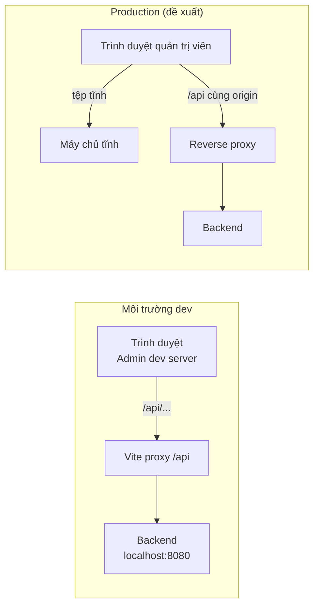

# 12 - Environment and Deployment (Môi trường và triển khai)

- Trạng thái: BẢN NHÁP v0.1
- Cập nhật: 2026-11-08
- Áp dụng cho: Moldy-Market-Admin-Frontend
- Mục đích: hướng dẫn dựng môi trường dev, biến môi trường, proxy, build và những điều đặc thù khi triển khai trang quản trị.

Nhãn: `[ĐÃ CẤU HÌNH]` có trong repo; `[ĐÃ XÁC MINH BACKEND]` lấy từ doc 14; `[ĐỀ XUẤT]` dự kiến, chưa có. Cấu hình công cụ của Admin giống repo User (chưa đối chiếu lại từng dòng).

---

## 1. Yêu cầu môi trường `[ĐÃ CẤU HÌNH]`

| Thành phần | Yêu cầu |
|---|---|
| Node.js | `>=22.12.0` (`engines.node`), `.nvmrc` = `22` (máy hiện chạy 22.20.0) |
| npm | đi kèm Node 22 (10.9.3); không trộn yarn/pnpm |
| Git | bản mới, EOL là LF (`.gitattributes`) |
| Backend | Spring Boot ở `http://localhost:8080` |
| Tài khoản | **bắt buộc có tài khoản role `ADMIN`** (xem mục 7) |
| IDE | Antigravity; `.vscode/settings.json` bật Prettier và ESLint khi lưu |

---

## 2. Cài đặt và chạy dev `[ĐÃ CẤU HÌNH]`

```powershell
git clone https://github.com/Chu0701/Moldy-Market-Admin-Frontend.git
cd Moldy-Market-Admin-Frontend
npm install
Copy-Item .env.example .env.local
npm run dev
```

**Chạy song song hai repo:** nếu chạy cả User và Admin cùng lúc, Vite tự chọn cổng kế tiếp khi cổng bị chiếm (ví dụ 5173 cho một repo, 5174 cho repo kia). Đọc cổng thực tế trong terminal. Cả hai cùng proxy `/api` tới một Backend.

| Lệnh | Tác dụng |
|---|---|
| `npm run dev` | Dev server, HMR, proxy `/api` |
| `npm run build` | Build ra `dist/` |
| `npm run preview` | Chạy thử bản build (không có proxy dev) |
| `npm run lint` | ESLint |
| `npm run format` / `format:check` | Prettier ghi đè / kiểm tra |
| `npm run test` | **Chưa có**, xem mục 8 |

Đổi `vite.config.js` hoặc `.env.local` thì phải **lưu file và khởi động lại** dev server.

---

## 3. Biến môi trường `[ĐÃ CẤU HÌNH]`

| Biến | Dùng ở | Dev | Production |
|---|---|---|---|
| `VITE_API_BASE_URL` | code Frontend (Axios) | để trống (cùng origin, qua proxy) | URL tuyệt đối của Backend hoặc để trống nếu cùng origin |
| `API_PROXY_TARGET` | `vite.config.js` | `http://localhost:8080` | không dùng |

- Chỉ biến tiền tố `VITE_` vào bundle; `API_PROXY_TARGET` không lộ ra trình duyệt.
- `.env.example` được commit; `.env.local` không commit (`*.local`).
- Không đặt bí mật trong biến `VITE_*`: bundle đọc được hoàn toàn. Với trang quản trị đây càng quan trọng.
- Thêm biến mới: cập nhật `.env.example` và doc này trong cùng PR.

---

## 4. API base URL và proxy

`[ĐÃ XÁC MINH BACKEND]` Backend không có CORS cho REST (B1), nên khi dev phải đi qua Vite proxy: `[ĐÃ CẤU HÌNH]` `server.proxy['/api']` trỏ `API_PROXY_TARGET`, mặc định `http://localhost:8080`, `changeOrigin`. Đã kiểm chứng `/api/v1/categories` chạy qua proxy.

`[ĐỀ XUẤT]` Axios `baseURL` đọc `VITE_API_BASE_URL`, **không** gắn cứng `/api/v1` vì Backend có hai prefix `/api/v1/...` và `/api/...`. Chi tiết ở doc 07.



---

## 5. Chuẩn bị cho production

### 5.1 Build và SPA fallback

`npm run build` tạo `dist/` gồm tệp tĩnh. Máy chủ phải trả `index.html` cho mọi đường dẫn không phải tệp (ví dụ tải lại `/users/123`), nếu không sẽ gặp 404.

### 5.2 CORS hay cùng origin (B1)

Proxy Vite không có ở production. `[ĐỀ XUẤT]`, chưa chốt:

| Phương án | Mô tả | Đánh đổi |
|---|---|---|
| A. Cùng origin qua reverse proxy | Một tên miền (hoặc tên miền con riêng cho admin, cùng reverse proxy chuyển `/api`) | Không sửa Backend; hạ tầng thêm một lớp |
| B. Khác origin + Backend thêm CORS | Backend cấu hình CORS cho REST | Phải sửa Backend (B1); danh sách origin chặt chẽ |

Khuyến nghị tạm: phương án A.

### 5.3 Đặc thù của trang quản trị

- **Hạn chế truy cập mạng:** trang quản trị nên được bảo vệ thêm ở tầng hạ tầng (VPN, danh sách IP, hoặc tên miền riêng khó đoán). Đây là lớp phòng thủ bổ sung, không thay thế kiểm tra quyền của Backend.
- **Không để lộ trang cho công chúng tìm kiếm:** thêm `noindex` trong `index.html` (cấu hình `index.html` thuộc bước sắp làm).
- **Frontend không phải ranh giới bảo mật.** Mọi quyền do Backend kiểm tra bằng `hasAuthority(...)` ở mỗi request (doc 14 mục 3.3). Cần nhớ rằng các endpoint của escrow, withdrawal, voucher admin, pricing trên các branch chưa merge **chưa có `@PreAuthorize`** (B2): không nên bật các trang đó ở production cho đến khi Backend sửa.
- **Tài khoản `ADMIN`** do seed hoặc cấp riêng; không có luồng tự đăng ký admin.
- Cân nhắc cookie, token và thời hạn phiên rất cẩn thận (Q2 chưa chốt, doc 08), vì rủi ro của tài khoản admin cao hơn user thường.

### 5.4 Nền tảng triển khai

**Chưa chốt.** Các lựa chọn cho tệp tĩnh: hosting tĩnh, Nginx trên VPS, hoặc Docker (Nginx phục vụ `dist/`). Tiêu chí: SPA fallback, biến môi trường lúc build, HTTPS, reverse proxy `/api`, khả năng giới hạn truy cập.

### 5.5 Checklist

- [ ] `VITE_API_BASE_URL` đúng môi trường (đóng vào bundle lúc build).
- [ ] Đã quyết CORS hoặc cùng origin.
- [ ] SPA fallback, HTTPS, `noindex`.
- [ ] Đã quyết cách lưu token (Q2).
- [ ] B2 và B11 được xử lý hoặc chấp nhận có chủ đích; trang escrow/voucher/pricing chưa bật nếu Backend chưa có kiểm tra quyền.

---

## 6. Vấn đề đã biết

| Vấn đề | Chi tiết | Hướng xử lý |
|---|---|---|
| `npm audit` moderate về `minimatch` | Trong chuỗi ESLint (devDependencies), chưa có bản vá | Chấp nhận tạm, không vào bundle |
| File chưa lưu làm config "không chạy" | Từng gặp | Bật auto-save, restart dev server |
| Không có CORS REST (B1) | Chỉ chạy qua proxy hoặc cùng origin | Mục 5.2 |
| Không có API thống kê, danh sách order, giao dịch | Dashboard, giao dịch, báo cáo là `NOT_FOUND` (doc 14 mục 4.3) | Chỉ làm skeleton |
| Quyền (permission code) không đọc được từ Frontend (Q1) | Chỉ biết tên role từ `/users/me` | Phân quyền UI tạm theo role, `403` là quyết định cuối |

---

## 7. Chạy cùng Backend `[ĐỀ XUẤT]`

1. Chạy Backend ở cổng 8080.
2. Chuẩn bị tài khoản có role `ADMIN` đang `ACTIVE` (seed). Tài khoản đăng ký mới ở `PENDING_VERIFICATION` không đăng nhập được (B10); chính admin là người chuyển trạng thái `ACTIVE` qua `PUT /api/v1/users/{id}/status`.
3. `npm run dev`, kiểm tra `/api/v1/categories` qua cổng của Admin.
4. Không có phản hồi: kiểm tra Backend, `.env.local`, đã lưu `vite.config.js`.

---

## 8. CI và test: sắp cấu hình (chưa có)

| Hạng mục | Trạng thái | Kế hoạch |
|---|---|---|
| Vitest + React Testing Library | chưa cấu hình | jsdom, file setup, script `test` |
| GitHub Actions CI | chưa cấu hình | cài đặt, `lint`, `format:check`, `test`, `build` mỗi PR |
| Mẫu Pull Request | chưa có | `.github/pull_request_template.md` |
| Bảo vệ branch `main` | chưa bật | bắt buộc CI xanh và review |
| Playwright E2E | chỉ kế hoạch | sau khi có luồng chính |
| Husky, lint-staged | không dùng | có thể thêm sau |

---

## Tài liệu liên quan

- Doc 02: kiến trúc. Doc 07: Axios và API. Doc 08: xác thực và phân quyền (Q1, Q2).
- Doc 13: roadmap. Doc 14: ma trận Backend (B1, B2, B10). Doc 15: quy trình đóng góp.
