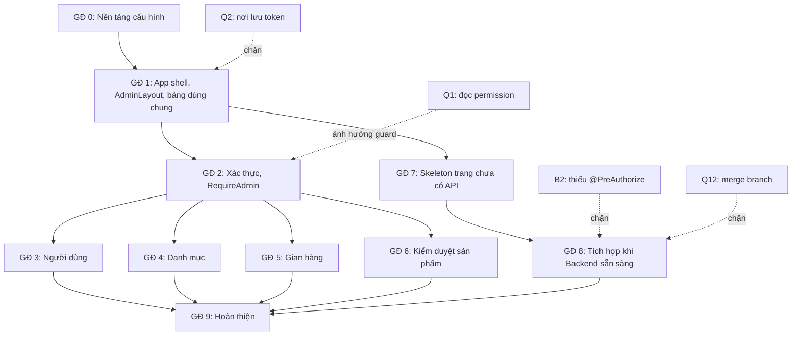

# 13 - Development Roadmap (Lộ trình phát triển)

- Trạng thái: BẢN NHÁP v0.1
- Cập nhật: 2026-11-08
- Áp dụng cho: Moldy-Market-Admin-Frontend
- Mục đích: sắp xếp thứ tự xây dựng trang quản trị, chỉ ra phụ thuộc vào Backend và các điểm chặn.

Đây là **đề xuất** `[ĐỀ XUẤT]`. Hiện mọi tính năng Frontend là `NOT_STARTED`, công cụ là `FOUNDATION_ONLY`. Danh sách route và từng trang ở doc 04 và 05, doc này không lặp lại, chỉ nhóm thành giai đoạn. Trạng thái Backend lấy từ doc 14.

**Đặc điểm của Admin:** phạm vi Backend hỗ trợ ổn định hẹp hơn nhiều so với kế hoạch ban đầu. Chỉ có API cho người dùng, gian hàng, kiểm duyệt sản phẩm và danh mục. Dashboard, giao dịch, báo cáo, khiếu nại, danh sách order... chưa có API nên chỉ là skeleton. Vì vậy roadmap của Admin ngắn và bị chặn bởi Backend nhiều hơn User.

---

## 1. Nguyên tắc

1. Chỉ tích hợp endpoint `IMPLEMENTED` trên `main`. Module `IN_PROGRESS` đợi branch merge và doc 14 cập nhật (Q12).
2. Nền móng (Axios, router, layout, auth) trước, trang nghiệp vụ sau.
3. Làm theo thứ tự rủi ro tăng dần: danh sách đọc trước, hành động ghi sau, hành động phá hủy cuối cùng.
4. Mọi hành động đổi trạng thái có xác nhận; Backend là chốt chặn quyền thật.
5. Mỗi giai đoạn có cột mốc kiểm tra được với Backend thật.

---

## 2. Các giai đoạn

### Giai đoạn 0: Nền tảng cấu hình `FOUNDATION_ONLY`

Đã xong: Vite, Tailwind v4, shadcn (chỉ `button`), alias, proxy, Prettier, ESLint, i18n, design tokens, font, Node/EOL/editor, cấu trúc thư mục. Còn lại: Vitest + RTL, `index.html` (lang, title, `noindex`), GitHub Actions CI, mẫu PR, bảo vệ branch `main`, đối chiếu hai repo.
Cột mốc: `lint`, `format:check`, `build` sạch.

### Giai đoạn 1: Khung ứng dụng

Providers, Axios instance và interceptor, router skeleton, `AuthLayout`, `AdminLayout` (sidebar trái, header, vùng nội dung), `NotFoundPage`, lớp feedback, ErrorBoundary, thành phần bảng dữ liệu dùng chung (có phân trang, rỗng, lỗi). Chọn nơi lưu token trước khi viết interceptor (Q2).
Cột mốc: khung admin điều hướng được giữa các route skeleton; `GET /api/v1/categories` đi qua lớp API chuẩn.

### Giai đoạn 2: Xác thực và chặn truy cập admin

Đăng nhập, đăng xuất, refresh token, guard `RequireAdmin` (kiểm tra role `ADMIN` từ `GET /api/v1/users/me`). Xem doc 08.
Phụ thuộc Backend: `IMPLEMENTED`. **Điểm chặn Q1:** permission `ADMIN_PORTAL_ACCESS` có tồn tại nhưng Frontend không đọc được, nên guard tạm dựa trên tên role và vẫn phải coi `403` là quyết định cuối. Cần tài khoản `ADMIN` seed.
Cột mốc: user thường đăng nhập bị từ chối vào khu admin; admin vào được; tự refresh token; xử lý `AUTH_007`.

### Giai đoạn 3: Quản lý người dùng

Danh sách, chi tiết, đổi trạng thái (`PUT /api/v1/users/{id}/status`), quyền `USER_STORE_MANAGE`.
Ghi chú B10: admin là người chuyển `PENDING_VERIFICATION` sang `ACTIVE` ở trạng thái hiện tại, nên đây là trang quan trọng sớm để tạo tài khoản test cho cả hai repo. Doc 14 chưa mô tả đầy đủ body của endpoint này: đọc lại DTO Backend trước khi dựng form.
Cột mốc: tìm, lọc, đổi trạng thái user với xác nhận; bảng cập nhật sau mutation.

### Giai đoạn 4: Quản lý danh mục

Cây danh mục, thêm, sửa, xóa, quyền `CATEGORY_MANAGE`.
Phụ thuộc: `IMPLEMENTED`. Cần xử lý ràng buộc khi xóa danh mục đang có sản phẩm hoặc có con (đọc kỹ hành vi Backend, doc 14 chưa liệt kê).
Cột mốc: CRUD danh mục với dữ liệu thật.

### Giai đoạn 5: Quản lý gian hàng

Danh sách, chi tiết, đổi trạng thái (`GET /api/v1/stores`, `PUT /api/v1/stores/{id}/status`). Phụ thuộc: `IMPLEMENTED`.
Cột mốc: khóa, mở gian hàng với xác nhận.

### Giai đoạn 6: Kiểm duyệt sản phẩm

Danh sách và chi tiết sản phẩm (dùng search), gỡ sản phẩm (`PUT .../remove` kèm `reason`), khôi phục (`PUT .../restore`), quyền `PRODUCT_MODERATE`.
Cột mốc: gỡ có lý do bắt buộc, khôi phục thành công, xử lý 409 khi dữ liệu đổi (`COMMON_010`).

### Giai đoạn 7: Skeleton cho các trang chưa có Backend

Dashboard (khung thẻ và biểu đồ, không có số liệu thật), giao dịch, báo cáo, khiếu nại, thẩm định viên, voucher, escrow, cài đặt: trang giữ chỗ đánh dấu rõ trạng thái Backend (`NOT_FOUND`, `IN_PROGRESS`, `REQUIRES_BUSINESS_CLARIFICATION`). **Không viết service**. Chọn thư viện biểu đồ khi có dữ liệu thật.

### Giai đoạn 8: Tích hợp khi Backend sẵn sàng (chờ)

| Hạng mục | Trạng thái Backend | Điều kiện bắt đầu |
|---|---|---|
| Xác nhận thu COD (`POST /api/v1/orders/admin/{orderId}/cod-collected`) | `IN_PROGRESS`, chưa merge | Merge; làm rõ Q18; B11 |
| Escrow | `IN_PROGRESS`, B2: chưa có `@PreAuthorize` | Backend sửa quyền, làm rõ Q4 |
| Voucher admin, thẩm viên, pricing | `IN_PROGRESS`, B2 | Merge và sửa quyền |
| Quản lý order (danh sách) | **không có endpoint** cho admin | Backend bổ sung |
| Khiếu nại, refund, dispute | `REQUIRES_BUSINESS_CLARIFICATION` (Q9, Q10) | Team quyết định nghiệp vụ |
| Dashboard thống kê | `NOT_FOUND` | Backend bổ sung API thống kê |

### Giai đoạn 9: Hoàn thiện

Kiểm thử, trợ năng, rà soát bảo mật, triển khai (doc 12), cập nhật docs, demo đồ án.

---

## 3. Sơ đồ phụ thuộc

Giai đoạn 3 đến 6 độc lập nhau sau giai đoạn 2, có thể chia cho nhiều thành viên.

---

## 4. Điểm chặn đã biết

| Mã | Nội dung | Ảnh hưởng |
|---|---|---|
| Q2 | Chưa chốt nơi lưu token | Bảo mật phiên admin; cần chốt trước interceptor |
| Q1 | Không đọc được permission code | Guard và menu chỉ dựa trên role |
| B10, Q14 | Không có luồng kích hoạt tài khoản | Admin là người kích hoạt, cần tài khoản admin seed |
| B1 | Không có CORS REST | Triển khai khác origin |
| B2 | Thiếu `@PreAuthorize` (escrow, voucher admin, pricing, appraiser admin) | Không bật các trang này ở production khi chưa sửa |
| B11 | Order đọc được bởi bất kỳ user | Rủi ro dữ liệu |
| Q4, Q9, Q10, Q18 | Nghiệp vụ escrow, refund, dispute, COD chưa rõ | Các trang giữ skeleton |
| Q12 | Thời điểm merge các branch | Giai đoạn 8 |

## 5. Chưa có API (không làm tích hợp)

Theo doc 14 mục 4.3: thống kê dashboard, danh sách order cho admin, giao dịch, báo cáo, cài đặt hệ thống. Chỉ skeleton `TODO`. Không viết service đoán endpoint.

## 6. Theo dõi tiến độ

Mỗi giai đoạn một milestone GitHub; mỗi trang một issue gắn trạng thái Backend. Khi xong, cập nhật trạng thái Frontend (`NOT_STARTED`, `FOUNDATION_ONLY`, `INTEGRATED`) trong doc 04 và 07. Rà soát roadmap mỗi khi doc 14 đổi.

---

## Tài liệu liên quan

- Doc 04, 05: route và trang. Doc 08: xác thực. Doc 10: luồng.
- Doc 12: môi trường, CI. Doc 14: ma trận Backend. Doc 15: quy trình làm một tính năng.
