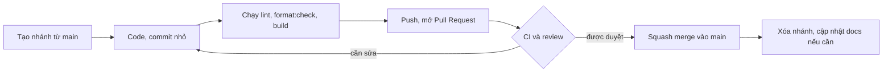
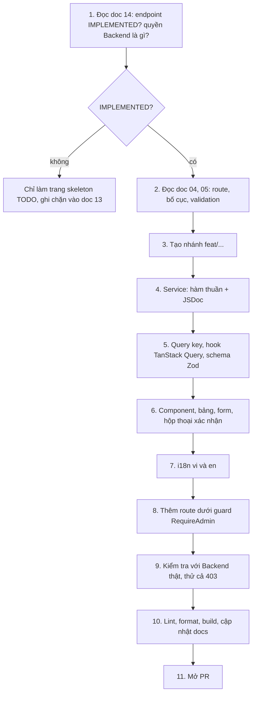

# 15 - Contributing (Hướng dẫn đóng góp)

- Trạng thái: BẢN NHÁP v0.1
- Cập nhật: 2026-11-08
- Áp dụng cho: Moldy-Market-Admin-Frontend
- Mục đích: quy trình làm việc của team cho trang quản trị: cài repo, nhánh, commit, Pull Request, review, và cách làm một trang từ đầu đến cuối.

Nhãn: `[ĐÃ CẤU HÌNH]` có sẵn trong repo; `[ĐỀ XUẤT]` là quy trình team cần đồng ý (mẫu PR, CI, bảo vệ branch chưa cấu hình).

---

## 1. Cài đặt repo `[ĐÃ CẤU HÌNH]`

```powershell
git clone https://github.com/Chu0701/Moldy-Market-Admin-Frontend.git
cd Moldy-Market-Admin-Frontend
nvm use          # Node 22 theo .nvmrc
npm install
Copy-Item .env.example .env.local
npm run dev
```

Cần Backend chạy ở cổng 8080 và **một tài khoản role `ADMIN` đang `ACTIVE`** (seed). Cài các extension IDE gợi ý trong `.vscode/extensions.json`. Chi tiết môi trường: doc 12. Nếu chạy cùng repo User, mỗi repo dùng một cổng khác nhau (Vite tự chọn).

---

## 2. Nhánh `[ĐỀ XUẤT]`

- Nhánh mặc định `main`; **không commit trực tiếp lên `main`**.
- Tên nhánh: `<loại>/<mô-tả-ngắn-kebab-case>`.

| Loại | Dùng cho | Ví dụ |
|---|---|---|
| `feat/` | tính năng mới | `feat/user-list-page` |
| `fix/` | sửa lỗi | `fix/category-delete-confirm` |
| `docs/` | tài liệu | `docs/update-routes` |
| `chore/` | cấu hình, phụ thuộc | `chore/add-vitest` |
| `refactor/` | tái cấu trúc | `refactor/extract-data-table` |
| `test/` | test | `test/require-admin-guard` |

Nhánh sống ngắn; việc lớn chia nhỏ.

---

## 3. Commit `[ĐỀ XUẤT]`

Conventional Commits, tiếng Anh, thể mệnh lệnh:

```text
feat: add user list page
fix: disable submit button while updating status
docs: document moderation flow
chore: add base folder structure
refactor: extract data table component
```

Một commit một thay đổi logic; không commit `.env.local`, `dist/`; chạy `lint` và `format:check` trước khi commit.

---

## 4. Pull Request `[ĐỀ XUẤT]`



Mô tả PR: làm gì và vì sao, ảnh chụp màn hình nếu đổi giao diện, endpoint dùng (kèm trạng thái trong doc 14), quyền Backend liên quan, cách kiểm tra, docs đã cập nhật.

Checklist:

- [ ] `npm run lint`, `npm run format:check`, `npm run build` sạch.
- [ ] Endpoint có trong doc 14 và `IMPLEMENTED`.
- [ ] Loading, rỗng, lỗi đủ; chuỗi qua i18n.
- [ ] **Hành động đổi trạng thái hoặc phá hủy có hộp thoại xác nhận** và vô hiệu hóa nút khi đang gửi.
- [ ] Không có `console.log`, code chết.
- [ ] Đã cập nhật docs trong cùng PR (mục 7).

PR nhỏ (khoảng dưới 400 dòng đổi có ý nghĩa). Mẫu PR và CI sẽ thêm ở bước cấu hình tiếp theo (doc 12).

---

## 5. Review

- Ít nhất một người khác duyệt (sẽ bật luật bảo vệ `main`).
- Người review kiểm tra: ranh giới lớp (component, hook, service), không gọi Axios trong component, không lưu dữ liệu API vào Zustand, không bịa endpoint, có xác nhận cho hành động nguy hiểm, không coi việc ẩn nút là bảo mật, xử lý lỗi, docs.
- **Review đặc biệt kỹ** các thay đổi liên quan xác thực, guard, lưu token và hành động phá hủy, vì đây là trang quản trị.
- Nhận xét cụ thể, tách "bắt buộc sửa" và "gợi ý". Không merge khi CI đỏ (khi đã có CI).

---

## 6. Xử lý conflict

1. `git fetch origin`.
2. `git rebase origin/main` (hoặc merge nếu team thống nhất).
3. Giải từng file, không chọn bừa một phía; chạy lại `lint`, `build` và thử ứng dụng.
4. `package-lock.json`: lấy bản của `main`, chạy lại `npm install`, commit.
5. Sau rebase dùng `git push --force-with-lease`, chỉ trên nhánh của mình.
6. Conflict liên quan doc 14: hỏi tác giả đoạn đó.

---

## 7. Cập nhật docs cùng PR `[ĐỀ XUẤT]`

| Thay đổi | Doc cần cập nhật |
|---|---|
| Thêm hoặc đổi route, trang | 04, 05 |
| Thêm service, hook, đổi cách gọi API | 07, 14 (nếu phát hiện lệch contract) |
| Đổi cấu trúc thư mục, component dùng chung | 02, 06 |
| Đổi token, font, component UI | 03 |
| Đổi xác thực, guard, phân quyền | 08 |
| Đổi state, query key | 09 |
| Thêm biến môi trường, script, CI | 12 |
| Hoàn thành một trang | 04, 07 (trạng thái Frontend), 13 |

Khi Backend đổi: **cập nhật doc 14 trước**, rồi sửa code. Dùng đúng bộ nhãn `IMPLEMENTED`, `PARTIALLY_IMPLEMENTED`, `IN_PROGRESS`, `PLANNED`, `NOT_FOUND`, `REQUIRES_BUSINESS_CLARIFICATION`.

---

## 8. Quy trình làm một trang quản trị từ đầu đến cuối `[ĐỀ XUẤT]`



Ghi chú:

1. **Kiểm tra Backend trước.** Doc 14 chưa mô tả đầy đủ DTO một số endpoint (ví dụ body đổi trạng thái user): đọc DTO ở Backend, bổ sung doc 14, rồi mới dựng form.
2. **Chỉ viết service cho endpoint `IMPLEMENTED`.** Dashboard, giao dịch, báo cáo, danh sách order là `NOT_FOUND`: chỉ skeleton. Escrow, voucher admin, pricing đang `IN_PROGRESS` và có B2: chưa tích hợp.
3. Test thủ công: thành công, rỗng, lỗi mạng, 401, **403 (tài khoản không đủ quyền)**, 409 nếu liên quan.
4. Hành động gỡ sản phẩm phải bắt buộc nhập `reason`.

---

## 9. Những điều không làm

- Không bịa endpoint, DTO, enum, quyền hay quy tắc nghiệp vụ không có trong doc 14.
- Không sửa tay `src/components/ui/*`.
- Không commit bí mật hoặc `.env.local`.
- Không tắt rule ESLint mà không ghi lý do.
- Không trộn cấu hình, refactor và tính năng trong một PR.
- Không coi việc ẩn menu hoặc nút là kiểm soát quyền.

## 10. Hỏi và báo vấn đề

- Câu hỏi Backend: ghi vào doc 14 mục 7 và nhắn team Backend, đừng đoán.
- Lỗi hoặc thiếu sót Backend: ghi vào doc 14 mục 6 kèm cách tái hiện.
- Lỗi Frontend: tạo issue GitHub kèm bước tái hiện, kết quả mong đợi và thực tế.

---

## Tài liệu liên quan

- Doc 02, 06: kiến trúc. Doc 07: API. Doc 08: xác thực. Doc 11: quy ước code.
- Doc 12: môi trường, CI. Doc 13: roadmap. Doc 14: ma trận Backend.
